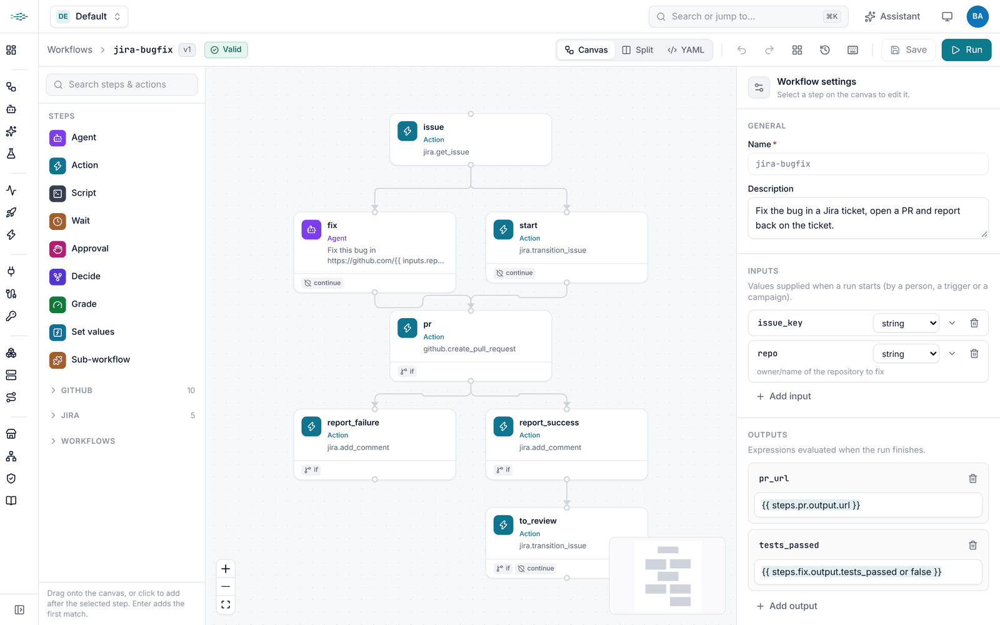
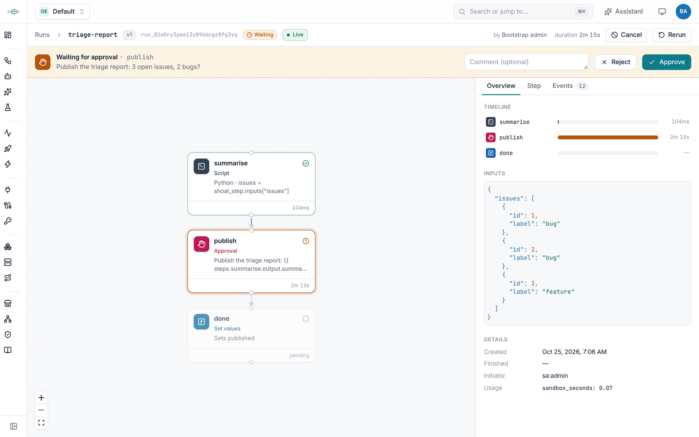
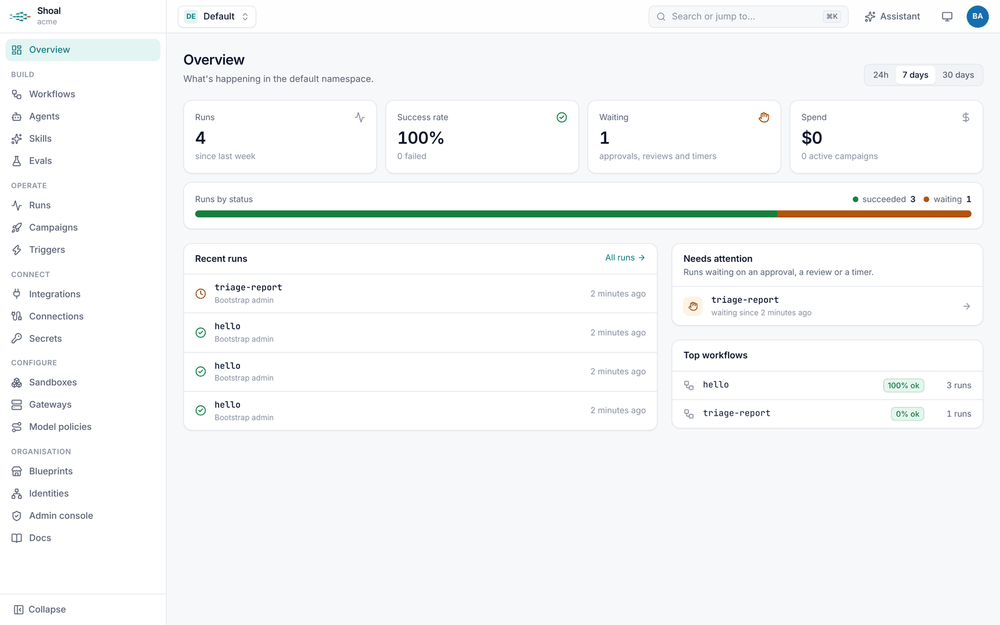
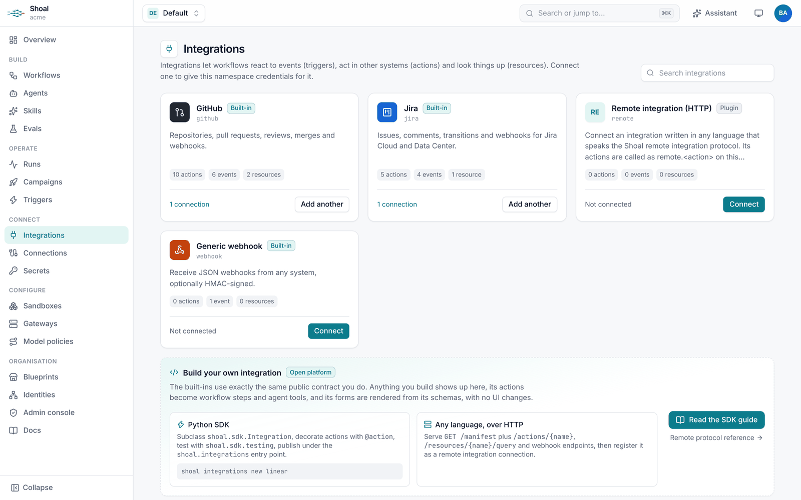
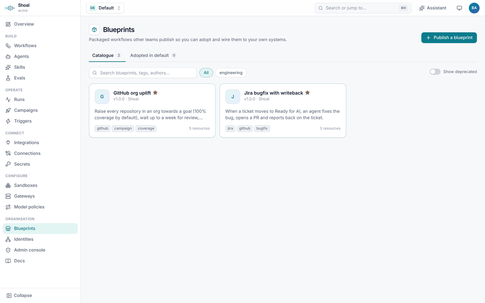
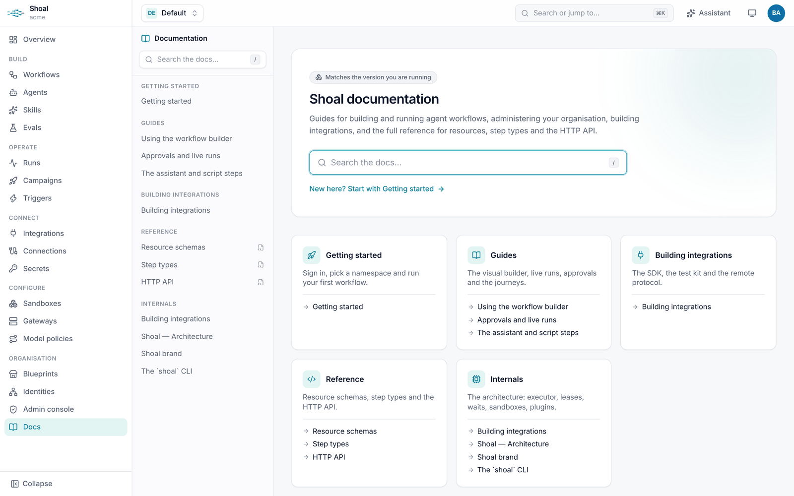

<p align="center">
  <picture>
    <source media="(prefers-color-scheme: dark)" srcset="docs/assets/brand/shoal-logo-dark.svg">
    
  </picture>
</p>

<h3 align="center">Open-source orchestration for multi-agent AI workflows</h3>

<p align="center">
  Define agents and workflows as code, run them durably in isolated sandboxes,<br>
  and govern them across every team in your organisation.
</p>

<p align="center">
  <a href="LICENSE"></a>
  
  
  <a href="terraform-provider/README.md"></a>
  <a href="deploy/README.md"></a>
  
</p>

<p align="center">
  <a href="#install">Install</a> ·
  <a href="#quickstart">Quickstart</a> ·
  <a href="#features">Features</a> ·
  <a href="#documentation">Docs</a> ·
  <a href="CONTRIBUTING.md">Contributing</a>
</p>

<p align="center">
  <picture>
    <source media="(prefers-color-scheme: dark)" srcset="docs/assets/screenshots/builder-dark.png">
    
  </picture>
</p>

---

A shoal is a group of fish that swim together. **Shoal** does the same for AI agents. It gives each
agent a model, skills, tools and a sandbox, wires agents and plain code into versioned workflows,
and runs those workflows durably, whether a run takes ten seconds or waits a week for a code review.

- **Built for real work.** Turn a Jira ticket into a tested pull request, or roll a change out to every repository in a GitHub org, with people approving the steps that matter.
- **Durable by default.** Runs survive restarts, wait for days and pick up where they left off. All you need is Postgres.
- **Yours to run and extend.** Self-hosted, multi-tenant and API-first. Every layer (models, sandboxes, integrations, secrets, evals) is a plugin you can swap without forking.

## Install

| Path | Best for | Needs |
|---|---|---|
| [docker compose](#docker-compose) | Trying Shoal, small teams | Docker |
| [Helm](#kubernetes-helm) | Production on Kubernetes | A Kubernetes cluster, Helm 3 |
| [From source](#from-source-uv-or-pip) | Development, a single machine | Python 3.11+ with [uv](https://docs.astral.sh/uv/) or pip |
| [The `shoal` CLI](#the-shoal-cli) | Working with any Shoal server | Python 3.11+ |
| [Terraform provider](#terraform-provider) | Managing Shoal as code | Terraform, Go |

### docker compose

Runs Postgres, the API server (with the web UI) and a worker.

```sh
git clone https://github.com/kyonz/ai-workflow-manager.git shoal && cd shoal
cp deploy/.env.example deploy/.env       # then set a real value for every secret in it
docker compose -f deploy/docker-compose.yaml --env-file deploy/.env up -d --build
export $(grep ^SHOAL_ADMIN_TOKEN= deploy/.env)   # for the quickstart below
```

Open <http://localhost:8080>. To add workers, run
`docker compose -f deploy/docker-compose.yaml --env-file deploy/.env up -d --scale worker=3`.

### Kubernetes (Helm)

```sh
helm install shoal deploy/helm/shoal -n shoal --create-namespace \
  --set config.publicUrl=https://shoal.example.com \
  --set ingress.enabled=true --set ingress.hosts[0].host=shoal.example.com \
  --set-json 'ingress.hosts[0].paths=[{"path":"/","pathType":"Prefix"}]'

export SHOAL_ADMIN_TOKEN=$(kubectl -n shoal get secret shoal -o jsonpath='{.data.SHOAL_ADMIN_TOKEN}' | base64 -d)
```

The chart runs the API and workers with PodDisruptionBudgets and optional autoscaling, generates
its secrets once, and includes a Postgres for evaluation. For production, point `database.url` at a
managed database. The [deploy guide](deploy/README.md) covers every option, including sandboxes as
Kubernetes pods and Prometheus monitoring.

### From source (uv or pip)

```sh
cd engine
uv sync --all-extras
SHOAL_ADMIN_TOKEN=change-me uv run shoal serve      # API + embedded worker on http://127.0.0.1:8080
```

This stores data in SQLite in the current directory; set `SHOAL_DATABASE_URL` for Postgres. To serve
the web UI too, build it with `cd frontend && npm ci && npm run build` and start the server with
`SHOAL_STATIC_DIR=../frontend/dist`. With pip, install the engine into a virtualenv with
`pip install "./engine[postgres]"`.

### The `shoal` CLI

The CLI ships with the engine:

```sh
uv tool install ./engine          # or: pipx install ./engine
shoal version
```

### Terraform provider

The provider manages every Shoal resource, from namespaces and roles to workflows and campaigns.
Until it is published to the Terraform Registry, build it and point Terraform at the binary:

```sh
cd terraform-provider && go build -o "$HOME/.terraform.d/shoal/terraform-provider-shoal" .
cat >> ~/.terraformrc <<EOF
provider_installation {
  dev_overrides { "kyonz/shoal" = "$HOME/.terraform.d/shoal" }
  direct {}
}
EOF
```

```terraform
terraform {
  required_providers {
    shoal = { source = "kyonz/shoal" }
  }
}

provider "shoal" {
  endpoint = "http://localhost:8080"     # or SHOAL_ENDPOINT; the API key comes from SHOAL_API_KEY
}

resource "shoal_workflow" "hello" {
  name = "hello"
  spec = yamldecode(file("${path.module}/hello.yaml")).spec
}
```

See the [provider docs](terraform-provider/docs/index.md) for every resource and data source.

## Quickstart

**1. Create a tenant.** Using the admin token, create your first tenant. The command prints the
tenant's first API key:

```sh
shoal --server http://localhost:8080 --token "$SHOAL_ADMIN_TOKEN" tenants create acme
shoal login http://localhost:8080 --token <api-key>
```

You can now sign in to the web UI with the same key (**Use an API key instead**), or set up single
sign-on under **Admin console › Sign-in & SCIM**.

**2. Run your first workflow.** It needs no model, sandbox or connection:

```sh
shoal apply -f examples/hello/
shoal run hello -i name=Dana --wait
```

```text
workflow/hello (default) created v1
run run_01m5rs2jpdjadd0wnap8pf5dxr started (hello@v1)
run run_01m5rs2jpdjadd0wnap8pf5dxr succeeded
{
  "greeting": "Hello Dana"
}
```

**3. Add code and a human.** This workflow runs a Python script step, then waits for someone to
approve the result:

```sh
shoal apply -f examples/shared/sandboxes.yaml -f examples/triage-report/
shoal run triage-report
```

Open the run in the UI to watch it live and approve it:

<p align="center">
  
</p>

**4. Bring in agents.** Set `ANTHROPIC_API_KEY` on the server, or store a key as a secret and add a
gateway as in [`examples/shared/gateways.yaml`](examples/shared/gateways.yaml). Then try the full journeys: [`examples/jira-bugfix`](examples/jira-bugfix) turns a Jira ticket into a
tested pull request, and [`examples/github-uplift`](examples/github-uplift) rolls a change out to
every repository in a GitHub org. Both are in the UI's **Blueprints** catalogue, ready to install.

## What a workflow looks like

```yaml
apiVersion: shoal.dev/v1
kind: Workflow
metadata:
  name: bugfix
spec:
  inputs:
    issue_key: {type: string}
    repo: {type: string}
  connections: {jira: jira-acme, github: github-acme}
  steps:
    - id: issue
      type: action                          # call an integration
      action: jira.get_issue
      with: {key: "{{ inputs.issue_key }}"}
    - id: fix
      type: agent                           # model, skills, tools and a sandbox
      agent: bugfixer
      prompt: "Fix {{ steps.issue.output.summary }} in {{ inputs.repo }} and push a branch."
      outputs:
        branch: {type: string}
    - id: review
      type: approval                        # a durable human-in-the-loop gate
      message: "Open a PR for {{ steps.fix.output.branch }}?"
    - id: pr
      type: action
      action: github.create_pull_request
      with:
        repo: "{{ inputs.repo }}"
        head: "{{ steps.fix.output.branch }}"
        title: "{{ inputs.issue_key }}: {{ steps.issue.output.summary }}"
```

Write workflows as YAML and `shoal apply` them (GitOps), manage them with Terraform, or build them
on the visual canvas. All three produce the same versioned resources.

## Features

### Workflows and runs
- **Step types:** `agent`, `action`, `script`, `wait`, `approval`, `decide`, `grade`, `set` and `workflow` (sub-workflows, with `for_each` fan-out). Every step takes `if`, `retry`, `timeout`, `on_error`, and `needs` for parallel branches.
- **Script steps** run deterministic work as code in Python, Node or shell, with typed inputs and validated outputs. Use them for glue that doesn't need a model: it's faster, cheaper and repeatable.
- **Signals** send data into a running workflow from the API, the CLI (`shoal signal`) or a signed callback URL, so external systems can reply to a run that is waiting on them.
- **Durable executor** on Postgres: runs survive restarts and wait for days with no extra infrastructure. Database migrations run automatically. If you already operate Temporal, Shoal can use it to drive runs instead ([guide](docs/temporal.md)).
- **Versioning** with change notes, diffs, rollback and pinned versions, and a live run viewer that streams every event.

### Agents
- An **agent** is a model, a system prompt, skills (`SKILL.md`), tools, sub-agents, a sandbox profile and limits on turns, tokens, time and cost.
- Run agents on Shoal's own tool-use loop, as an external coding agent CLI inside the sandbox, or as a remote agent over **A2A**. Workflows can be published as A2A agents too.
- **LLM gateways and model policies** are managed centrally per tenant: Anthropic and OpenAI-compatible APIs, directly or through LiteLLM, Portkey, OpenRouter and others, without clear-text credentials.
- **MCP servers as tools:** connect any MCP server and its tools become workflow actions and agent tools.
- **Cloud identities:** grant workflows and agents AWS IAM roles. Each step gets short-lived STS credentials through Shoal's own OIDC issuer or the deployment's role, with no stored cloud secrets, and every session is tagged with who started the run.
- **Delegated credentials and workload identity**, so agents act with exactly the access the run allows.

### Sandboxes
Every agent and script step runs in a sandbox: `local`, `docker`, `kubernetes`, `e2b`, Perplexity
`space` (which suspends and wakes during long waits) or any provider that speaks the remote sandbox
protocol. Sandbox profiles are per namespace, so one team can run on Kubernetes while another uses E2B.

Everything above is a plugin: integrations, model providers, sandboxes, secret backends, eval sinks,
decision providers, agent runtimes, cloud credential providers and skill sources all follow one pattern (a base
class, an entry point and a contract test), so new ones install without engine changes
([guide](docs/plugins.md)).

### Integrations, campaigns and blueprints
- **GitHub, Jira, Slack, MCP, webhooks and schedules** are built in, each with triggers, actions and metadata queries. Approvals and questions can go to Slack with buttons and forms. Write your own in Python with the SDK and test kit, or in any language with the remote protocol ([guide](docs/integrations.md)).
- **Per-user credentials:** a connection can use a shared credential or each person's own token or OAuth sign-in. A step that needs someone's credential waits for them to connect, then resumes.
- **Skill marketplaces:** import `SKILL.md` skills from git repositories, registries or any skill source plugin, with version labels, upgrade diffs and rollback ([guide](docs/skills.md)).
- **Campaigns** fan one workflow out over many targets (every repo in an org) with concurrency, budgets, rate limits and progress tracking.
- **Blueprints** package workflows, agents and triggers so other teams can install and wire them up from the catalogue.

### Quality
- **Evals** score workflows against datasets, gate CI on regressions (`shoal eval run --fail-under`) and export results to Braintrust or Langfuse.
- **Decisions and grading:** `decide` steps ask a model typed questions and branch on the answer and its confidence; `grade` steps score output against a rubric.

### The web UI
A visual workflow builder, a live run viewer with approvals, integrations and connections, campaigns,
the blueprint catalogue, an admin console, and built-in docs that always match the running version.
An **assistant** (⌘J) on every page sets up workflows, triggers and campaigns, writes script steps
and explains failed runs. It acts with your permissions, and you approve every change.

<table>
  <tr>
    <td></td>
    <td></td>
  </tr>
  <tr>
    <td></td>
    <td></td>
  </tr>
</table>

### Governance
- **Hard multi-tenancy** with namespaces, roles and bindings, users, groups and service accounts, OIDC single sign-on and SCIM provisioning.
- **Initiator attribution:** every run records who started it, and actions in external systems can run with that person's authority.
- **Federation:** link tenants on separate deployments to a hub, so one organisation can see and run work across them (`shoal federation`).
- Encrypted, write-only secrets and an audit log of every change.

### Operations
One container image for the API, workers and CLI; docker compose and a Helm chart; Prometheus
metrics; health checks; and an OpenAPI spec with interactive docs at `/v1/docs`.

## Documentation

| Read | For |
|---|---|
| [Architecture](docs/architecture.md) | Concepts, the runtime, plugin contracts and the API surface |
| [CLI](docs/cli.md) | Connecting, applying resources, runs, signals, secrets, evals |
| [Integrations](docs/integrations.md) | Building integrations with the SDK or the remote protocol |
| [Skills](docs/skills.md) | Importing skills from marketplaces and keeping them up to date |
| [Plugins](docs/plugins.md) | Adding model providers, sandboxes, secret backends, eval sinks and other plugins, with contract tests |
| [Deploying](deploy/README.md) | Container image, docker compose and Kubernetes |
| [Temporal](docs/temporal.md) | Driving runs with a Temporal cluster you already operate |
| [Terraform provider](terraform-provider/docs/index.md) | Managing Shoal as code |
| [Web UI](frontend/README.md) | Developing the frontend |
| [Brand](docs/brand.md) | Logo, colours and how to use them |

## Repository layout

```
engine/               Python engine: library, API server, worker and the `shoal` CLI
frontend/             React + TypeScript web UI
terraform-provider/   Terraform provider for every Shoal resource
deploy/               Dockerfile, docker compose and Helm chart
examples/             Workflows, agents, triggers, campaigns and blueprints to start from
templates/            Starter project for a new integration
scripts/              check.sh: build and test everything locally
docs/                 Architecture and guides
```

## Contributing

Contributions are welcome. [CONTRIBUTING.md](CONTRIBUTING.md) explains how to set up a development
environment, and `scripts/check.sh` builds and tests everything locally. Please follow our
[Code of Conduct](CODE_OF_CONDUCT.md), and report security issues privately as described in
[SECURITY.md](SECURITY.md).

## License

Shoal is licensed under the [Apache License 2.0](LICENSE).
