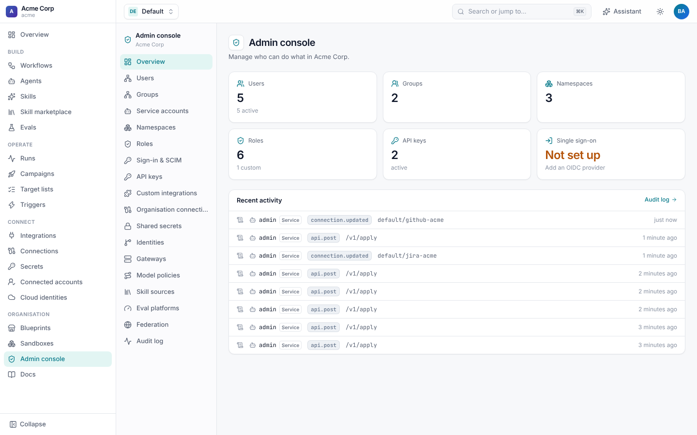
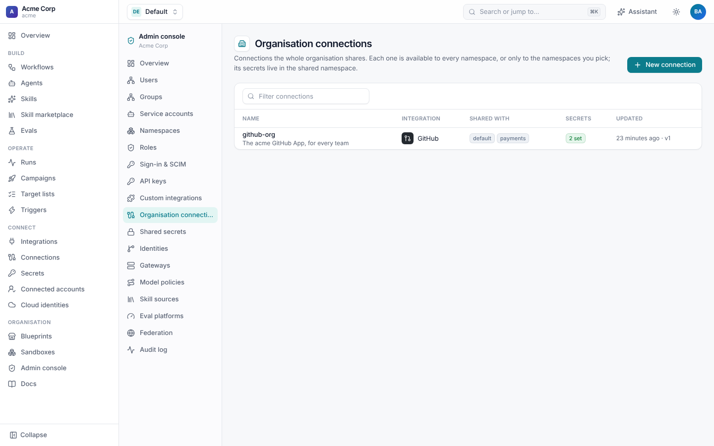
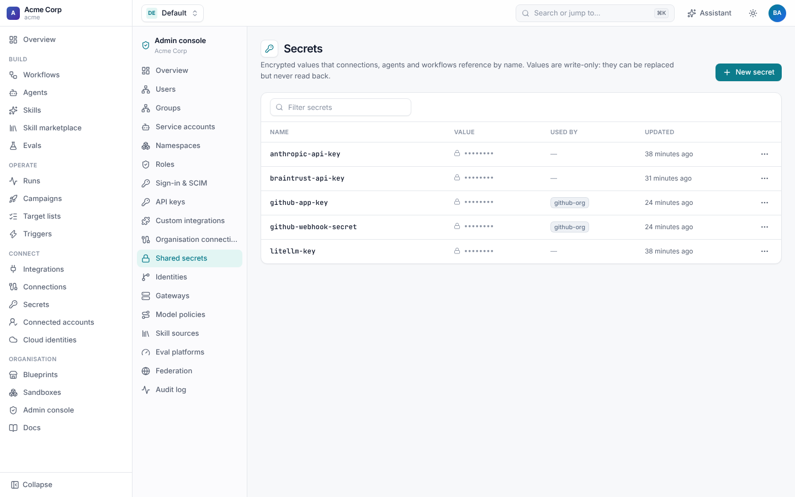
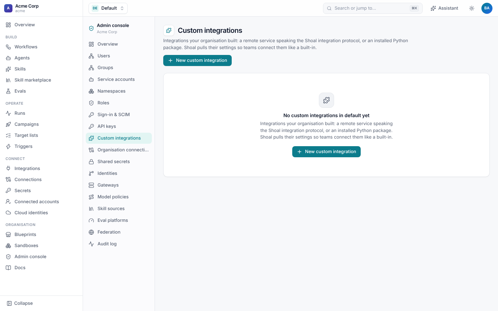
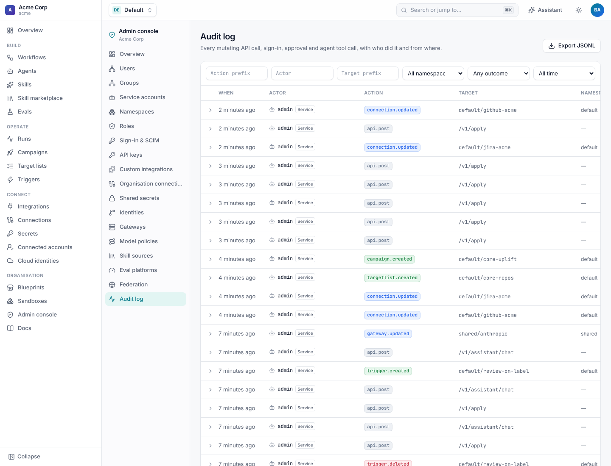

# The admin console

The **Admin console** (`/admin`) is where tenant admins run their organisation in Shoal: who can sign in, what they may
do, the settings every namespace shares, and the audit log. It appears in the sidebar for anyone with a tenant-level
permission, and each page shows only what the person may see.



| Page | What it manages | Guide |
| --- | --- | --- |
| **Users**, **Groups**, **Service accounts** | The people and non-human principals in the tenant. | [Access](access.md#users-groups-and-service-accounts) |
| **Namespaces** | The tenant's namespaces, their members and their roles. | [Access](access.md#namespaces-and-members) |
| **Roles** | Built-in and custom roles, and tenant-wide role bindings. | [Access](access.md#roles-and-permissions) |
| **Sign-in & SCIM** | OIDC providers and SCIM provisioning. | [Access](access.md#single-sign-on) |
| **API keys** | Keys for the CLI, Terraform, CI and integrators. | [Access](access.md#api-keys) |
| **Identities** | One person across GitHub, Jira and Slack, for attribution. | [Access](access.md#identities) |
| **Custom integrations** | Integrations your organisation registers. | [Building integrations](../integrations.md#registering-an-integration-for-your-organisation) |
| **Organisation connections** | Connections set up once, in `shared`, for every namespace or some. | [Connections](../connections/README.md#organisation-and-namespace-connections) |
| **Shared secrets** | Secrets in `shared`: gateway keys, organisation connection secrets, OAuth client secrets. | [Connections](../connections/README.md#secrets) |
| **Gateways**, **Model policies** | Where model calls go and which models each workflow may use. | [Gateways and model policies](../agents/gateways.md) |
| **Skill sources** | Marketplaces people import skills from. | [Skill sources](../skills.md) |
| **Eval platforms** | Braintrust, Langfuse and other places eval results are sent. | [Evals](../evals/README.md#eval-platforms) |
| **Federation** | Joining this tenant to a hub. | [Federation](federation.md) |
| **Audit log** | Everything that changed, and who changed it. | [Below](#audit-log) |

Everything on these pages is tenant-wide and stored in the `shared` namespace, so one change applies to every team. The
same resources can be managed as code with `shoal apply` or the [Terraform provider](../../terraform-provider/docs/index.md).

Instance admins, who run the Shoal deployment itself and all its tenants, have a separate **Instance console**. See
[Tenants](tenants.md).

## Shared settings

**Organisation connections** let a platform team connect GitHub, Jira or Slack once and offer the connection to every
namespace, or only those it lists, without sharing the secrets behind it.



**Shared secrets** holds the values behind them. Values are write-only, as everywhere in Shoal.



**Custom integrations** registers your own integrations (a remote service, an MCP server, or a plugin package) so they
appear under **Integrations** in every namespace.



## Audit log

Every change made through the API or the UI is recorded: resources applied or deleted, secrets set, runs started,
approved or cancelled, sign-ins, role changes, API keys issued, agent tool calls, and refused requests
(`access.denied`). Each entry has:

| Field | Example |
| --- | --- |
| `actor` | `user:priya@acme.dev`, `sa:ci-deployer`, `account:ops@acme.dev` (an instance admin) |
| `action` | `workflow.updated`, `secret.set`, `run.approved`, `api_key.created`, `github.merge_pull_request` |
| `target` | `payments/jira-bugfix`, `shared/github-org` |
| `namespace`, `outcome` | `payments`; `success`, `denied` or `error` |
| `source`, `request_id`, `ip`, `user_agent` | where the call came from |
| `data` | details, such as the changed fields or the merge decision |



Filter by action prefix (`workflow.`, `access.denied`), exact actor, target prefix (`payments/`), namespace, outcome or
time, and expand an entry to see its details. **Export JSONL** downloads everything that matches the filters.

```sh
curl -H "Authorization: Bearer $SHOAL_TOKEN" \
  "https://shoal.acme.dev/v1/audit?action=secret.&namespace=payments&limit=100"
curl -H "Authorization: Bearer $SHOAL_TOKEN" -o audit.jsonl \
  "https://shoal.acme.dev/v1/audit/export?since=2026-10-01T00:00:00Z"
```

- Reading the log needs `audit:read`. A key limited to some namespaces sees only those namespaces' entries.
- Entries older than `SHOAL_AUDIT_RETENTION_DAYS` (default 400) are deleted. `0` keeps them forever.
- Behind a reverse proxy, set `SHOAL_TRUSTED_PROXIES` (addresses or CIDRs) so the log records the client's address from
  `X-Forwarded-For` instead of the proxy's.
- Run-level detail (each step's inputs, outputs and tool calls) is in the run's own events. See
  [Runs](../runs/README.md).
- Instance-level events (tenants created or suspended, instance roles, instance sign-ins) are in the instance audit log.
  See [Tenants](tenants.md#instance-audit).

## More

- [Access: users, roles, sign-in and API keys](access.md)
- [Tenants and the instance console](tenants.md)
- [Federation](federation.md)
