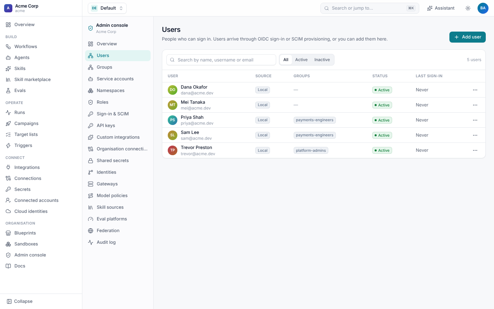
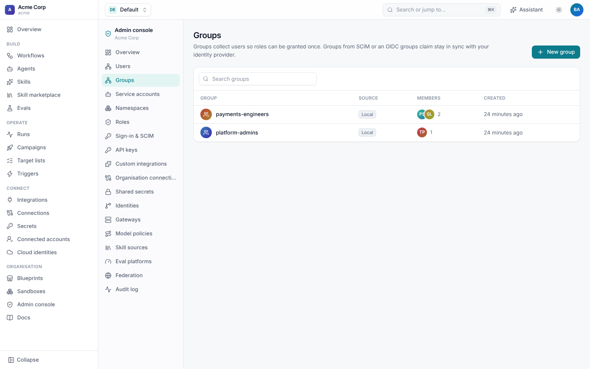
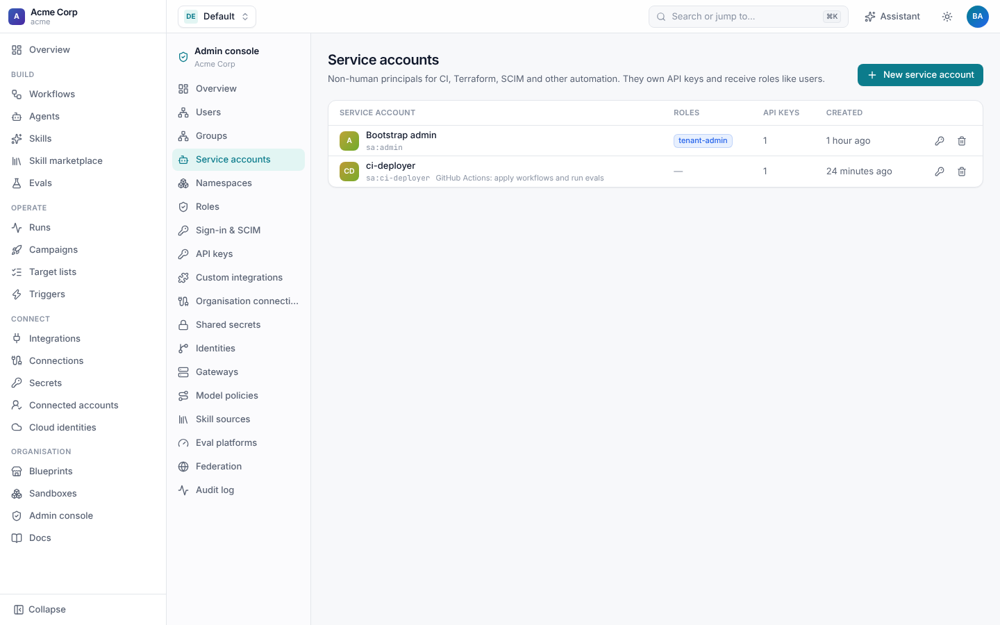
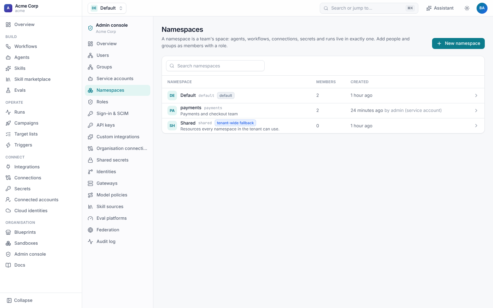
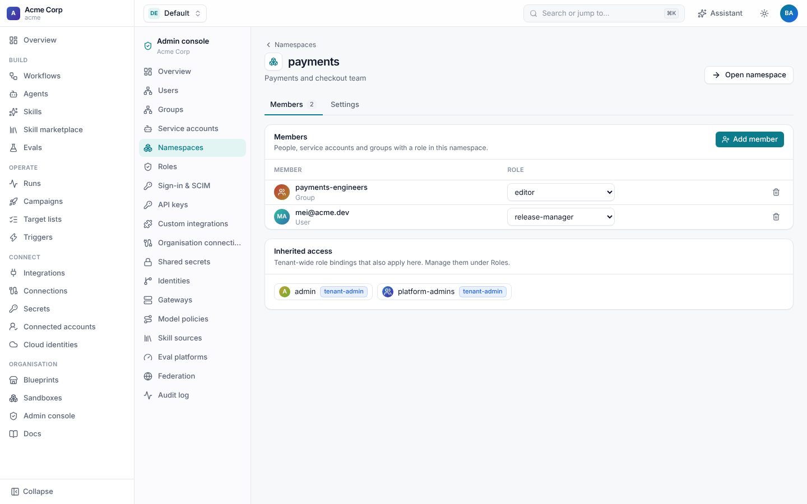
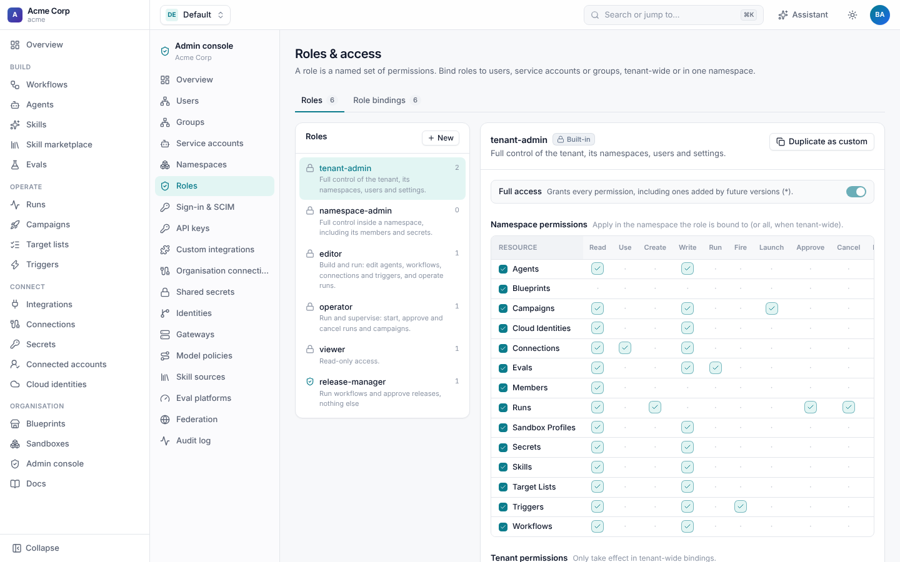
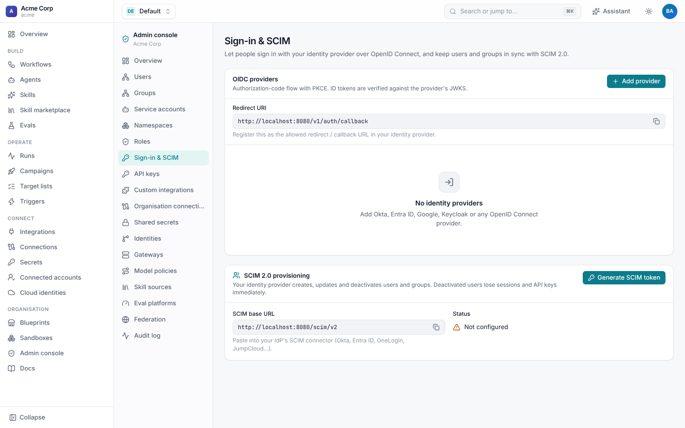
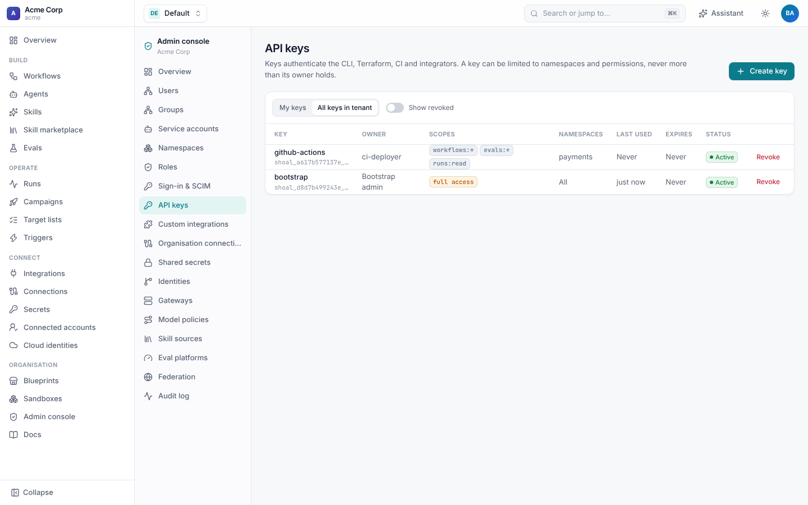
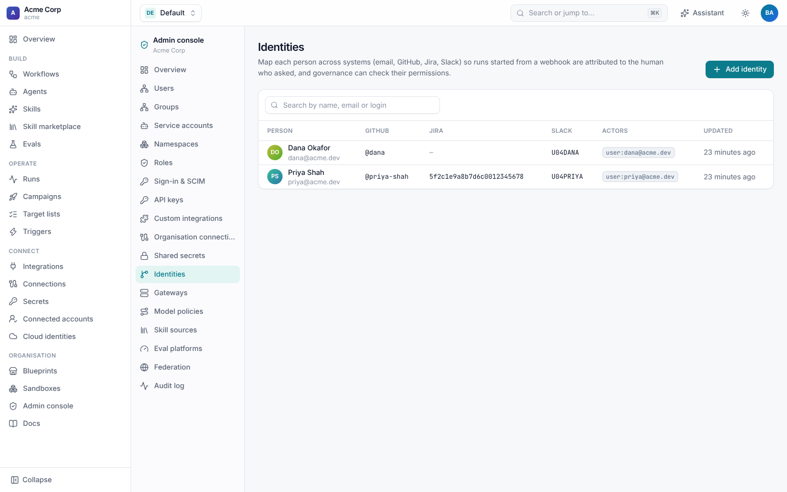

# Access: users, roles, sign-in and API keys

Who can do what in a tenant is decided by **role bindings**: a role (a named set of permissions) granted to a user, group
or service account, either across the tenant or in one namespace. People arrive through single sign-on or SCIM, and
programs use API keys. All of it is managed in the [admin console](README.md) and recorded in the
[audit log](README.md#audit-log).

## Users, groups and service accounts

| Principal | Where it comes from |
| --- | --- |
| **User** | Created the first time someone signs in with OIDC, provisioned over SCIM, or added by an admin. |
| **Group** | Created by an admin, provisioned over SCIM, or filled from an OIDC provider's groups claim. A role bound to a group applies to all its members. |
| **Service account** | A non-human principal for CI, Terraform and integrators. It owns API keys and holds roles like a user. |



Deactivating a user ends their sessions and stops their API keys at once, and keeps their history. Nobody can deactivate
or delete themselves.





## Namespaces and members

A **namespace** groups what one team owns: its workflows, agents, skills, connections, triggers, campaigns, sandbox
profiles, secrets and runs. Every tenant has `default` and `shared`; `shared` holds what admins publish for everyone
(organisation connections, shared secrets, gateways, identities). Names are unique within a namespace, and lookups fall
back from a namespace to `shared`, so a team can use a shared skill or connection without being able to change it or
read its secrets.



**Namespaces** lists them. Opening one shows its members, the role each holds there, and the tenant-wide bindings that
also apply. **Add member** grants a user, group or service account a role in that namespace only.



People switch between the namespaces they can see with the picker at the top of every page.

## Roles and permissions

Permissions are `resource:verb` strings such as `workflows:write`, `runs:approve` or `secrets:write`. Patterns can use
`*` (`runs:*`, `*:read`, or `*` for everything).

| Built-in role | Grants |
| --- | --- |
| `tenant-admin` | Everything (`*`), including permissions added by future versions. |
| `namespace-admin` | Everything inside a namespace, including its members and secrets. |
| `editor` | Read everything; create, change and delete agents, workflows, connections, triggers and the rest; operate runs; set secrets; adopt blueprints; import skills. |
| `operator` | Read everything; start, approve, cancel and signal runs; launch and manage campaigns; use connections; fire triggers; run evals. |
| `viewer` | Read-only. |

**Roles › New**, or **Duplicate as custom** on a built-in role, makes a custom role from a checklist of permissions.
Namespace permissions apply wherever the role is bound. Tenant permissions (`users:manage`, `roles:manage`,
`auth:manage`, `audit:read`, `gateways:manage`, `federation:manage`, ...) only take effect in tenant-wide bindings.



The **Role bindings** tab lists every binding, tenant-wide and per namespace. As code:

```sh
curl -X POST -H "Authorization: Bearer $SHOAL_TOKEN" https://shoal.acme.dev/v1/role-bindings \
  -d '{"role": "editor", "subject_kind": "group", "subject_id": "grp_...", "namespace": "payments"}'
```

Every API call is checked as `authorize(principal, permission, namespace)`, and the UI hides what a person can't do using
the same check (`GET /v1/me/permissions`). A refused call is recorded as `access.denied`.

### Nobody hands out more than they hold

Granting a role, changing a custom role's permissions, changing a group that has role bindings, choosing an OIDC
provider's default role, creating a key for a service account, and managing another user or service account all need the
caller to hold every permission involved. A namespace admin can't make someone a tenant admin, and an editor can't mint
a key with more than editor rights.

## Single sign-on

**Sign-in & SCIM** configures how people sign in. Shoal supports any OpenID Connect provider (Okta, Microsoft Entra ID,
Google, Keycloak, Auth0, Dex) with the authorization-code flow and PKCE. ID tokens are checked against the provider's
JWKS (issuer, audience, expiry, nonce), and signing out revokes the Shoal session itself, not only the cookie.



1. In your identity provider, create an OIDC web application with the **Redirect URI** shown on the page
   (`https://<shoal>/v1/auth/callback`).
2. **Add provider** and fill in:

| Field | Meaning |
| --- | --- |
| `issuer`, `client_id`, `client_secret` | From the identity provider. The secret is write-only; omit it for a public, PKCE-only client. |
| `scopes` | Default `openid email profile`. |
| `groups_claim` | An ID token claim with group names, such as `groups`. Members are added to the matching Shoal groups. |
| `allowed_domains` | Only these email domains may sign in. |
| `auto_provision` | Create a user on first sign-in (default on). Off: only people already provisioned can sign in. |
| `default_role`, `default_namespace` | A role given to new users, tenant-wide or in one namespace. |

A tenant can have several providers, and the sign-in page offers each one. For a deployment that hosts several tenants,
operators can also set one **instance sign-in** for everyone. See [Tenants](tenants.md#signing-in).

### SCIM provisioning

With SCIM 2.0, your identity provider creates, updates and deactivates Shoal users and groups for you. Deactivating
someone in the IdP ends their sessions and API keys immediately, and group changes flow through to their role bindings.

1. **Generate SCIM token** creates an API key for the `scim` service account with only `scim:provision`. It is shown
   once.
2. In the IdP's SCIM connector (Okta, Entra ID, OneLogin, JumpCloud, ...), set the **SCIM base URL** from the page
   (`https://<shoal>/scim/v2`) and the token as a bearer token.

Shoal serves `Users` and `Groups` (with filters such as `userName eq "..."`, and PATCH), plus `ServiceProviderConfig`,
`ResourceTypes` and `Schemas`.

### The break-glass token

`SHOAL_ADMIN_TOKEN` is a bearer token with full rights over every tenant, for first setup and emergencies. Use it to
create tenants and the first admin, then set up sign-in and keep it unset or locked away.

## API keys

Keys authenticate the CLI, Terraform, CI pipelines and integrators. A key looks like `shoal_<prefix>_<secret>`. Shoal
stores only a hash and shows the key once.



| Setting | Meaning |
| --- | --- |
| Owner | You, or a service account (needs the permissions you'd grant it). |
| Scopes | Permission patterns the key is limited to, such as `workflows:*` and `runs:read`. Default `*`: everything the owner holds. |
| Namespaces | The namespaces the key may touch. Empty: all. A key limited to namespaces keeps only the owner's tenant-level `:read` permissions, never tenant administration. |
| Expires | When it stops working. `SHOAL_API_KEY_MAX_DAYS` caps every key's life and gives keys without an expiry that cap. |

A key can never do more than its owner can, now or later: if the owner loses a role, the key loses it too, and a
deactivated owner's keys stop working. **My keys** shows your own; **All keys in tenant** (`api-keys:manage`) shows
everyone's, with when each was last used. Revoking is immediate.

```sh
curl -X POST -H "Authorization: Bearer $SHOAL_TOKEN" https://shoal.acme.dev/v1/api-keys \
  -d '{"name": "github-actions", "service_account": "ci-deployer",
       "scopes": ["workflows:*", "evals:*", "runs:read"], "namespaces": ["payments"],
       "expires_at": "2027-06-30T00:00:00Z"}'
shoal login https://shoal.acme.dev --token shoal_...
```

## Identities

An **Identity** maps one person across systems: their email, GitHub login, Jira account id, Slack id and Shoal user. When
a webhook says "Priya moved BUG-142", Shoal uses identities to know that is `priya@acme.dev` in Shoal and `priya-shah` on
GitHub, so the run is attributed to her, her own credentials can be used, and GitHub governance can check her
permissions.



```yaml
apiVersion: shoal.dev/v1
kind: Identity
metadata: {name: priya}
spec:
  display_name: Priya Shah
  email: priya@acme.dev
  github: priya-shah
  jira_account_id: 5f2c1e9a8b7d6c0012345678
  slack_id: U04PRIYA
  actors: ["user:priya@acme.dev"]
```

Identities are tenant-wide and managed under **Admin console › Identities** (`identities:write`). People can also link
their GitHub account through OAuth. See [GitHub attribution](../github/attribution.md) and
[Jira attribution](../jira/reference.md#attribution).

## API

| Call | What it does |
| --- | --- |
| `GET/POST /v1/users`, `PATCH/DELETE /v1/users/{id}` | Users. |
| `/v1/groups`, `/v1/groups/{id}/members` | Groups and members. |
| `/v1/service-accounts` | Service accounts. |
| `/v1/namespaces`, `/v1/namespaces/{name}/members` | Namespaces and their members. |
| `/v1/roles`, `/v1/role-bindings`, `GET /v1/permissions` | Roles, bindings, and the permission catalogue. |
| `/v1/oidc-providers` | Sign-in providers. |
| `/v1/api-keys` | API keys (`?all=true` for every key in the tenant). |
| `GET /v1/me/permissions` | What the caller may do. |
| `/scim/v2/...` | SCIM provisioning. |
