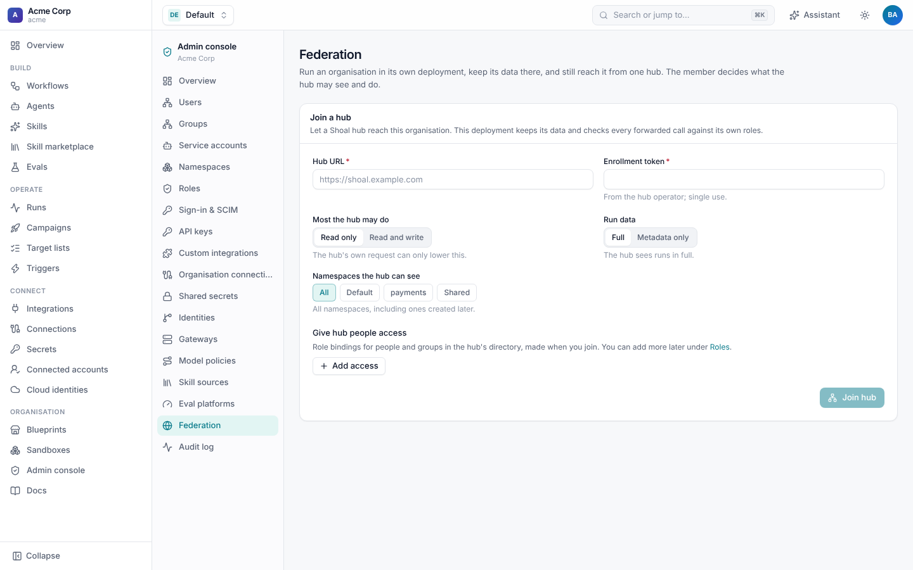

# Federation

A tenant is usually **hosted**: its data and runs live in the central Shoal deployment. A **federated** tenant instead
runs on its own Shoal deployment inside the organisation's network, with its own database, workers, sandboxes and
secrets, and is still reached from the central deployment (the **hub**) through the same UI, CLI, API and Terraform.
Hosted and federated tenants mix freely on one hub.

Use it when an organisation's code, credentials or run data must stay inside its network, or when its GitHub Enterprise
and Jira are only reachable from there.

```text
          Hub (central deployment)                         Organisation network
 ┌─────────────────────────────────────┐          ┌───────────────────────────────────┐
 │ UI · API · sign-in · Terraform        │          │ Member deployment (tenant "acme")  │
 │ tenants: hosted-a, hosted-b, acme ───┼─ tunnel ─┼─ tenant connector (dials out)      │
 │ stores: the link and its health      │  HTTPS   │ API · workers · Postgres · secrets │
 └─────────────────────────────────────┘          │ sandboxes · GitHub/Jira in-network │
                                                   └───────────────────────────────────┘
```

## How it works

- **The member dials out.** A member is an ordinary Shoal deployment with federation turned on. Its **tenant connector**
  keeps an outbound HTTPS long-poll open to the hub (`POST /v1/federation/tunnel`). Each poll returns the answers to
  earlier calls and picks up new ones. Nothing in the organisation accepts inbound traffic, and it works through ordinary
  egress proxies. Hubs that terminate TLS with client certificates can require mTLS as well.
- **The member is the source of truth.** Calls for a federated tenant are forwarded live through the tunnel. Nothing is
  copied to the hub: a forwarded call waits in the hub's queue encrypted, and is deleted as soon as it is answered or
  times out. The hub keeps only the link, its health and the member's version.
- **One API.** The UI, CLI, Terraform and A2A clients talk to the hub with the same `/v1` API for hosted and federated
  tenants, and the hub routes by tenant. They can also talk to the member directly.
- **Live run events** stream as usual: the hub long-polls the member's events through the tunnel and relays them.
- **If the hub is unreachable**, the member keeps running on its own, and the hub shows the tenant as disconnected.

## Set it up

### 1. On the hub: create the link

An operator creates an empty tenant and federates it, which prints a single-use **enrollment token**:

```sh
shoal tenants create acme --name "Acme Corp"
shoal federation link acme --mode read_write
# enrollment token (single use, expires ...): ...
```

Only an empty tenant can be federated. Links can also be managed as code with the Terraform
[`shoal_federation_link`](../../terraform-provider/docs/resources/federation_link.md) resource.

### 2. On the member: join the hub

A tenant admin on the member (`federation:manage`) joins under **Admin console › Federation**, or with the CLI, and
decides how much the hub may do:



```sh
shoal federation join https://shoal.hub.example.com --token <enrollment token> \
  --max-mode read_write \
  --namespace payments --namespace platform \
  --visibility full \
  --grant tenant-admin=hub_group:platform \
  --grant viewer=hub_user:auditor@acme.dev
```

| Option | Meaning |
| --- | --- |
| **Most the hub may do** (`--max-mode`) | `read` (default) or `read_write`. The hub's own link mode can only lower it. |
| **Run data** (`--visibility`) | `full`, or `metadata` to hide step outputs, prompts and logs from the hub. |
| **Namespaces** (`--namespace`) | Expose only these. Default: all, including ones created later. |
| **Give hub people access** (`--grant`) | The first role bindings for hub people (`hub_user`, by email or service actor) and groups (`hub_group`, by hub group name, optionally `@namespace`). More can be added later under **Roles**. |

### 3. Check it

On the hub, `shoal federation links` shows each federated tenant, whether its member is connected, the effective mode,
when it was last seen, and the member's version.

## Access modes

| Mode | The hub can |
| --- | --- |
| `read` | List and view resources, runs, events, campaigns, evals and audit, and stream run events. Any write is refused with `403 federation_read_only`. |
| `read_write` | Also apply resources, start, cancel and approve runs, launch campaigns, manage namespaces, roles and bindings, and write secret values (write-only, never read back). |

The member reads its ceiling afresh for every call, so lowering it applies at once.

## Who can do what

A forwarded call is authorised twice. People sign in at the hub, and each forwarded call carries a one-minute assertion,
signed with the link secret, naming the person, their hub groups, the request id, and the method and path it was issued
for, so it can't be replayed against another call. The member then checks it against its own roles, where hub people act
as `hub:user:<email>` and are bound like any other subject.

A call succeeds only if the hub allows it, the link's mode allows it, and the member's roles allow it. The hub's operator
token gets no rights in a member: a member that wants operators to browse binds `hub_user` `system:admin` explicitly.

The hub serves its own directory, sign-in, API keys, OIDC, SCIM, webhooks and federation endpoints. Everything else for a
federated tenant, including `/v1/me/permissions`, is forwarded, so the UI shows what the member allows.

## Audit

Both sides record every forwarded call. The hub records who asked for what. The member records the action with
`via: hub`, the hub's request id and the person, so either side can reconstruct it. A member that exposes only some
namespaces shows the hub only those namespaces' audit entries.

## Leaving and revoking

- **Leaving.** `shoal federation leave` on the member (or **Leave the hub** on its Federation page) tells the hub, which
  marks the link `left`. The member removes the role bindings it gave hub people, and keeps running on its own.
- **Revoking.** When the hub revokes a link, it refuses the tenant's calls with `503 federation_revoked` rather than
  serving it as an empty hosted tenant, and the member's Federation page says the hub rejected its link. Linking the
  tenant again issues a new enrollment token.

Moving a tenant between hosted and federated while it runs isn't supported: export its resources and apply them on the
other side. Workflows that span tenants aren't supported either.
