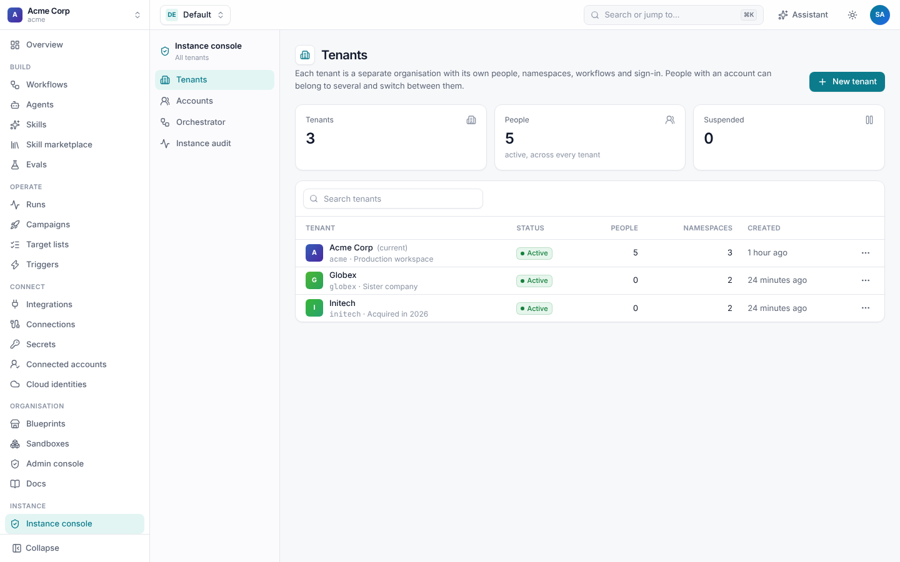
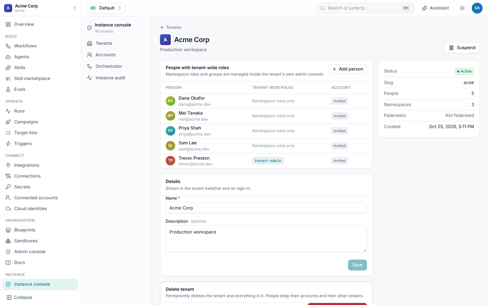
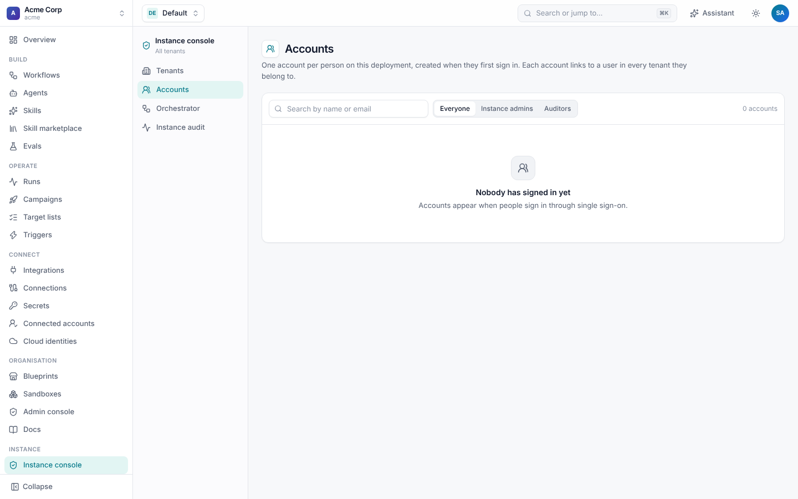
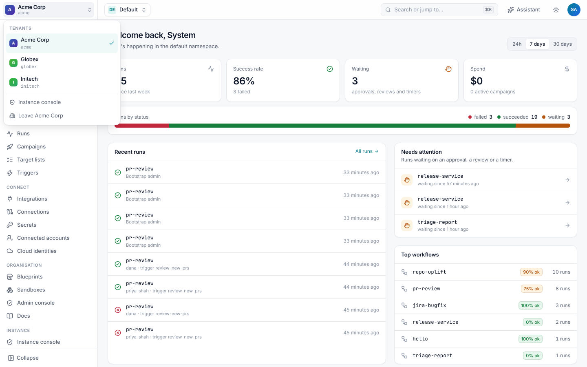
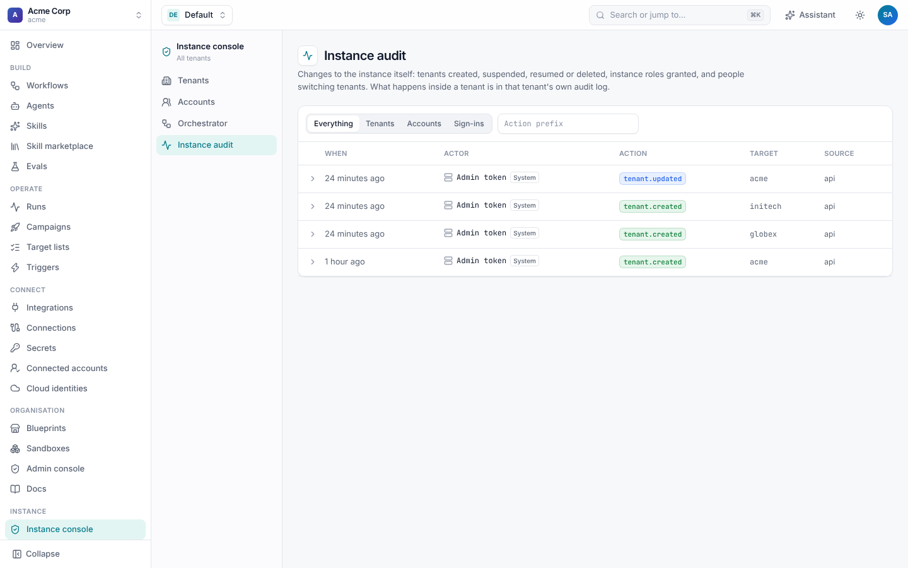
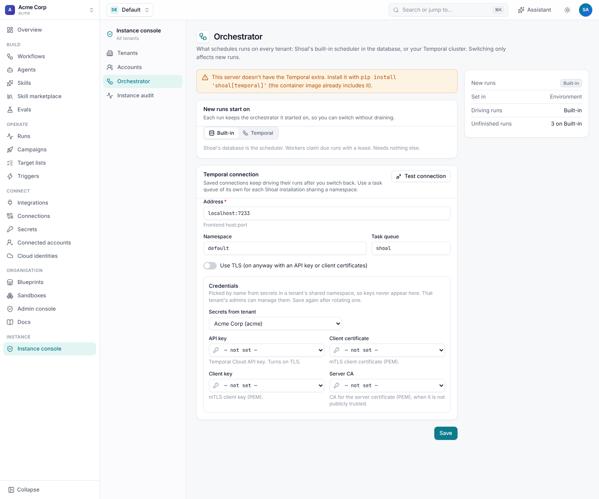

# Tenants and the instance console

One Shoal deployment can host many **tenants**. A tenant is a separate organisation: its own people, namespaces,
workflows, connections, secrets, sign-in and audit log. Every row in the database carries its tenant, every query is
scoped to it, and on Postgres row-level security adds a second check. Tenants never see each other's data.

People who run the deployment itself are **instance admins**. They create and manage tenants from the **Instance
console**, while each tenant's own admins run their tenant from its [admin console](README.md).

## The instance console

The **Instance console** (`/instance`) appears in the sidebar for instance admins and auditors.



**Tenants** lists every tenant with its status, people and namespaces. **New tenant** creates one: a slug (`acme`), a
display name, and optionally its first admin's email, who is given `tenant-admin`. Opening a tenant shows the people with
tenant-wide roles, its details, and buttons to suspend or delete it.



| Action | Effect |
| --- | --- |
| **Add person** | Gives someone a tenant-wide role there. If they haven't signed in yet they are invited, and the role applies when they do. Namespace roles and groups are managed inside the tenant. |
| **Rename** | Changes the name shown in the tenant switcher and on sign-in. The slug stays. |
| **Suspend** | Refuses its members' calls and new runs, and keeps its data. Running work is left to finish. **Resume** reverses it. |
| **Delete** | Deletes the tenant and everything in it. People keep their accounts and their other tenants. |

The same from the CLI, with an instance admin's key or the break-glass token:

```sh
shoal tenants create globex --name Globex --admin-email ops@globex.com   # prints a bootstrap API key, once
shoal tenants list
shoal tenants add-member globex dana@globex.com --role tenant-admin
shoal tenants suspend globex
shoal tenants resume globex
```

## Accounts

A person has one **account** on the deployment, created the first time they sign in, and keyed by their identity
provider's issuer and subject. The account links to a user in each tenant they belong to. Roles stay per tenant: being an
admin in `acme` gives nothing in `globex`.



**Accounts** lists everyone who has signed in, with their tenants. An account can also hold an instance role:

| Instance role | Can |
| --- | --- |
| `instance-admin` | Create, rename, suspend, resume and delete tenants; give people roles in any tenant; grant instance roles; and act as a tenant admin in any tenant, audited as `account:<email>`. |
| `instance-auditor` | Read everything in every tenant, audit logs included, and change nothing. |

`SHOAL_INSTANCE_ADMINS` lists the emails that become instance admins when they first sign in through the instance
sign-in. Nobody can change their own instance role, and the last instance admin can't be removed unless
`SHOAL_ADMIN_TOKEN` is set.

## Switching tenants

Someone who belongs to several tenants switches with the menu at the top left. The session moves to the other tenant
without signing in again. Instance admins and auditors also see **Instance console** there, and **Leave**, which takes
their session out of the current tenant and back to the instance level.



`GET /v1/me/tenants` lists the tenants a session can switch to, and `POST /v1/me/tenant` issues a session for another.

## Signing in

People sign in in one of two ways, and both link their account to their user in each tenant:

- **The instance sign-in**: one identity provider for everyone on the deployment, set with `SHOAL_INSTANCE_OIDC`
  (JSON with `issuer`, `client_id`, `client_secret`, `scopes`, `allowed_domains`; or put the secret in
  `SHOAL_INSTANCE_OIDC_CLIENT_SECRET`). It links accounts by verified email and applies `SHOAL_INSTANCE_ADMINS`.
- **A tenant's own providers**, set by its admins under [Sign-in & SCIM](access.md#single-sign-on). These never link by
  email or grant instance roles, because a tenant admin's provider must not vouch for people in other tenants.

## Instance audit

**Instance audit** (`GET /v1/instance/audit`) records what happens at the deployment level: tenants created, renamed,
suspended or deleted, instance roles granted or removed, and instance sign-ins. Each tenant's own changes stay in its
[audit log](README.md#audit-log), including those an instance admin makes there.



## Orchestrator

**Orchestrator** chooses the engine that runs workflows for the whole deployment: the **built-in** one (Postgres and
Shoal's workers) or **Temporal**. Switching tests the Temporal connection first. See
[Running Shoal on Temporal](../temporal.md#from-the-instance-console).



## Tenants on other deployments

An organisation that needs its data and execution inside its own network can run its own Shoal deployment and still be
managed from this one. See [Federation](federation.md).
