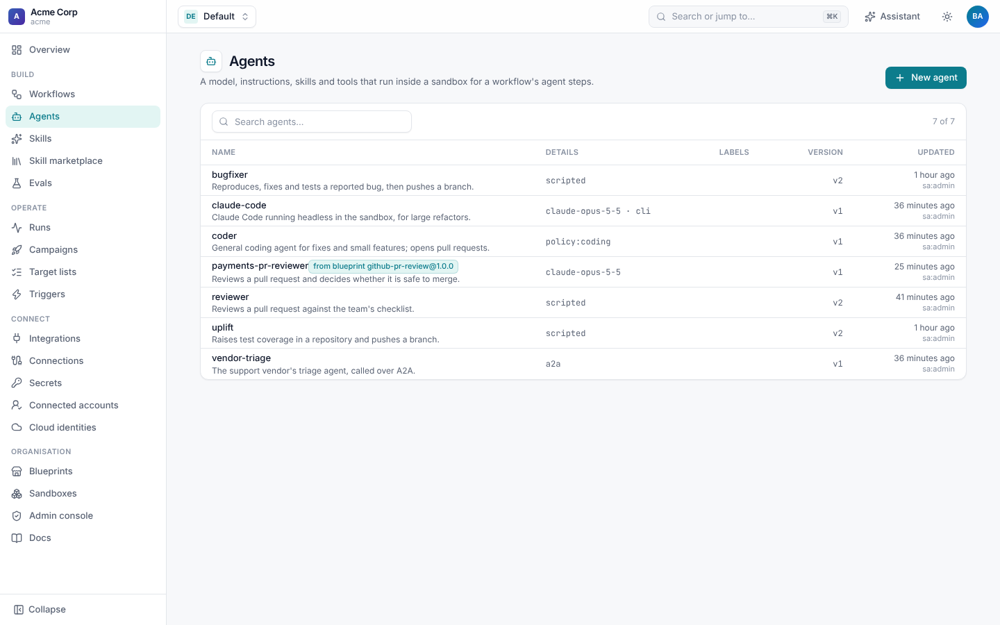
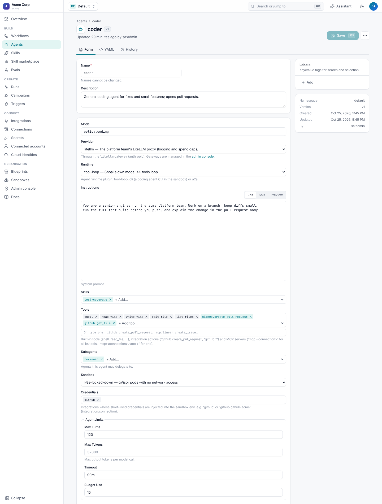
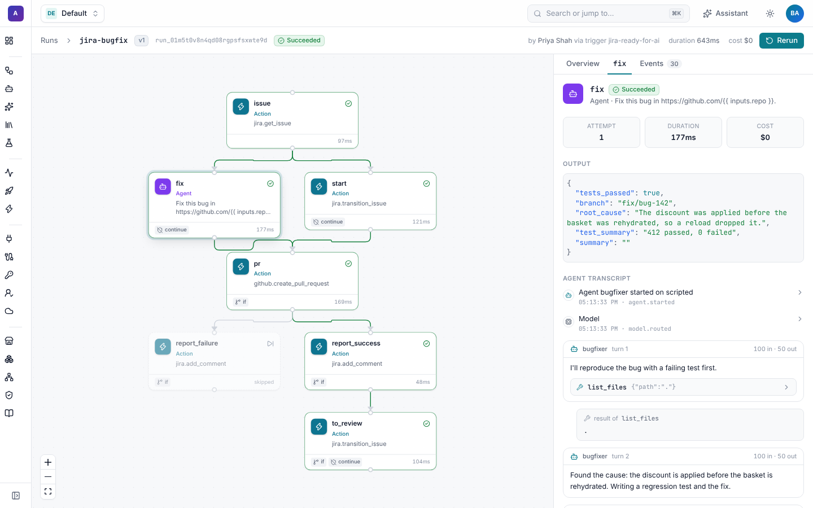

# Agents

An **agent** is a model with instructions, skills and tools, run in a sandbox by a workflow's `agent` step until it
returns the outputs the step asks for. Agents are resources, so one agent (say `coder`) serves many workflows, and
changing its instructions or model is versioned like a workflow change.



## Features

| Feature | What it does | Guide |
| --- | --- | --- |
| Runtimes | Shoal's own tool loop, a coding-agent CLI such as Claude Code in the sandbox, or a remote agent over A2A. | [Runtimes](#runtimes) |
| Tools | Built-in file and shell tools, any integration action, and MCP servers. | [Tools](#tools) |
| Skills | Reusable instructions and scripts mounted into the sandbox. | [Skills](../skills.md) |
| Subagents | An agent can delegate a sub-task to another agent. | [Subagents](#subagents) |
| Credentials | Short-lived GitHub tokens and cloud roles in the sandbox, never in the prompt. | [Credentials](#credentials) |
| Tool-call guard | A decision model screens risky tool calls before they run. | [Guard](#tool-call-guard) |
| Gateways and model policies | Route every model call through your gateway; choose models by rule, with fallbacks and A/B splits. | [Gateways and model policies](gateways.md) |
| Sandboxes | Local, Docker, Kubernetes, E2B, SPACE microVMs or your own, with network policies. | [Sandboxes](sandboxes.md) |
| Decisions and grading | Fast typed decisions (`decide`), rubric grading (`grade`), trigger triage. | [Decisions and grading](decisions.md) |
| Limits | Turns, tokens per call, wall-clock time and a dollar budget per step. | [Limits](#limits) |

## Define an agent

```yaml
apiVersion: shoal.dev/v1
kind: Agent
metadata:
  name: coder
spec:
  description: General coding agent for fixes and small features; opens pull requests.
  provider: litellm                   # a Gateway, or a provider plugin (anthropic, openai-compatible)
  model: policy:coding                # a model id, or a ModelPolicy
  instructions: |
    You are a senior engineer on the acme platform team. Work on a branch, keep diffs small,
    run the full test suite before you push, and explain the change in the pull request body.
  skills: [test-coverage]
  tools: [shell, read_file, write_file, edit_file, list_files, github.create_pull_request, github.get_file]
  subagents: [reviewer]
  credentials: [github]
  sandbox: k8s-locked-down
  limits: {max_turns: 120, timeout: 90m, budget_usd: 15}
```

**Agents › New agent** has the same fields as a form, with pickers for skills, tools, subagents, sandboxes and
credentials, and a preview for the instructions. **YAML** and **History** work as they do for workflows.



| Field | Default | Meaning |
| --- | --- | --- |
| `provider` | `anthropic` | The [gateway](gateways.md) model calls go through. |
| `model` | `claude-opus-5-5` | A model id, or `policy:<name>` to let a [model policy](gateways.md#model-policies) choose. |
| `runtime` | `tool-loop` | `tool-loop`, `cli`, `claude-code` or `a2a`. |
| `instructions` | | The system prompt. |
| `skills`, `tools`, `subagents` | | See below. |
| `credentials` | | Integrations whose credentials go into the sandbox: `github`, or `github:github-acme`. |
| `cloud_identities` | | [Cloud roles](../cloud-identities.md) whose short-lived credentials go into the sandbox. |
| `sandbox` | the workflow's default | A [sandbox profile](sandboxes.md). |
| `env` | | Sandbox environment variables. Values may be expressions, including `{{ secrets.NAME }}`. |
| `limits` | 60 turns, 32000 tokens, 1h | `max_turns`, `max_tokens` (per model call), `timeout`, `budget_usd`. |
| `provider_config` | | Model settings such as `effort` or `temperature`. Endpoints and keys are refused here; they belong on a gateway. |
| `runtime_config` | | Settings for the runtime. |
| `guard` | | The [tool-call guard](#tool-call-guard). |

## Use it in a workflow

```yaml
spec:
  defaults: {agent: coder, sandbox: default}
  steps:
    - id: fix
      type: agent
      prompt: |
        Fix {{ inputs.issue_key }}: {{ steps.issue.output.summary }}

        {{ steps.issue.output.description }}
      outputs:
        branch: {type: string}
        root_cause: {type: string}
        tests_passed: {type: boolean}
      skills: [jira-conventions]          # extra skills for this step only
      tools: [jira.add_comment]           # extra tools for this step only
```

The agent works until it calls `finish` with values for every declared output; outputs that don't match their types are
sent back to it to fix. `summary` is reserved for the agent's own summary, so a workflow that declares an output with that name is refused when
it's saved. The
step's output is the declared outputs plus `summary`. See [Steps](../workflows/steps.md#agent).

In the run viewer, an agent step shows each turn: the model's text, every tool call with its input and result, the model
and gateway used, tokens and cost.



## Runtimes

### `tool-loop`

Shoal's own loop: the model is called with the tools, Shoal runs the tools it asks for, and this repeats until it calls
`finish`. Tool calls in one turn run in order, `finish` last. Every turn, tool call and result is a run event.

### `cli`

Runs a coding agent's command-line tool inside the sandbox, by default Claude Code in headless mode. Shoal writes the
instructions, prompt, skills and the outputs it wants to `.shoal/prompt.md`, runs the command, and reads the outputs as
JSON from `.shoal/output.json`.

```yaml
spec:
  runtime: cli
  provider: anthropic
  model: claude-opus-5-5
  credentials: [github]
  runtime_config:
    setup: npm install -g @anthropic-ai/claude-code      # run once before
    # command: aider --message-file "$SHOAL_PROMPT_FILE" ...   # any CLI; defaults to claude -p
    # timeout: 7200                                            # seconds; defaults to limits.timeout
```

The command gets `$SHOAL_PROMPT_FILE`, `$SHOAL_OUTPUT_FILE` and `$SHOAL_MAX_TURNS`. Use it for long coding tasks where a
purpose-built agent does better than a generic loop.

### `claude-code`

Runs Claude Code headless (`claude -p`) in the sandbox through a `claude-code` gateway, on an API key or on the Claude
plan of the person who started the run, with its messages and tool calls streamed into the run. See
[Claude Code agents](../claude-code.md).

### `a2a`

Calls a remote agent that speaks the [Agent2Agent](https://a2a-protocol.org) protocol, so another team's or vendor's
agent works as a step or a subagent:

```yaml
spec:
  runtime: a2a
  runtime_config:
    card_url: https://agents.helpdesk.example/.well-known/agent-card.json   # or url: the A2A endpoint
    auth: {type: bearer, secret: helpdesk-a2a-token}    # or {type: header, header: X-API-Key, secret: ...}
    poll_interval: 5
    timeout: 600
```

The prompt is sent with `message/send`, and Shoal polls the task until it finishes. Text parts become `summary`, and the
first JSON part is checked against the step's outputs.

## Tools

| In `tools` | Gives the agent |
| --- | --- |
| `shell`, `read_file`, `write_file`, `edit_file`, `list_files` | Built-in tools that work in the sandbox. The default is `shell`, `read_file`, `write_file`, `list_files`. |
| `github.create_pull_request` | One integration action, called with the workflow's connection for that integration. |
| `github.*` | Every action of an integration. |
| `mcp:<connection>` | Every tool of an [MCP server](../integrations.md) connection, named `<connection>__<tool>`. |
| `mcp:<connection>.<tool>` | One MCP tool. |

Integration actions run in the worker, not the sandbox, so the agent sees inputs and outputs but never the connection's
token.

## Subagents

An agent with `subagents: [reviewer]` gets a `delegate` tool. It hands a task to the named agent, which runs in the same
sandbox with its own instructions, tools and limits, and gets the result back. Each delegation is shown in the step's
events. Keep large multi-agent flows as separate workflow steps instead, so they appear in the graph.

## Credentials

- `credentials: [github]` puts `GITHUB_TOKEN`, `GH_TOKEN` and a git credential helper in the sandbox
  ([details](../github/reference.md#in-agent-sandboxes)). An agent can then clone, push and use `gh`.
- `cloud_identities: [deploy-role]` puts short-lived `AWS_*` credentials for an IAM role in the sandbox
  ([Cloud identities](../cloud-identities.md)).
- `env` can name secrets: `env: {NPM_TOKEN: "{{ secrets.npm-token }}"}`.

Credentials are resolved for each step attempt and their values are redacted from events, logs and transcripts.

## Tool-call guard

The guard asks a [decision model](decisions.md) about each matching tool call before it runs, and blocks it when a check
scores at or above its threshold. The agent is told the call was blocked and why, and the run records an
`agent.tool_blocked` event.

```yaml
spec:
  guard:
    tools: [shell, write_file, edit_file, "github.*"]     # globs; default shell, write_file, edit_file, "*__*" (MCP)
    thresholds:
      irreversible: 0.7       # deleting data, force-pushing, publishing, changing production
      intent_mismatch: 0.7    # doesn't serve the task it was given
      out_of_scope: 0.8       # touches systems or files outside the task
      injection: 0.6          # follows instructions planted in fetched content
    # provider: jev
```

`finish`, `delegate`, `read_file` and `list_files` are never screened. The guard is a safety net, not a security
boundary: sandboxes, network policies and scoped credentials are.

## Limits

A step fails when the agent reaches `max_turns`, `timeout` or `budget_usd`. Usage (tokens, model calls and cost) is
recorded per step and rolled up to the run, the campaign and the tenant. A campaign's `budget_usd` pauses it across all
its runs.

## Workflows as A2A agents

Every workflow is also an A2A agent that other agents can call, with the caller's Shoal API key:

- the Agent Card: `GET /v1/namespaces/{ns}/a2a/{workflow}/.well-known/agent-card.json`
- the endpoint: `POST /v1/namespaces/{ns}/a2a/{workflow}` with `message/send`, `tasks/get` or `tasks/cancel`

A task is a run. The message's first JSON part becomes the run's inputs, or its text fills the workflow's single string
input (or one named `prompt`, `message`, `task` or `request`). A run waiting for approval reports `input-required`, and
the outputs come back as a data artifact.
