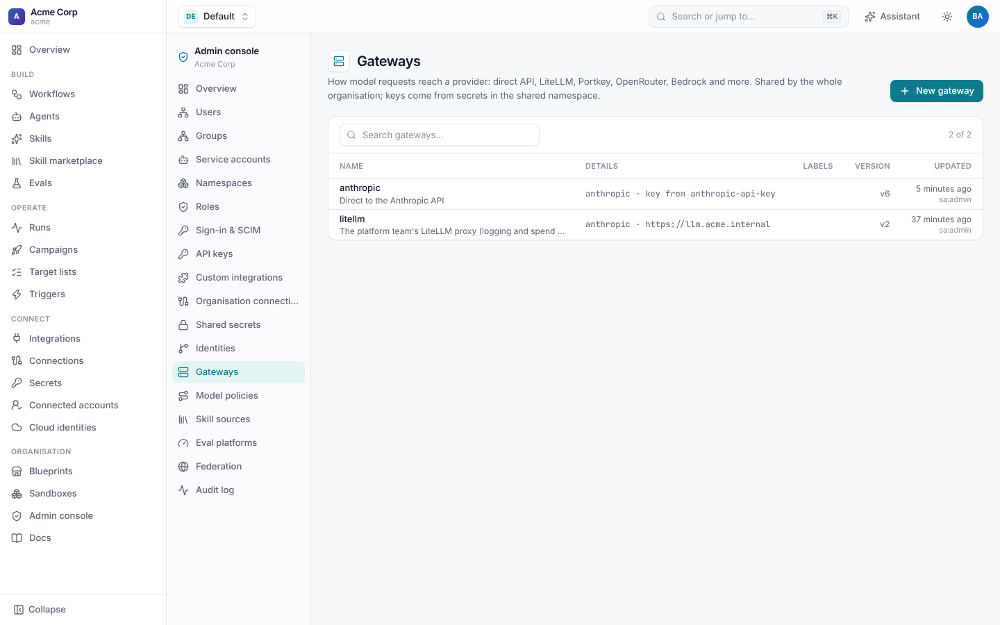
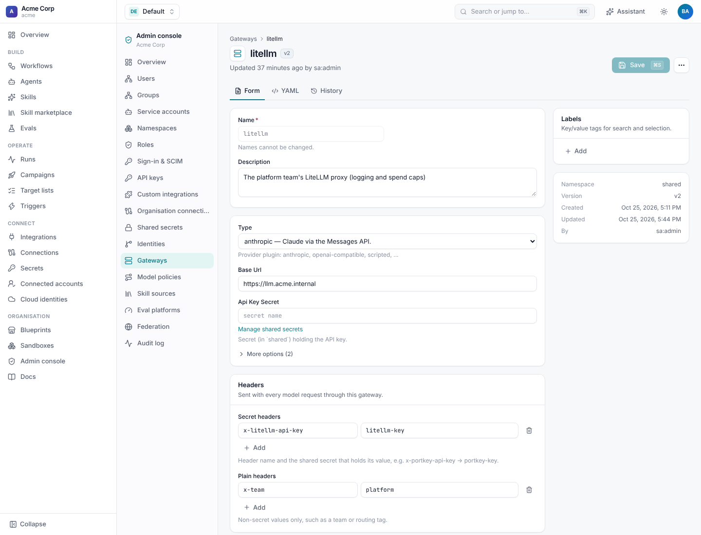
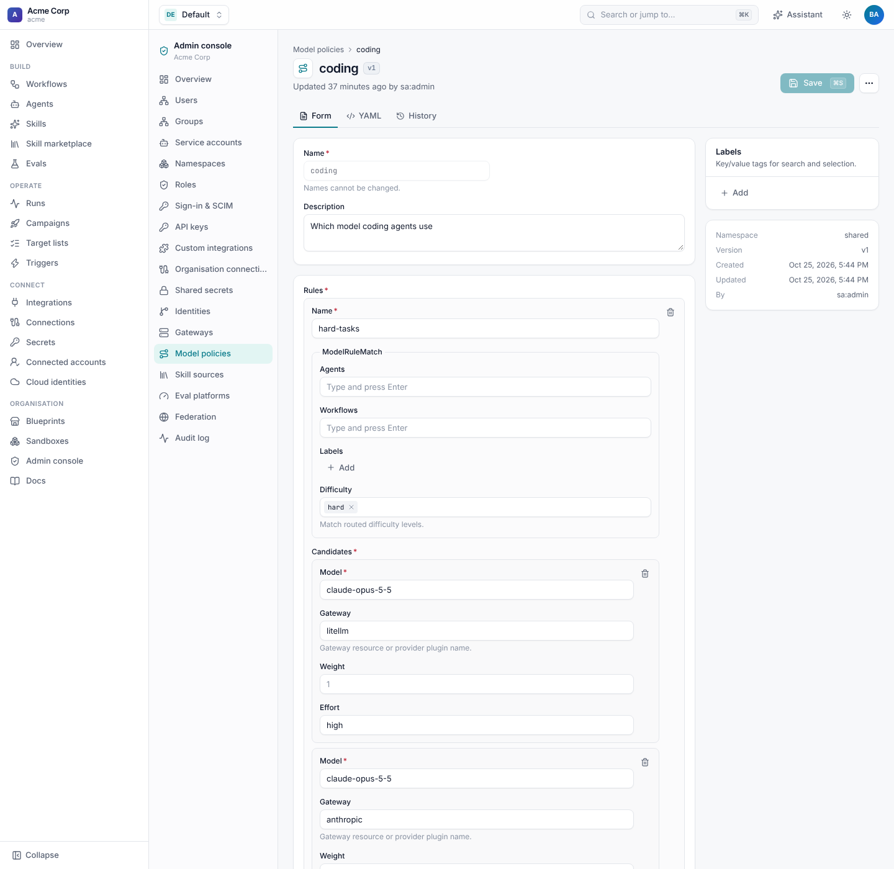

# Gateways and model policies

Two tenant-wide resources, managed by admins in the **Admin console**, decide how agents reach models:

- a **gateway** is *how* a request reaches a provider: the Anthropic API directly, or your LiteLLM, Portkey, Bedrock or
  OpenAI-compatible endpoint, with its credentials;
- a **model policy** is *which* model runs: allow and deny lists, rules by agent, workflow, label or task difficulty,
  fallbacks and A/B splits.

Agents pick a gateway and a model (or a policy) by name. They can tune the model but never set an endpoint or a key, so
nothing routes around the gateway your platform team runs.



## Gateways

```yaml
apiVersion: shoal.dev/v1
kind: Gateway
metadata:
  name: litellm
  description: The platform team's LiteLLM proxy (logging and spend caps)
spec:
  type: anthropic                          # the provider plugin: anthropic, openai-compatible, scripted
  base_url: https://llm.acme.internal
  headers: {x-team: platform}              # plain headers
  secret_headers: {x-litellm-api-key: litellm-key}   # header -> secret name
  # api_key_secret: anthropic-api-key      # the provider's API key, as a secret name
  # config: {timeout: 120}
```

| Field | Meaning |
| --- | --- |
| `type` | The provider plugin. `anthropic` speaks the Anthropic Messages API, directly or through any Anthropic-compatible proxy (LiteLLM, Portkey, Cloudflare AI Gateway). `openai-compatible` speaks the OpenAI Chat Completions API (OpenRouter, vLLM, Ollama, Azure OpenAI). |
| `base_url` | Where requests go. Empty means the provider's own API. |
| `api_key_secret` | The API key, as the name of a secret in the tenant's `shared` namespace. |
| `headers`, `secret_headers` | Extra headers; credential headers only as secret names. |
| `config` | Provider settings. |

Credentials are never stored in clear text. Header and config names that look like credentials (`authorization`,
`*-key`, `*token*`, `secret`) are refused in `headers` and `config`; use `api_key_secret` or `secret_headers`, which
name secrets in `shared`. Their values are resolved at call time and redacted from run events.



An agent uses a gateway with `provider: litellm`. Naming a provider plugin instead (`provider: anthropic` with no
Gateway of that name) calls it with the server's own credentials, such as `ANTHROPIC_API_KEY`. Managing gateways needs
`gateways:manage`, which tenant admins have.

## Model policies

```yaml
apiVersion: shoal.dev/v1
kind: ModelPolicy
metadata: {name: coding}
spec:
  allow_models: [claude-opus-5-5, claude-sonnet-5-5, claude-haiku-5-5]
  difficulty_router:
    type: score
    instructions: How hard is this coding task for an experienced engineer?
    levels: [easy, medium, hard]
  rules:
    - name: hard-tasks
      match: {difficulty: [hard]}
      candidates:
        - {model: claude-opus-5-5, gateway: litellm, effort: high}
        - {model: claude-opus-5-5, gateway: anthropic}         # fallback if the proxy is down
    - name: default
      strategy: weighted
      candidates:
        - {model: claude-sonnet-5-5, gateway: litellm, weight: 9}
        - {model: claude-opus-5-5, gateway: litellm, weight: 1}
```

An agent uses it with `model: policy:coding`. For each agent step Shoal:

1. scores the task's difficulty with the `difficulty_router`, if any rule matches on difficulty (a
   [decision](decisions.md), using `decision_provider`);
2. takes the **first rule** whose `match` fits: `agents` and `workflows` (globs), run `labels`, and `difficulty`. An empty
   `match` fits everything, so put a catch-all rule last;
3. orders its candidates: in order for `fallback`, or with one picked by weight first for `weighted` (stable for a step
   attempt, so retries see the same model);
4. drops models that `allow_models` or `deny_models` rule out, here or in the policy named `default`;
5. calls the first candidate, moving to the next on an outage, a rate limit or a refusal, and staying there for the rest
   of the step.



| Field | Meaning |
| --- | --- |
| `allow_models`, `deny_models` | Globs of model ids. If `allow_models` is set, nothing else may run. |
| `rules[].match` | `agents`, `workflows`, `labels`, `difficulty`. |
| `rules[].candidates` | `model`, `gateway` (default: the agent's `provider`), `weight`, `effort`. |
| `rules[].strategy` | `fallback` (default) or `weighted` for A/B splits. |
| `difficulty_router` | A `score` question whose level the rules match on. |
| `decision_provider` | The decision provider for the router: `jev` or `llm`. |

### A tenant-wide allow list

A policy named `default` applies its `allow_models` and `deny_models` to every policy, so admins can, for example, keep
every agent on approved models:

```yaml
apiVersion: shoal.dev/v1
kind: ModelPolicy
metadata: {name: default}
spec:
  deny_models: ["*-preview"]
  rules:
    - name: default
      candidates: [{model: claude-sonnet-5-5}]
```

Managing policies needs `model-policies:manage`.

## Seeing what ran

Each agent step records a `model.routed` event with the candidates, the rule and the difficulty answer, and a
`model.fallback` event whenever it moves on. Usage and cost per step use the model that answered, so an A/B split can be
compared in the run list or with an [eval](../evals/README.md).
