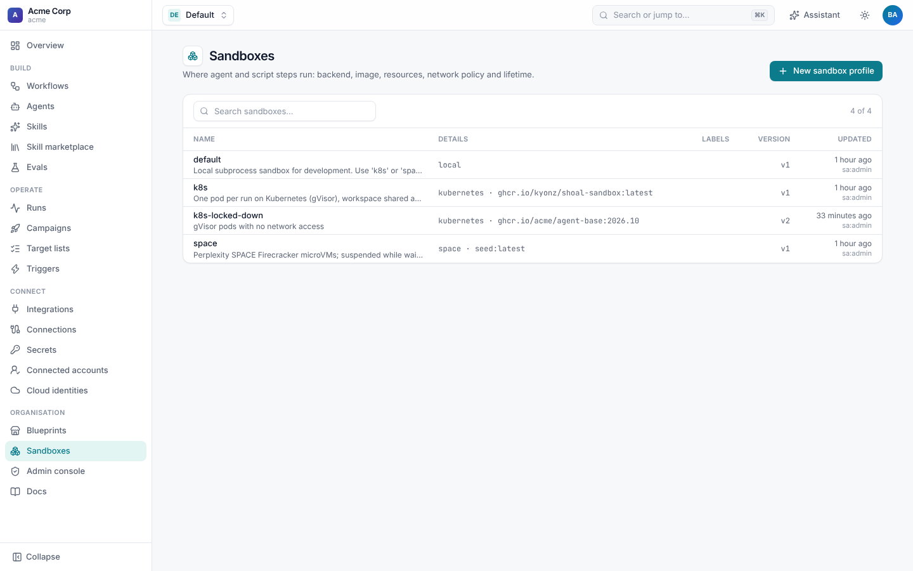
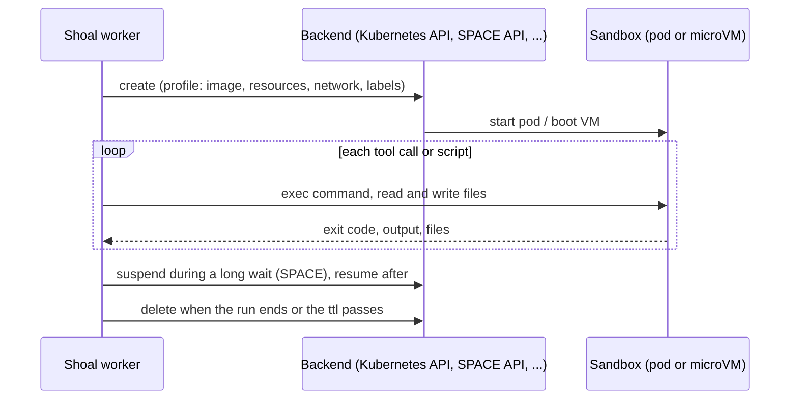
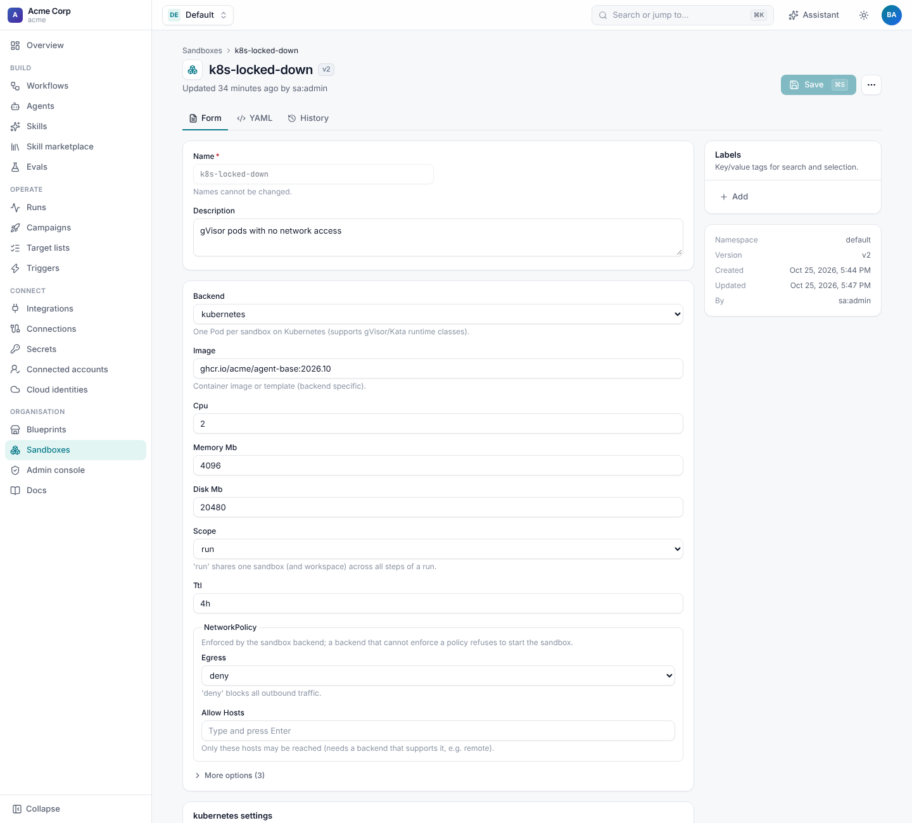

# Sandboxes

Agent steps, script steps and CLI agents run inside a **sandbox**: an isolated machine with a workspace, created for the
run and thrown away after it. A **sandbox profile** says where and how: the backend, the image, CPU and memory, the
network policy, and how long it lives. One tenant can run on Kubernetes while another uses microVMs.



## How a sandbox runs

You never start sandbox jobs yourself. A Shoal **worker** creates and drives them as a run needs them:



1. A run reaches an `agent`, `script` or CLI-agent step that needs a sandbox. The worker resolves the profile (the
   step's, the agent's, or the workflow's `defaults.sandbox`).
2. The worker calls the backend's **create**. On Kubernetes that is one Pod, created through the Kubernetes API with
   in-cluster config or a kubeconfig, in the profile's namespace. On SPACE it is a Firecracker microVM, created through
   SPACE's HTTP API as an asynchronous operation that Shoal polls.
3. Everything then runs **from the worker into the sandbox**. Every agent tool call (`shell`, `read_file`, ...) and
   every script is an exec: the Pod exec API on Kubernetes, and command streams over server-sent events with
   `files:read` and `files:write` on SPACE. Nothing in the sandbox polls Shoal for work or needs to reach it.
4. Integration actions (`github.*`, `jira.*`) run in the worker, not the sandbox. The sandbox only holds the credentials
   an agent asks for with `credentials` or `cloud_identities`.
5. With `scope: run`, later steps reuse the same sandbox and workspace. The sandbox is deleted when the run finishes or
   its `ttl` passes, and suspended during long waits where the backend supports it.

The worker remembers each sandbox's id, so a restarted worker reattaches to it and carries on with the workspace intact.

### Liveness and failures (Kubernetes)

There is no job to poll. The pod runs `sleep infinity` as an idle shell host, and each command is a **blocking exec**
over a websocket from the worker. The worker knows a command is running because it is still waiting on that call, and it
gets the exit code and output when the call returns. Commands are wrapped in `timeout`, so a hung command ends at the
step's limit. A CLI agent (Claude Code) is one long exec for the whole session.

Liveness is tracked at the **run** level, not the pod level:

- A worker advancing a run holds a **lease** on it in the database (`SHOAL_LEASE_SECONDS`, default 60) and renews it
  every third of that while it works.
- Other workers only claim runs whose lease has expired.

| What fails | What happens |
| --- | --- |
| **The worker dies mid-step** | The lease stops being renewed and expires within a minute. Another worker claims the run, finds the step still `running`, and re-runs that attempt. With `scope: run` it reattaches to the recorded pod if it is still `Running`, so files written so far are kept. The interrupted command's result is lost, and the command itself may still finish inside the pod. Make steps safe to re-run. |
| **The pod dies** (evicted, OOM-killed, node lost) | The exec call fails, and the step fails or retries according to its `retry` policy. On the next attempt, reattaching finds the pod gone, so a fresh pod is created. With `scope: run` the workspace is lost too, because it is an `emptyDir`. |
| **The pod doesn't start** | `create` waits up to `startup_timeout` (default 300s) for `Running`. Otherwise it deletes the pod and its NetworkPolicy, and the step fails. |
| **The database or API is down** | Workers can't renew leases or checkpoint. Runs resume from the last checkpoint once it's back. |

### Cleanup

- **Normal cleanup.** A `scope: step` pod is deleted when its step ends. `scope: run` pods are deleted when the run
  finishes, including when it fails or is cancelled. Each pod's NetworkPolicy is deleted with it.
- **The backstop.** Every pod has `activeDeadlineSeconds` set to the profile's `ttl` and `restartPolicy: Never`, so the
  kubelet kills a pod that outlives its ttl even if no worker ever comes back for it. Keep `ttl` comfortably above your
  longest run.
- **Leftovers.** Pods ended by the deadline stay as `Failed` pod objects until Kubernetes' pod garbage collection removes
  them. Their NetworkPolicies stay too. Every object is labelled `app.kubernetes.io/managed-by=shoal`, with
  `shoal.dev/run`, `shoal.dev/tenant` and `shoal.dev/workflow`, so you can find and remove them:

  ```sh
  kubectl -n shoal-sandboxes get pods -l app.kubernetes.io/managed-by=shoal --field-selector=status.phase=Failed
  kubectl -n shoal-sandboxes delete pods -l app.kubernetes.io/managed-by=shoal --field-selector=status.phase=Failed
  kubectl -n shoal-sandboxes get networkpolicies -l app.kubernetes.io/managed-by=shoal
  ```

  Shoal doesn't yet sweep these automatically.

## Profiles

```yaml
apiVersion: shoal.dev/v1
kind: SandboxProfile
metadata:
  name: k8s
  description: One pod per run on Kubernetes (gVisor), workspace shared across steps.
spec:
  backend: kubernetes
  image: ghcr.io/kyonz/shoal-sandbox:latest
  cpu: 2
  memory_mb: 4096
  disk_mb: 20480
  scope: run
  ttl: 8h
  network: {egress: allow}
  config: {namespace: shoal-sandboxes, runtime_class: gvisor}
```

| Field | Default | Meaning |
| --- | --- | --- |
| `backend` | `local` | Where sandboxes run. See [backends](#backends). |
| `image` | the backend's | A container image or template. |
| `cpu`, `memory_mb`, `disk_mb` | the backend's | Resources. |
| `env` | | Environment variables for everything in the sandbox. |
| `workdir` | `/workspace` | The working directory. |
| `ttl` | `4h` | The longest a sandbox lives. |
| `scope` | `run` | `run` shares one sandbox, and its files, across the run's steps; `step` gives each step a fresh one. |
| `suspend_on_wait` | `true` | Suspend a run-scoped sandbox during long waits, where the backend can. |
| `network.egress` | `allow` | `deny` blocks all outbound traffic. |
| `network.allow_hosts` | | Only these hosts may be reached. |
| `config` | | Backend settings. |



A workflow picks its default with `defaults: {sandbox: k8s}`, and an agent or a step can name another. With
`scope: run`, a script step can prepare the repository, an agent can change it, and a later script step can run the tests
on the same files.

## Backends

| Backend | Isolation | Network policy | Suspend | Settings (`config`) |
| --- | --- | --- | --- | --- |
| `local` | None: a subprocess in a temp directory. Development and tests only. | none | no-op | |
| `docker` | A container per sandbox. `pip install 'shoal[docker]'`. | `deny` | | |
| `kubernetes` | A pod per sandbox, commands over the exec API; gVisor or Kata with `runtime_class`. `pip install 'shoal[kubernetes]'`. | `deny` (a NetworkPolicy per pod) | | `namespace` (`{tenant}` is substituted), `runtime_class`, `service_account`, `image_pull_secrets`, `node_selector`, `tolerations`, `run_as_user` |
| `e2b` | E2B cloud or self-hosted sandboxes. `pip install 'shoal[e2b]'`. | `deny` | | `api_key_secret`, `domain` |
| `space` | [Perplexity SPACE](https://github.com/perplexityai/SPACE) Firecracker microVMs. | none | yes | `api_url`, `data_plane_url`, `token_secret`, `runtime` |
| `remote` | Anything that implements the small Shoal remote sandbox HTTP protocol. | `deny`, `allow_hosts` (the provider must enforce them) | if the provider says so | `url`, `token_secret` |

A backend that can't enforce a profile's network policy refuses to start the sandbox, so a policy is never silently
ignored. For example, `allow_hosts` needs the `remote` backend, and `egress: deny` doesn't work on `local` or `space`.

### Suspending during waits

A run that opens a pull request and waits a week for review doesn't need a machine for that week. With
`suspend_on_wait`, a backend that supports it (SPACE, or a remote provider) saves the sandbox's memory and disk when the
run starts a long wait and resumes it, workspace intact, when the run carries on. Other backends keep the sandbox until
its `ttl`.

### A remote provider

The `remote` backend lets you bridge any sandbox provider with seven HTTP endpoints:

```text
POST   /sandboxes                     {spec}                        -> {"id": "..."}
GET    /sandboxes/{id}                                              -> 200 | 404
POST   /sandboxes/{id}/exec           {command, cwd, env, timeout}  -> {exit_code, stdout, stderr, timed_out}
PUT    /sandboxes/{id}/files?path=…   (raw body)
GET    /sandboxes/{id}/files?path=…                                 -> raw body | 404
POST   /sandboxes/{id}/suspend | /resume     (optional; advertise with "suspend": true)
DELETE /sandboxes/{id}
```

The create body carries the profile's `network` policy, and the provider must enforce it or refuse to create the sandbox.

## What goes into a sandbox

- The agent's [skills](../skills.md), under `.shoal/skills/`.
- Credentials the agent or step asks for: `credentials: [github]`, `cloud_identities: [...]` and `env`. See
  [Agents](README.md#credentials).
- For script steps, the step's inputs and an outputs file. See [Script steps](../workflows/script-steps.md).

Each sandbox is labelled with the tenant, run and step, and its creation is a `sandbox.created` run event with the
profile and backend.

Profiles are namespaced and need `sandbox-profiles:write` to change. Put shared profiles in the `shared` namespace so every team
can use them.
