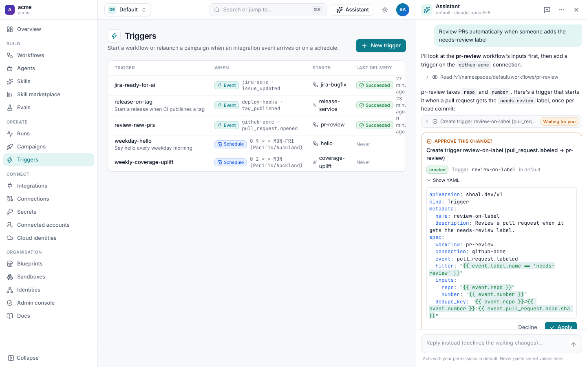
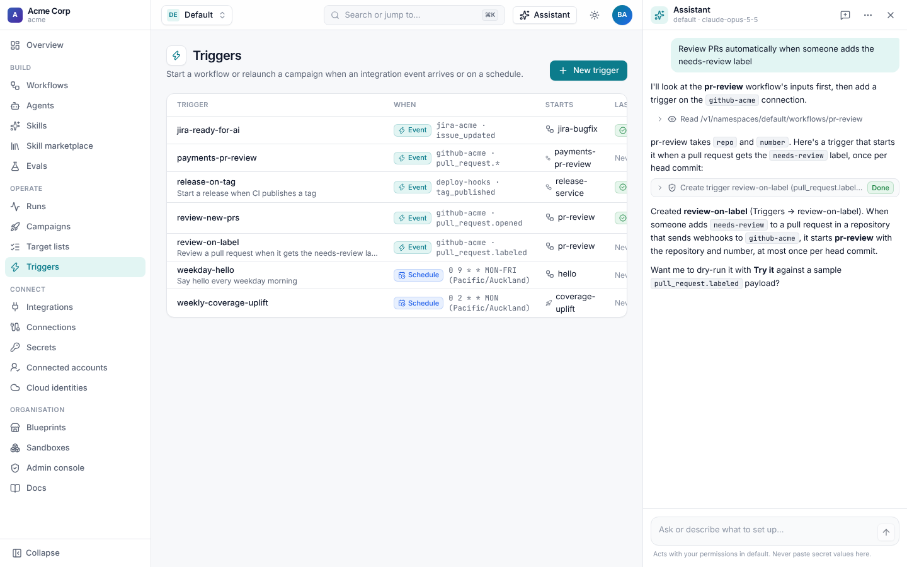

# The assistant

The assistant is a chat panel on every page that sets up anything Shoal offers: workflows, agents, triggers,
connections, campaigns, evals, gateways, runs and approvals. Describe what you want ("review PRs when someone adds the
needs-review label") and it reads what's there, writes the YAML, and shows you the change to approve before anything is
saved. It acts with your permissions, so it can never do more than you could yourself.

Open it with **Assistant** in the top bar, or <kbd>⌘</kbd>/<kbd>Ctrl</kbd>+<kbd>J</kbd>.

## What it can do

| Ask for | It will |
| --- | --- |
| "Start jira-bugfix when a BUG ticket moves to Ready for AI" | Look up the connection and the workflow's inputs and write a trigger. |
| "Write a workflow that dedupes and sorts a list of emails, in code, not an agent" | Write a workflow with a `script` step, so deterministic work runs as code. |
| "Why did run_01m5… fail?" | Read the run and its events and explain the failure. |
| "Approve the waiting deploy for checkout" | Find the approval and, once you confirm, approve it. |
| "Add a model policy that sends hard tasks to Opus" | Write the policy, if you're allowed to manage policies. |
| "What does the GitHub integration's can_merge action check?" | Read the integration's catalogue and answer. |

It prefers `script` steps for work that doesn't need judgement, follows the patterns in these docs, and fixes its own
YAML when validation finds a problem.

## Approving changes

Reading is immediate: the panel shows each read (**Read /v1/namespaces/default/workflows/pr-review**) as a line you can
expand. Every change waits for you:

- **Applying resources.** The YAML is validated with a dry run first. Errors go back to the assistant to fix. Valid
  changes appear as a card with what will be **created**, **updated** or left **unchanged**, and **Show YAML**.
- **Other changes** (starting a run, approving a step, launching a campaign, deleting something) appear as a card with
  the API call.

Choose **Apply** or **Decline**. Typing a reply instead declines the waiting changes. Once applied, the assistant carries
on and tells you what it did.

To skip the cards, turn on **Make changes without asking** in the panel's **…** menu. The header then shows
"auto-approve". Changes still run with your permissions and are still audited.

## Permissions and audit

The assistant calls Shoal's public API in-process with your credentials, through the same checks as any other request:

- it can only read and change what your roles allow in the current namespace and tenant;
- every change is in the [audit log](../administration/README.md#audit-log) under your name, with source `assistant`;
- sign-in, webhook, SCIM and assistant endpoints are out of its reach.

Don't paste secret values into the chat. Ask it to create the secret's name and set the value yourself under
**Secrets**.

## Conversations

Your conversation stays in your browser, per tenant, and is sent with each message; the server keeps no chat history.
**New chat** (the pen icon) starts over. The header shows the namespace it is acting in and the model.

## Configuration

Operators configure the assistant with environment variables on the server:

| Variable | Default | Meaning |
| --- | --- | --- |
| `SHOAL_ASSISTANT_ENABLED` | `true` | Serve the assistant. |
| `SHOAL_ASSISTANT_GATEWAY` | `anthropic` | The [gateway](../agents/gateways.md) (tenant-wide) or provider plugin it calls. |
| `SHOAL_ASSISTANT_MODEL` | `claude-opus-5-5` | The model. |
| `SHOAL_ASSISTANT_EFFORT` | `medium` | Reasoning effort. |
| `SHOAL_ASSISTANT_MAX_TURNS` | `16` | Model calls per message before it stops and asks you to continue. |

To run the assistant on Claude Code, set `SHOAL_ASSISTANT_GATEWAY` to a `claude-code` gateway. On a subscription
gateway each person chats on their own Claude plan, once they have linked it under **Settings → Connected accounts**
([Claude Code agents](../claude-code.md#use-it-as-a-model-gateway)).

The tenant's `default` model policy applies. The API is
`POST /v1/assistant/chat`.
