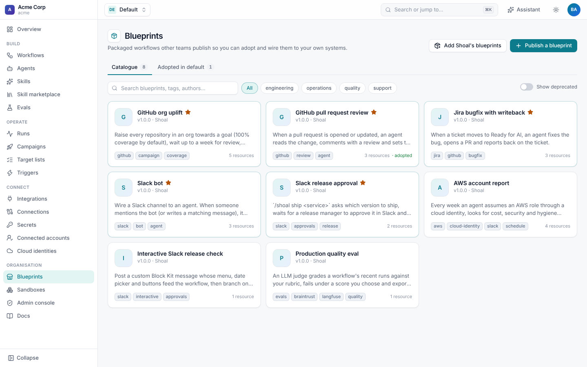
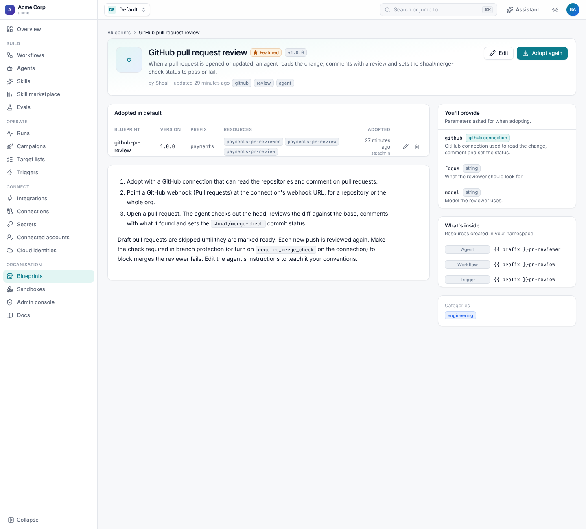
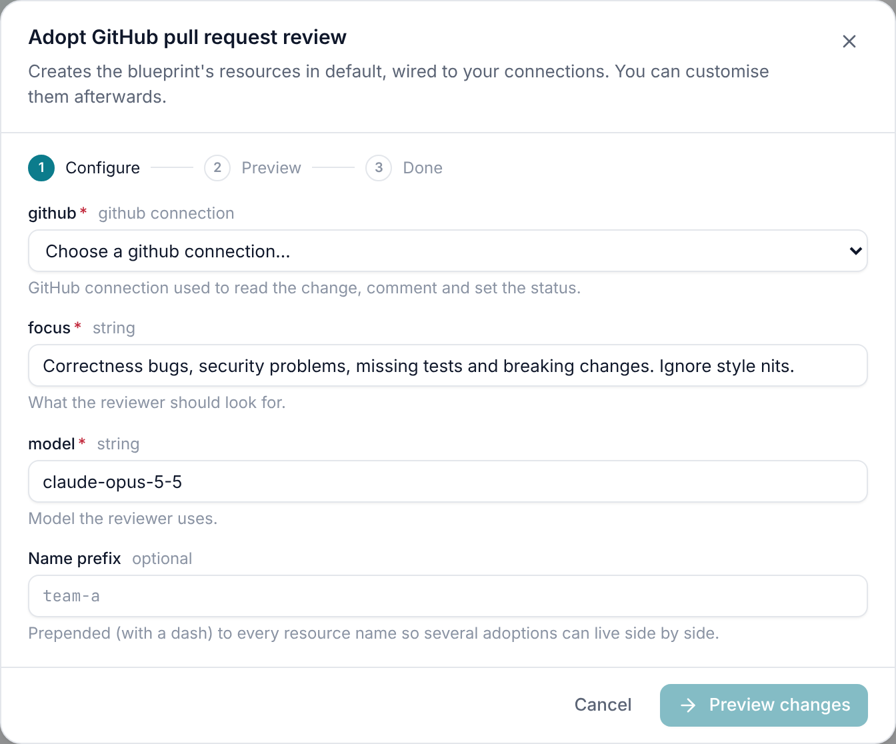
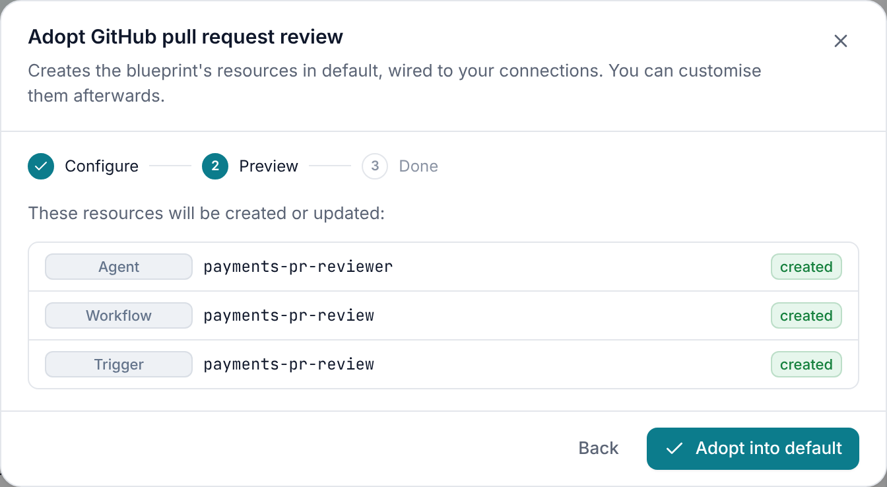
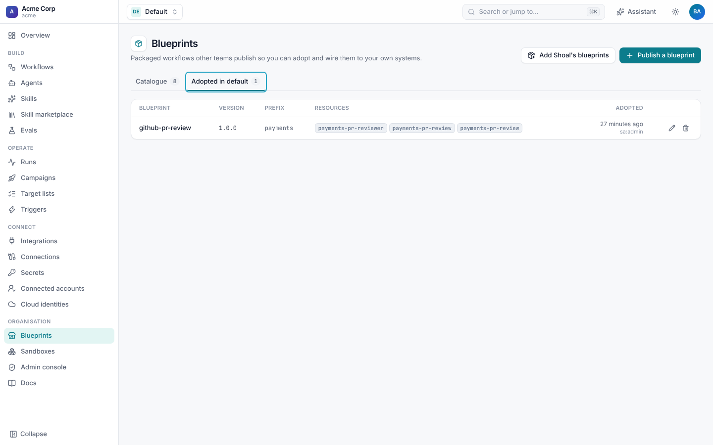

# Blueprints

A **blueprint** packages a workflow with its agents, triggers and campaigns so other teams can adopt it and wire it to
their own systems. One team builds "review every pull request" once; every other team adopts it from the catalogue,
picks its GitHub connection, and has it running in a minute. The catalogue lives inside your tenant: it's how teams
share with each other, not a public marketplace.

Every tenant starts with [Shoal's own blueprints](bundled.md) for the common scenarios: GitHub PR review, Jira bugfix,
org-wide uplift, Slack bots and release approvals, an AWS account report and a production quality eval.



## Adopt a blueprint

1. Open **Blueprints**, find one by search, category or tag, and read its README: it explains the setup outside Shoal,
   such as webhooks or a Slack app.
2. Press **Adopt into &lt;namespace&gt;**. Fill in what it asks for: connections (only ones of the right integration
   are offered), secrets and values. A **name prefix** lets you adopt the same blueprint more than once in a namespace.
3. **Preview changes** lists the resources it will create or update. Press **Adopt**.







The resources are ordinary workflows, agents and triggers in your namespace, labelled with `shoal.dev/blueprint`,
`shoal.dev/blueprint-version` and `shoal.dev/adoption`. Open them in the builder and customise them like anything else.

```sh
shoal blueprints adopt github-pr-review -p github=github-acme --prefix payments --dry-run
shoal blueprints adopt github-pr-review -p github=github-acme --prefix payments
```

Adopting needs `blueprints:adopt` and write access to each kind of resource the blueprint creates.

### Upgrade or remove an adoption

**Blueprints › Adopted in &lt;namespace&gt;** lists every adoption with its version, prefix and resources.



- **Edit** (the pencil) upgrades to a newer version or changes the parameters, with a preview. Resources the new version
  no longer has are deleted.
- **Delete** removes the adoption and everything it created.

The API is `PUT` and `DELETE /v1/namespaces/{ns}/blueprint-adoptions/{id}`, both with `dry_run`.

## Write a blueprint

```yaml
apiVersion: shoal.dev/v1
kind: Blueprint
metadata:
  name: github-pr-review
spec:
  title: GitHub pull request review
  summary: When a pull request is opened or updated, an agent reviews it and sets the shoal/merge-check status.
  version: 1.0.0
  status: published                 # draft, published, featured or deprecated
  tags: [github, review, agent]
  categories: [engineering]
  readme: |
    1. Adopt with a GitHub connection that can read the repositories and comment on pull requests.
    2. Point a GitHub webhook (Pull requests) at the connection's webhook URL.
  params:
    github: {type: connection, integration: github, description: GitHub connection used to read and comment.}
    focus: {type: string, default: "Correctness bugs, security problems, missing tests and breaking changes."}
  resources:
    - apiVersion: shoal.dev/v1
      kind: Agent
      metadata: {name: "{{ prefix }}pr-reviewer"}
      spec:
        instructions: "Review the change. Focus on: {{ params.focus }}"
        credentials: ["github:{{ params.github }}"]
    - apiVersion: shoal.dev/v1
      kind: Workflow
      metadata: {name: "{{ prefix }}pr-review"}
      spec:
        connections: {github: "{{ params.github }}"}
        defaults: {agent: "{{ prefix }}pr-reviewer"}
        inputs: {repo: {type: string}, number: {type: integer}}
        steps:
          - id: review
            type: agent
            prompt: "Review https://github.com/{{ inputs.repo }}/pull/{{ inputs.number }}"
```

| Field | Meaning |
| --- | --- |
| `title`, `summary`, `readme`, `icon`, `author`, `tags`, `categories` | What the catalogue shows. |
| `version` | Semver. Adoptions keep their version until they're upgraded. |
| `status` | Only `published` and `featured` blueprints can be adopted. `deprecated` ones are hidden unless you choose **Show deprecated**. |
| `namespaces` | Limit who may adopt it; empty means every namespace. |
| `params` | What the adopter supplies: `string`, `number`, `boolean`, `choice` (with `options`), `connection` (with `integration`) or `secret`, each with `description`, `default` and `required`. |
| `resources` | Resource templates. |

In `resources`, expressions over `params`, `prefix` and `blueprint` are filled in when it is adopted. Every other
expression (`inputs`, `steps`, `event`, `run`, …) is left as written for run time. `{{ prefix }}` is the adopter's
prefix plus a dash, or empty.

### Publish it

**Publish a blueprint** opens the editor, or apply the YAML. Blueprints are tenant-wide: publishing needs
`blueprints:publish`, and featuring (`status: featured`, shown with a star and first in the catalogue) needs
`blueprints:feature`. Raise `version` for each change, so teams can see there's an upgrade and choose when to take it.

## Bundled blueprints

See [Bundled blueprints](bundled.md) for the list, what each needs, how to add them to existing tenants
(**Add Shoal's blueprints**, `shoal blueprints install-defaults`) and how to turn them off.
