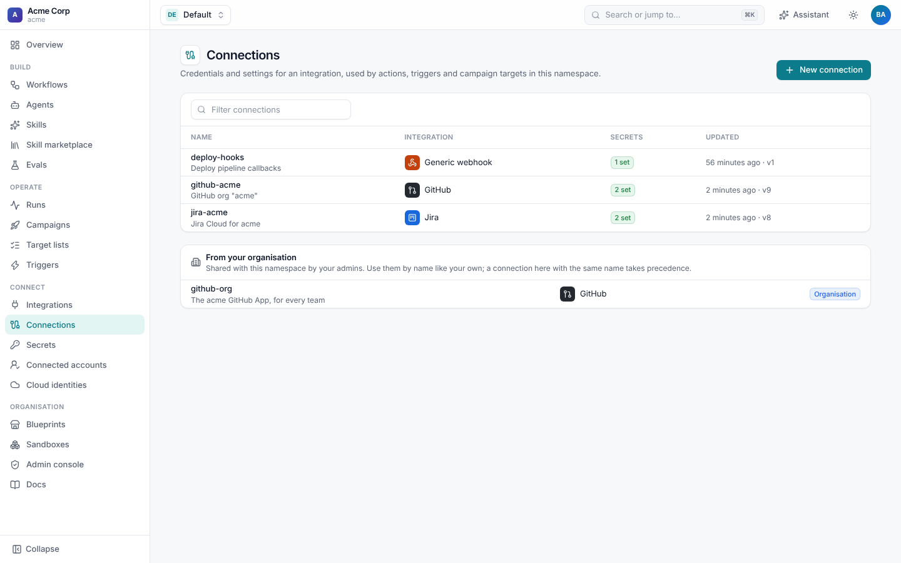
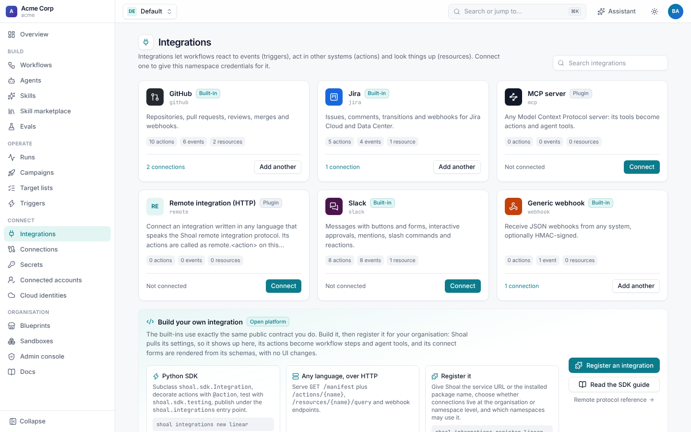
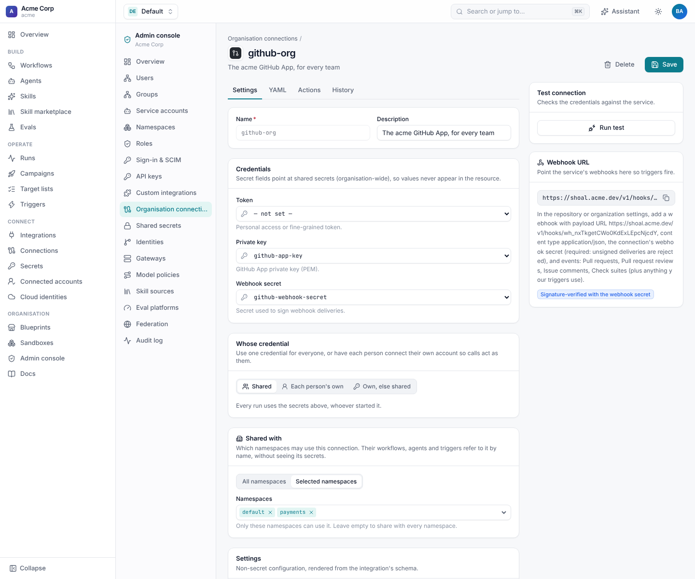
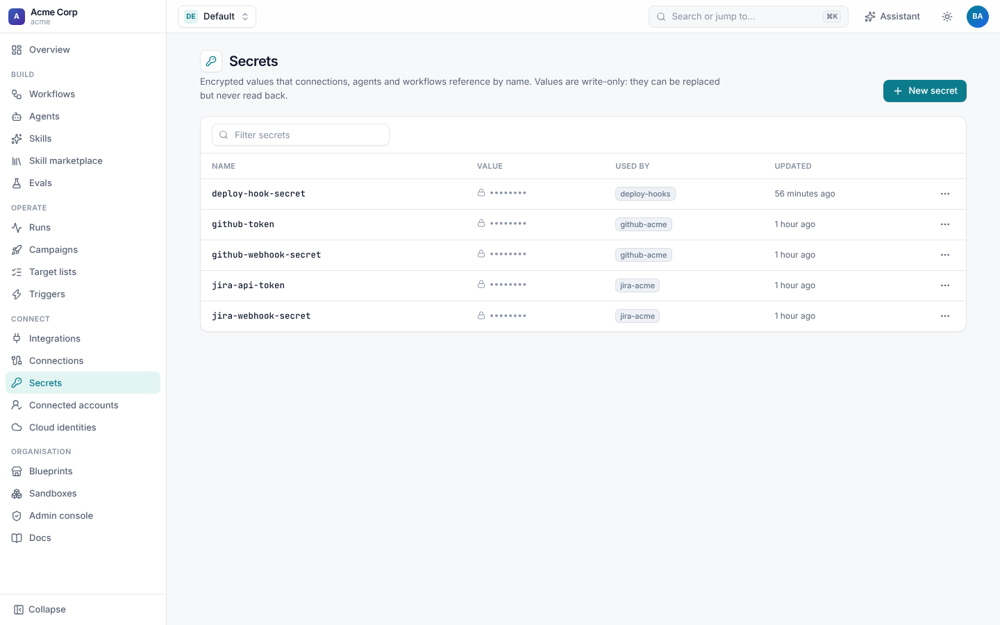

# Connections and secrets

A **connection** is a configured instance of an integration: which GitHub organisation, which Jira site, which Slack
workspace, and the credential Shoal uses to reach it. Workflows, agents and triggers refer to connections by name, never
to raw credentials. A **secret** holds a credential's value. Secrets are write-only, resolved at the moment a call needs
them, and redacted from run events and logs.



## Integrations and connections

**Connect › Integrations** lists every integration the namespace can connect: the built-in ones (GitHub, Jira, Slack,
MCP, ...), any your organisation registered, and remote ones. Each integration's page shows its settings, actions,
resources and events.



To connect one, open it and choose **New connection**, or apply a resource:

```yaml
apiVersion: shoal.dev/v1
kind: Connection
metadata: {name: jira-acme, namespace: payments}
spec:
  integration: jira
  config:                       # non-secret settings
    base_url: https://acme.atlassian.net
    email: shoal@acme.dev
  secrets:                      # connection field -> secret name
    api_token: jira-api-token
    webhook_secret: jira-webhook-secret
```

| Field | Meaning |
| --- | --- |
| `integration` | The integration's name: `github`, `jira`, `slack`, `mcp`, or one your organisation registered. |
| `config` | Non-secret settings. The integration's page lists them. |
| `secrets` | Which secret fills each credential field. Values are never written here. |
| `credentials` | Whose credential calls use. See [personal credentials](#personal-credentials). |
| `user_fields`, `oauth` | What each person supplies, and how. |
| `namespaces` | For organisation connections only: which namespaces may use it. |

**Run test** on the connection page (`POST /v1/namespaces/{ns}/connections/{name}/test`) calls the service with the
connection's credential and shows the account it signed in as, or the service's error. A connection that receives
events also shows its **webhook URL** and setup instructions there, and in its `status.webhook_url`.

Each integration has its own guide: [GitHub](../github/README.md), [Jira](../jira/README.md),
[Slack](../slack/README.md), MCP servers and remote services in [Building integrations](../integrations.md).

### Choosing a connection in a workflow

A step can name its connection with `connection:`. Without one, Shoal uses the connection that the step's
`connections` map, and then the workflow's, gives for that integration:

```yaml
spec:
  connections: {github: github-acme, jira: jira-acme}
  steps:
    - id: comment
      type: action
      action: jira.add_comment       # uses jira-acme
      with: {key: "{{ inputs.issue_key }}", body: Done}
```

## Organisation and namespace connections

A connection lives at one of two levels:

| Level | Stored in | Set up by | Used by |
| --- | --- | --- | --- |
| **Organisation** | the `shared` namespace | tenant admins, under **Admin console › Organisation connections** | every namespace, or only those in `spec.namespaces` |
| **Namespace** | the team's namespace | the team, under **Connect › Connections** | that namespace only |

Organisation connections let a platform team set up GitHub or Jira once and let teams use it without seeing its
secrets. A namespace connection with the same name wins over an organisation one. Integrations declare which levels they
allow. See [Building integrations](../integrations.md#organisation-and-namespace-connections).



## Secrets

**Connect › Secrets** lists a namespace's secrets by name, with who last set them and when. Values can be set and
replaced, never read back, through the UI, the API or the CLI:

```sh
shoal secrets set jira-api-token                   # prompts, hidden
shoal secrets set gh-token --from-env GITHUB_TOKEN
shoal secrets list
```



Secrets live at four levels:

| Level | Holds | Managed by |
| --- | --- | --- |
| **Deployment** | Shoal's own keys (`SHOAL_SECRET_KEY`, operator LLM keys, federation link secrets), from the environment or a secret backend. | Operators |
| **Tenant** (`shared`) | Gateway keys, organisation connection secrets, OAuth client secrets. Under **Admin console › Shared secrets**. | Tenant admins |
| **Namespace** | A team's connection secrets. | Namespace admins and editors (`secrets:write`) |
| **Personal** | One person's own token or OAuth grant for one connection. | That person. Admins can list and revoke them, never read them. |

A connection's secrets are looked up in its own namespace first and then in `shared`, so a namespace can use a shared
secret without being able to change it.

### Where values are stored

`SHOAL_SECRET_PROVIDERS` lists the secret backends in lookup order (default `db,env`). The first one that can be written
stores new values.

- **`db`** encrypts values in Shoal's database with `SHOAL_SECRET_KEY`. Set your own key in production.
- **`env`** reads `SHOAL_SECRET_<TENANT>__<NAME>`, then `SHOAL_SECRET_<NAME>`. The second form is readable by every
  tenant, so instances that host several organisations set `SHOAL_SECRET_ENV_SHARED=false`. Shoal's own settings
  (`SHOAL_SECRET_KEY`, `SHOAL_SECRET_PROVIDERS`) are never handed out as secrets.
- More backends are plugins in the `shoal.secrets` entry point group. See [Plugins](../plugins.md).

Deleting a namespace deletes its secrets and the personal credentials for its connections. Deleting a user deletes their
personal credentials.

## Personal credentials

By default every call through a connection uses the connection's own credential. A connection can instead act as the
person a run is for, so the other system shows their name and applies their permissions:

```yaml
spec:
  integration: jira
  credentials: per_user_or_shared
  user_fields: [api_token, email]       # what each person supplies (default: the fields in secrets)
  config: {base_url: https://acme.atlassian.net}
  secrets: {api_token: jira-api-token}
```

| `credentials` | Meaning |
| --- | --- |
| `shared` (default) | Every call uses the connection's secrets. |
| `per_user` | Calls use the credential of the person the run acts for. A step that needs it **waits** until they connect it, with a `credential.required` event and a link, and carries on as soon as they do. |
| `per_user_or_shared` | Their own credential when they have one, the connection's otherwise. |

The person a run acts for is its initiator: whoever started it, or the person behind the event that triggered it,
matched through [identities](../administration/access.md#identities). Service accounts and people Shoal can't match never
use personal credentials.

### Connecting with OAuth

Add `oauth` and people connect with a button instead of pasting a token. Shoal runs the authorization-code flow with
PKCE and refreshes the access token before it expires:

```yaml
oauth:
  authorize_url: https://auth.atlassian.com/authorize
  token_url: https://auth.atlassian.com/oauth/token
  client_id: 8Qx...
  client_secret_secret: jira-oauth-client-secret
  scopes: [read:jira-work, write:jira-work, offline_access]
  extra_params: {audience: api.atlassian.com}
```

The callback only saves the grant in the browser that started the flow, or one signed in as the same person, so an
authorize link sent to someone else can't collect their account.

### Connected accounts

Each person manages their own credentials under **Connect › Connected accounts** (`/settings/credentials`): which
connections they have connected, when, and buttons to connect, replace or remove one. From the CLI:

```sh
shoal credentials list
shoal credentials set payments/jira-acme --field api_token
shoal credentials connect payments/jira-acme      # prints the OAuth sign-in URL
shoal credentials remove payments/jira-acme
```

Admins see who connected what with `GET /v1/users/{username}/credentials` and revoke one with `DELETE` on the same path.
Every set, removal and revocation is in the [audit log](../administration/README.md#audit-log). Personal credentials
work the same way for every integration, MCP servers included.

## Cloud identities

To give a step short-lived cloud credentials (AWS IAM roles today), without storing a cloud key anywhere, register a
**cloud identity** and list it in the step's `cloud_identities`. See [Cloud identities](../cloud-identities.md).

## Permissions

| Permission | Allows |
| --- | --- |
| `connections:read` | Viewing connections. |
| `connections:write`, `connections:delete` | Creating, changing and deleting them. |
| `connections:use` | Calling actions and querying resources through them, from runs or the API. |
| `secrets:read` | Listing secret names. Values are never readable. |
| `secrets:write` | Setting and deleting secrets. |
