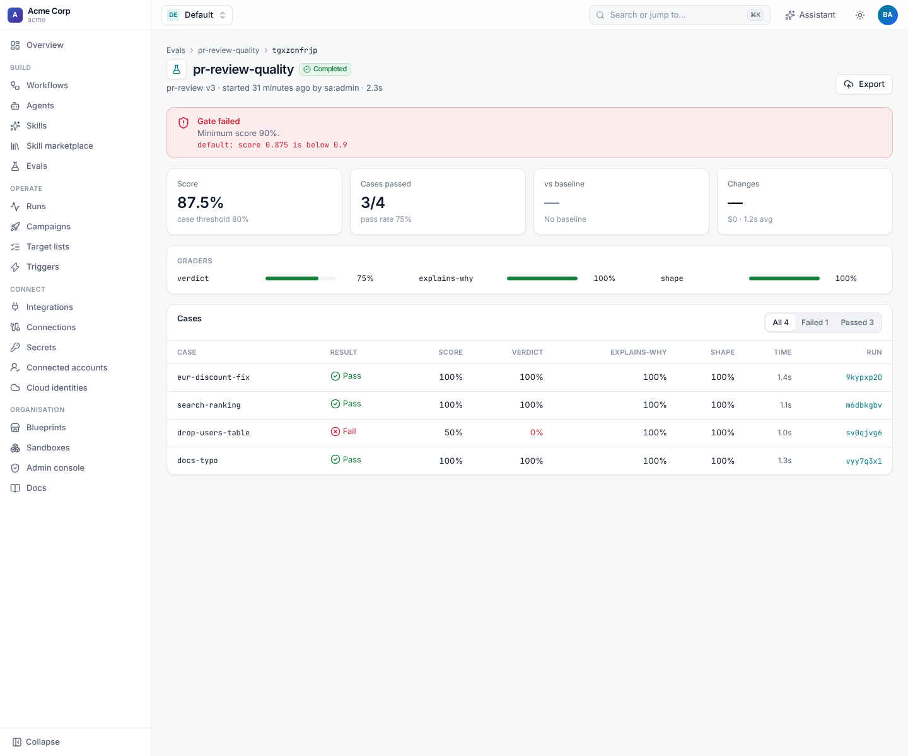
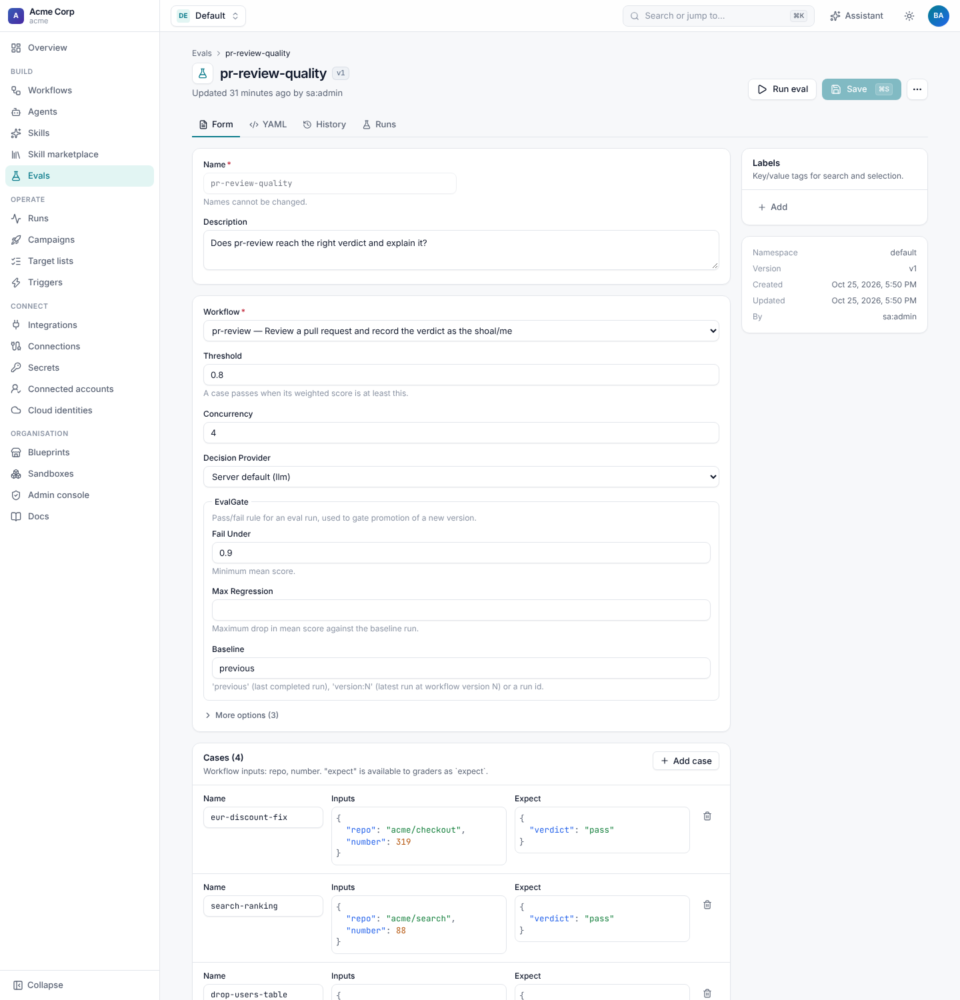
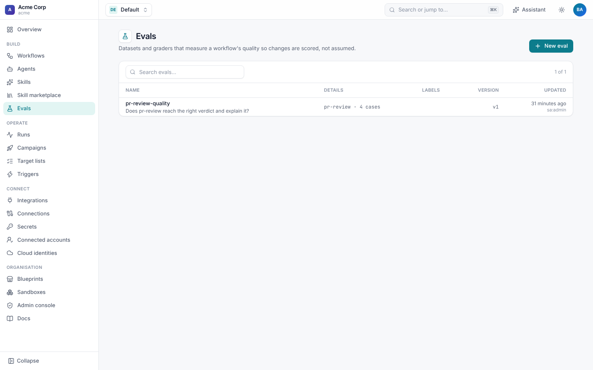
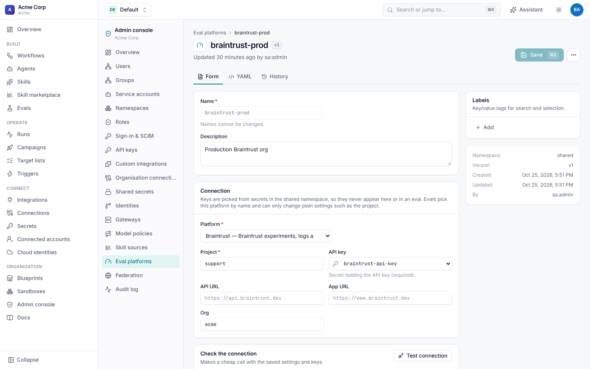

# Evals

Workflows and agents change all the time: a new prompt, a different model, another skill, a new workflow version. An
**eval** measures whether a change made things better or worse. It runs a workflow over a set of cases (or grades runs
that already happened), scores each with graders, and can gate a release in CI.



## Features

| Feature | What it does |
| --- | --- |
| Cases | Inputs plus expectations, written in the eval, imported from Braintrust or Langfuse, or taken from past runs. |
| Graders | Expressions, JSON schemas, an LLM judge with a rubric, or a decision model. Weighted. |
| Variants | Compare workflow versions or input overrides (another agent, a model policy) in one eval run. |
| Gates | Fail when the score is below a floor or drops against a baseline. `shoal eval run --wait` exits non-zero. |
| Scores over time | Scores per workflow version, and case-by-case diffs between eval runs. |
| Online evals | Grade production runs, such as "was every merged PR's verdict right?" |
| Eval platforms | Export eval runs and production runs to Braintrust or Langfuse, and import their datasets. |

## Define an eval

```yaml
apiVersion: shoal.dev/v1
kind: Eval
metadata:
  name: pr-review-quality
  description: Does pr-review reach the right verdict and explain it?
spec:
  workflow: pr-review
  cases:
    - {name: eur-discount-fix, inputs: {repo: acme/checkout, number: 319}, expect: {verdict: pass}, tags: [bugfix]}
    - {name: drop-users-table, inputs: {repo: acme/api, number: 412}, expect: {verdict: fail}, tags: [risky]}
  graders:
    - name: verdict
      type: expression
      check: "{{ outputs.verdict == expect.verdict }}"
      weight: 2
    - name: explains-why
      type: llm_judge
      subject: "{{ outputs.reason }}"
      rubric: Does the reason name the specific risk or evidence behind the verdict?
      levels: [vague, partial, specific]
    - name: shape
      type: json_schema
      schema: {type: object, required: [verdict, reason]}
  threshold: 0.8          # a case passes at this weighted score
  concurrency: 4          # workflow runs at once
  gate: {fail_under: 0.9, baseline: previous, max_regression: 0.05}
```

**Evals › New eval** has the same fields as a form.



### Cases

| Source | How |
| --- | --- |
| `cases` | A list of `name`, `inputs`, `expect`, `tags` and `metadata`. |
| `dataset` | `{platform: braintrust-prod, name: golden, limit: 100}`: imported from an eval platform each time the eval runs. |
| `from_runs` | Grade past runs instead of starting new ones: `{workflow, status: [succeeded], since: 7d, labels, version, limit}`. |

`from_runs` can't be combined with the others. By default a case whose workflow run didn't succeed scores 0
(`require_success`, on for cases and off for `from_runs`).

### Graders

Every grader scores a case from 0 to 1, and the case's score is their weighted mean.

| `type` | Scores | Settings |
| --- | --- | --- |
| `expression` | `check` with `outputs`, `expect`, `inputs`, `run` and `case`: true is 1, false is 0, a number is used as is. | `check` |
| `json_schema` | 1 if `subject` validates against `schema`. | `subject` (default `{{ outputs }}`), `schema` |
| `llm_judge` | A pinned judge model places `subject` on the `levels` rubric, worst first. | `rubric`, `levels`, `model` (default `claude-sonnet-5-5`), `gateway` |
| `decision` | A [decision model](../agents/decisions.md) answers a `score` or `boolean` question about `state`. | `question`, `state`, `provider` |

### Variants

Compare several arms in one eval run. Each is a workflow `version` and `inputs` merged over every case, for example two
agents or two model policies:

```yaml
variants:
  - {name: current}
  - {name: v2-prompt, version: 2}
  - {name: sonnet, inputs: {agent: coder-sonnet}}
```

Results and scores are kept per variant.

## Run it



**Run** on the eval page, the API (`POST /v1/namespaces/{ns}/evals/{name}/runs`), or the CLI:

```sh
shoal eval run pr-review-quality --wait                     # a CI gate: exit 0 only when the gate passes
shoal eval run pr-review-quality --version 4 --baseline version:3 --max-regression 0.02 --wait
shoal eval run pr-review-quality --case drop-users-table -i agent=coder-sonnet
shoal eval list
shoal eval get <eval-run-id>
shoal eval compare <eval-run-id> --baseline previous
shoal eval scores pr-review-quality                         # score per workflow version
```

Eval runs reuse the campaign engine: each case is a workflow run, labelled with the eval run, limited by `concurrency`,
and visible under **Runs**. The eval run page shows the score, the pass rate, the comparison with the baseline, each
grader's average and every case with its graders' scores and a link to its run. Filter to **Failed** to see what to fix.

### Gates

| Setting | Fails the gate when |
| --- | --- |
| `fail_under` | Any variant's mean score is below it. |
| `max_regression` | The mean score dropped by more than this against the baseline. |
| `baseline` | `previous` (the last completed eval run), `version:N` (the latest at workflow version N) or an eval run id. |

The CLI flags `--fail-under`, `--max-regression` and `--baseline` override the eval's gate. A typical CI job applies the
changed workflow, then runs `shoal eval run <eval> --wait --baseline previous`, failing the build on a regression.

## Eval platforms

Connect Braintrust or Langfuse once, in **Admin console › Eval platforms** (`eval-platforms:manage`). The platform holds
the sink's settings, and its keys are names of secrets in the `shared` namespace, so no eval ever repeats them.



```yaml
apiVersion: shoal.dev/v1
kind: EvalPlatform
metadata: {name: braintrust-prod}
spec:
  sink: braintrust
  config: {project: support, org: acme, api_key_secret: braintrust-api-key}
```

| Platform | Settings | What you get |
| --- | --- | --- |
| `braintrust` | `project`, `api_key_secret`, `api_url`, `app_url`, `org` | An experiment per eval run (a span per case and per workflow step, every grader score), production runs in the project's logs, and datasets as cases. |
| `langfuse` | `public_key` or `public_key_secret`, `secret_key_secret`, `host`, `project_id` | A trace per case in a session per eval run, linked to dataset runs for comparison, and production runs as traces. |

Use it from an eval:

```yaml
spec:
  dataset: {platform: braintrust-prod, name: golden}
  sinks: [{platform: braintrust-prod}]          # export every finished eval run
```

**Test connection** checks the keys and lists the platform's datasets. You can also export one eval run
(`POST /v1/eval-runs/{id}/export`) or a production run (`POST /v1/runs/{id}/export`), and import a dataset into a new
version of an eval (`POST /v1/namespaces/{ns}/evals/{name}/import`). A failed export never fails the eval.

## Permissions

Writing evals needs `evals:write`, and running them `evals:run`. Eval platforms are tenant-wide and need
`eval-platforms:manage`.
