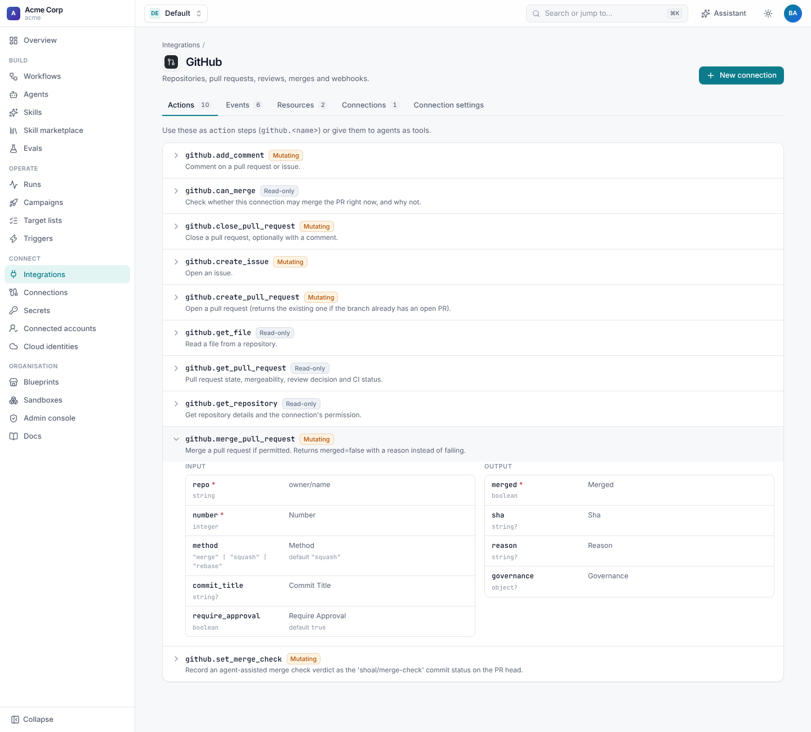
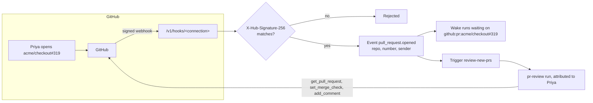
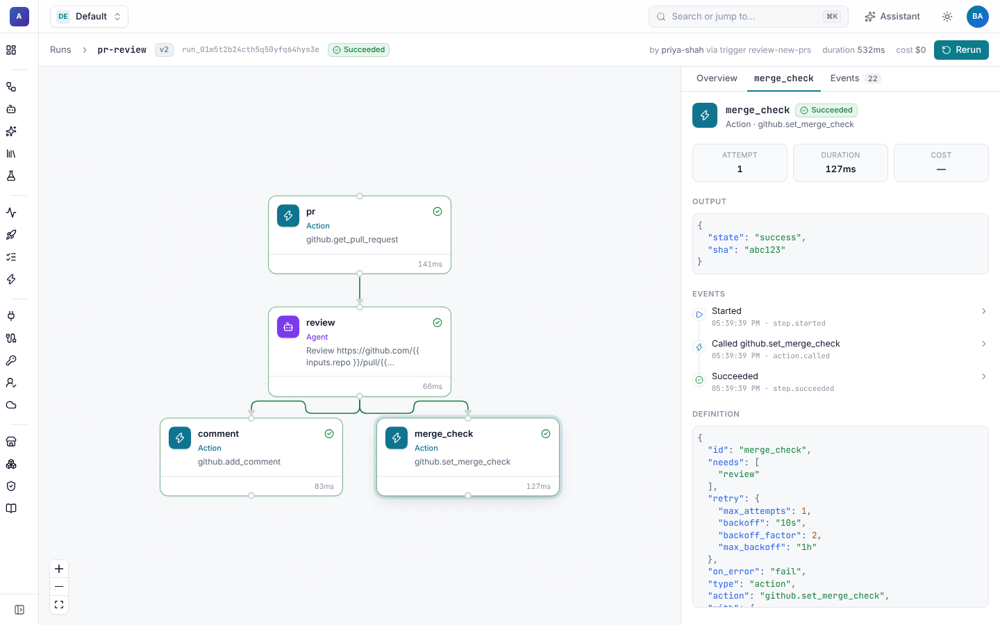

# GitHub

GitHub is built into Shoal. Connect an organization once and your workflows can:

- start when a pull request is opened, reviewed or commented on, an issue is labelled, a branch is pushed or CI
  finishes,
- open pull requests and issues, comment, and read files,
- check whether a pull request may be merged, and merge it when it is approved and green,
- record an agent's review as a `shoal/merge-check` commit status,
- run over every repository in an org, or every open pull request in a repo, as a [campaign](../runs/campaigns.md),
- wait, for days if need be, until a pull request is reviewed, then carry on.

Agents can get a GitHub token in their sandbox, so `git clone`, `git push` and `gh` work without setup. Every pull request
and issue Shoal opens says who asked for it, and merges follow a policy you set: who may merge, on whose rights, and
after which checks.



## Features

| Feature | What it does | Guide |
| --- | --- | --- |
| Connection | A personal access or fine-grained token, or a GitHub App installation. GitHub Enterprise Server too. | [Set up GitHub](setup.md) |
| Webhooks | One signed webhook URL per connection, for repository or organization webhooks. | [Set up GitHub](setup.md#receive-events-from-github) |
| Triggers | Start a workflow on `pull_request.*`, `pull_request_review.submitted`, `issue_comment.created`, `issues.*`, `push`, `check_suite.completed` or any other GitHub event. | [Triggers](triggers.md) |
| Actions | Repositories, pull requests, merges, merge checks, comments, issues and files. | [Reference](reference.md#actions) |
| Repository queries | The `repository` and `pull_request` resources, filtered by org, permission, topic, language or name. | [Reference](reference.md#resources) |
| Waking runs | Events wake runs waiting on `github:pr:<repo>#<n>` or `github:repo:<repo>`. | [Triggers](triggers.md#wait-for-a-review) |
| Agent sandboxes | `GITHUB_TOKEN`, `GH_TOKEN` and a git credential helper, with commits authored as the connection's bot. | [Reference](reference.md#in-agent-sandboxes) |
| Attribution and merge policy | Provenance labels, a `Requested-by` trailer, review requests, acting with the person's own token, and rules for merging on the app's rights. | [Attribution and merging](attribution.md) |

## How it fits together



One **connection** is one credential (a token or an App installation) and one webhook URL. A workflow names the
connection it uses for GitHub in `connections: {github: github-acme}`, and its `github.*` steps use it.

## Five-minute start

1. Create a fine-grained token for the `acme` org with **Contents**, **Pull requests**, **Issues** and **Commit statuses**
   (read and write) and **Metadata** (read), and store it with a webhook secret:

   ```sh
   shoal secrets set github-token                                     # paste the token at the prompt
   shoal secrets set github-webhook-secret --value "$(openssl rand -hex 32)"
   ```

2. **Connections › New connection › GitHub**. Pick the two secrets, save, and press **Run test**.
3. Copy the **Webhook URL** from the connection page. In the org's **Settings › Webhooks › Add webhook**, paste it, set
   the content type to `application/json` and the secret to the same value, and choose **Pull requests**, **Pull request
   reviews**, **Issue comments** and **Check suites**.
4. Apply the uplift journey and launch it over the org:

   ```sh
   shoal apply -f examples/github-uplift/
   shoal campaigns launch coverage-uplift
   ```

   Each repository gets an agent that raises its test coverage and opens a pull request. The run then waits up to a week
   for a review and merges once the pull request is approved.



The same connection in YAML:

```yaml
apiVersion: shoal.dev/v1
kind: Connection
metadata: {name: github-acme}
spec:
  integration: github
  config:
    attribution: {request_initiator_review: true}
  secrets:
    token: github-token
    webhook_secret: github-webhook-secret
```

## Examples

- [`examples/github-uplift/`](../../examples/github-uplift/): a campaign that raises test coverage across an org, one
  pull request per repository, merged once approved.
- [`examples/jira-bugfix/`](../../examples/jira-bugfix/): a Jira ticket becomes a tested pull request.
- [Bundled blueprints](../blueprints/bundled.md): ready-made journeys, including `github-pr-review` and `github-uplift`.

## Pages in this guide

- [Set up GitHub](setup.md): tokens and GitHub Apps, Enterprise Server, webhooks, and people's own accounts.
- [Triggers](triggers.md): events, what the run gets, recipes, and waiting for reviews.
- [Attribution and merging](attribution.md): who a pull request is for, provenance labels, merge rules and merge checks.
- [Reference](reference.md): connection settings, actions, resources, events and sandbox credentials.

For other integrations see [Jira](../jira/README.md), [Slack](../slack/README.md) and
[building your own](../integrations.md).
