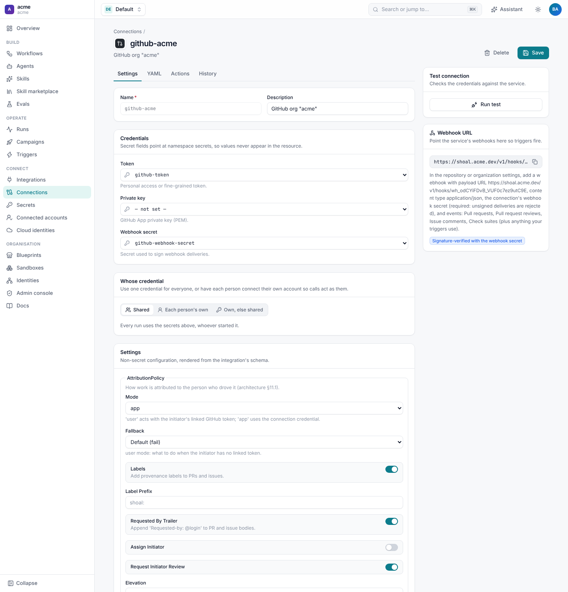

# Set up GitHub

A GitHub connection needs a credential (a token or a GitHub App installation) and, to receive events, a webhook secret.



## Credentials

### A token

The quickest start. Use a **fine-grained personal access token** limited to the org and repositories Shoal works on, from
an account created for automation (a "machine user"), so Shoal's commits and comments are easy to tell apart.

| Permission | Access | Needed for |
| --- | --- | --- |
| Metadata | Read | Everything |
| Contents | Read and write | `get_file`, and agents cloning and pushing branches |
| Pull requests | Read and write | Opening, reading, commenting on and merging pull requests |
| Issues | Read and write | `create_issue`, comments and provenance labels |
| Commit statuses | Read and write | `set_merge_check` and reading CI status |
| Checks | Read | Reading CI status |
| Members, Administration | Read | Only to check collaborators' permissions for the [merge policy](attribution.md#merging-on-whose-rights) |

```yaml
spec:
  integration: github
  secrets:
    token: github-token
    webhook_secret: github-webhook-secret
```

### A GitHub App

Recommended for production: an App's installation tokens are short-lived, its actions show as the App
(`acme-shoal[bot]`), and its rate limits grow with the org.

1. **Org settings › Developer settings › GitHub Apps › New GitHub App**. Give it the permissions in the table above, and
   set its webhook URL and secret later (step 4).
2. Generate a **private key** and store the PEM: `shoal secrets set github-app-key < acme-shoal.private-key.pem`.
3. **Install** the App on the org (all repositories, or the ones Shoal should touch), and note the installation id from
   the URL (`/settings/installations/<id>`).
4. Create the connection:

   ```yaml
   spec:
     integration: github
     config:
       app_id: "123456"
       installation_id: "45678901"
     secrets:
       private_key: github-app-key
       webhook_secret: github-webhook-secret
   ```

Shoal mints installation tokens as needed and caches each one until five minutes before it expires.

### GitHub Enterprise Server

Set `base_url` to the server's API root:

```yaml
config:
  base_url: https://github.acme.internal/api/v3
```

Agents' sandboxes then clone from that host too (`GH_HOST` is set from it).

### Check it

**Run test** on the connection page returns the token's login, or confirms that an installation token could be minted.
The same check is `POST /v1/namespaces/{ns}/connections/{name}/test`.

## Receive events from GitHub

Every connection has its own webhook URL, `https://<shoal>/v1/hooks/<id>`, shown on the connection page with a copy
button and returned by `GET /v1/namespaces/{ns}/connections/{name}/webhook`.

1. In the org's (or one repository's) **Settings › Webhooks › Add webhook**, or in the GitHub App's settings:
   - **Payload URL**: the connection's webhook URL.
   - **Content type**: `application/json`.
   - **Secret**: the value of the connection's `webhook_secret`.
2. Choose the events your triggers and waits use. A good default is **Pull requests**, **Pull request reviews**, **Issue
   comments** and **Check suites**; add **Issues** or **Pushes** if you use them.
3. Save. GitHub sends a `ping`, which Shoal accepts and ignores.

A `webhook_secret` is required. Shoal checks `X-Hub-Signature-256` on every delivery and rejects deliveries that are
unsigned or don't match, so nobody can fire your triggers by posting to the URL. GitHub's **Recent deliveries** tab shows
Shoal's answer for each delivery: the triggers it fired and the runs it woke.

## Each person's own account

By default Shoal calls GitHub with the connection's credential and [attributes](attribution.md) the work to the person
it is for. To have GitHub itself show the person as the author, use their own token. There are two ways.

**Per-person credentials.** People connect their own GitHub account under **Connected accounts**, and calls use it:

```yaml
spec:
  integration: github
  credentials: per_user_or_shared        # or per_user: wait until they connect
  user_fields: [token]
  oauth:                                  # optional: "Connect" with GitHub instead of pasting a token
    authorize_url: https://github.com/login/oauth/authorize
    token_url: https://github.com/login/oauth/access_token
    client_id: Iv1.0123456789abcdef
    client_secret_secret: github-oauth-client-secret
    scopes: [repo]
  secrets: {token: github-token, webhook_secret: github-webhook-secret}
```

See [Connections and secrets](../connections/README.md#personal-credentials).

**Attribution mode `user`.** With `attribution.mode: user`, calls use the token linked to the person's
[identity](#link-github-people-to-shoal) (`github_token_secret`), and `attribution.fallback` says whether to fail or fall
back to the connection's credential when they have none. See [Attribution and merging](attribution.md#acting-as-the-person).

## Link GitHub people to Shoal

Events carry the GitHub login of the sender. Shoal matches it to an **Identity** to know who a run is for, so it can
request their review, check their permission before merging, and @mention them:

```yaml
apiVersion: shoal.dev/v1
kind: Identity
metadata: {name: priya}
spec:
  display_name: Priya Shah
  email: priya@acme.dev
  github: priya-shah
  jira_account_id: 5f2c1e9a8b7d6c0012345678
  actors: ["user:priya@acme.dev"]
```

Manage identities under **Identities** in the sidebar. A run started in Shoal by `priya@acme.dev` and a run triggered by
`priya-shah` on GitHub are then both Priya's.
