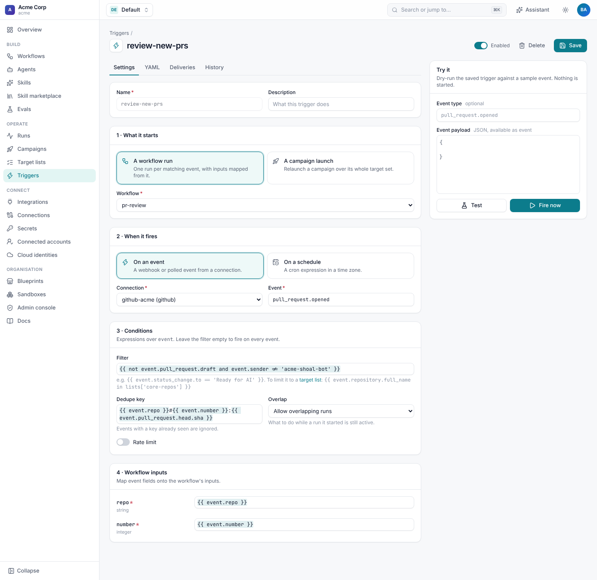
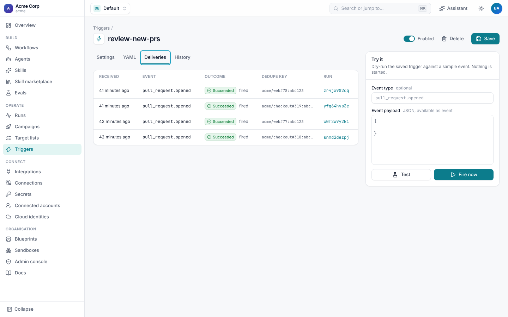

# GitHub triggers

A GitHub trigger starts a workflow when something happens in a repository: a pull request is opened or reviewed,
someone comments a command, an issue is labelled, a branch is pushed or CI finishes. For triggers in general (rate
limits, triage, schedules, the editor) see [Triggers](../runs/triggers.md).



## Events

The event type is GitHub's event name (the `X-GitHub-Event` header) and, when the payload has one, its `action`:
`pull_request.opened`, `pull_request_review.submitted`, `push`. Use a glob to take every action: `pull_request.*`.

| Event | When | Webhook event to tick |
| --- | --- | --- |
| `pull_request.opened`, `.synchronize`, `.closed`, `.labeled`, `.ready_for_review`, … | A pull request changed. On `closed`, `event.pull_request.merged` says whether it was merged. | Pull requests |
| `pull_request_review.submitted` | A review was submitted; `event.review.state` is `approved`, `changes_requested` or `commented`. | Pull request reviews |
| `issue_comment.created` | A comment on an issue or a pull request. | Issue comments |
| `issues.opened`, `.labeled`, `.closed`, … | An issue changed. | Issues |
| `push` | Commits were pushed; `event.ref` is the branch (`refs/heads/main`). | Pushes |
| `check_suite.completed` | CI finished for a commit; `event.check_suite.conclusion` is `success`, `failure`, … | Check suites |

Any other event you subscribe the webhook to (`release.published`, `workflow_run.completed`, `deployment_status`)
arrives the same way.

## What the run gets

Every GitHub event carries GitHub's whole payload plus:

| Field | Example | Meaning |
| --- | --- | --- |
| `event.repo` | `acme/checkout` | The repository's full name. |
| `event.number` | `319` | The pull request or issue number: from `pull_request`, a comment on a pull request, a check suite's pull requests, or the issue. |
| `event.sender` | `priya-shah` | The login of whoever caused the event. |
| `event.event` | `pull_request` | GitHub's event name. |
| `event.received_at` | `2026-10-25T17:39:39Z` | When Shoal received it. |
| `event.pull_request`, `event.review`, `event.comment`, `event.issue`, `event.check_suite`, … | | GitHub's payload, unchanged. |

The run is attributed to the sender. When an [identity](setup.md#link-github-people-to-shoal) has their login, the run
is theirs; otherwise `run.initiator.github` still holds the login, so pull requests can request their review.



## Recipes

**Review every new pull request**

```yaml
event: pull_request.opened
filter: "{{ not event.pull_request.draft and event.sender != 'acme-shoal[bot]' }}"
inputs: {repo: "{{ event.repo }}", number: "{{ event.number }}"}
dedupe_key: "{{ event.repo }}#{{ event.number }}:{{ event.pull_request.head.sha }}"
```

Leave out pull requests Shoal opened, or a review workflow will review its own work. `pull_request.synchronize` with the
same dedupe key reviews each new head commit once.

**A slash command in a comment**

```yaml
event: issue_comment.created
filter: "{{ event.issue.pull_request and event.comment.body.startswith('/shoal fix') }}"
inputs:
  repo: "{{ event.repo }}"
  number: "{{ event.number }}"
  request: "{{ event.comment.body[10:] | trim }}"
rate_limit: {max: 5, per: 1h, key: "{{ event.sender }}"}
```

`event.issue.pull_request` is only set on pull request comments. To let only maintainers use the command, check their
permission in the workflow's first step, or filter on `event.comment.author_association in ['OWNER', 'MEMBER']`.

**An issue gets a label**

```yaml
event: issues.labeled
filter: "{{ event.label.name == 'ai-fix' }}"
dedupe_key: "{{ event.repo }}#{{ event.number }}"
```

**CI failed on the default branch**

```yaml
event: check_suite.completed
filter: "{{ event.check_suite.conclusion == 'failure' and event.check_suite.head_branch == event.repository.default_branch }}"
overlap: skip
```

**A release is published**

```yaml
event: release.published
filter: "{{ not event.release.prerelease }}"
inputs: {repo: "{{ event.repo }}", tag: "{{ event.release.tag_name }}"}
```

## Duplicates and retries

GitHub redelivers on a timeout, and you can redeliver by hand. A `dedupe_key` keeps that from starting a second run;
key it on what makes the work unique (the pull request, the head commit, the comment id). `overlap: skip` keeps one run
per trigger at a time.

## Wait for a review

Every event about a pull request wakes runs waiting on `github:pr:<owner>/<repo>#<number>`, and every event in a
repository wakes runs waiting on `github:repo:<owner>/<repo>`. A run can open a pull request and wait days for a decision
without holding a worker:

```yaml
- id: await_review
  type: wait
  condition:
    action: github.get_pull_request
    with: {repo: "{{ inputs.repo }}", number: "{{ steps.open_pr.output.number }}"}
    check: "{{ result.review_decision == 'approved' or result.state != 'open' }}"
    poll_interval: 30m
    wake_on: ["github:pr:{{ inputs.repo }}#{{ steps.open_pr.output.number }}"]
  max_wait: 7d
  on_timeout: continue
```

The condition is checked every 30 minutes, and straight away whenever a review, comment or push arrives for that pull
request. To act on the event itself instead, take it as a signal:

```yaml
- id: review
  type: wait
  signal:
    event: "github:pr:{{ inputs.repo }}#{{ steps.open_pr.output.number }}"
    match: "{{ signal.type == 'pull_request_review.submitted' and signal.data.review.state == 'changes_requested' }}"
  max_wait: 3d
```

The step's `output.payload` is the event: `type`, `id`, `data` (the fields above) and `actor`. A follow-up agent step
can read `steps.review.output.payload.data.review.body` and address it. Events that arrive while the step is waiting but
don't `match` stay queued on the run; events that arrive while nothing waits on the key are not kept. See
[Signals and waiting](../runs/signals.md#waiting-for-integration-events).
