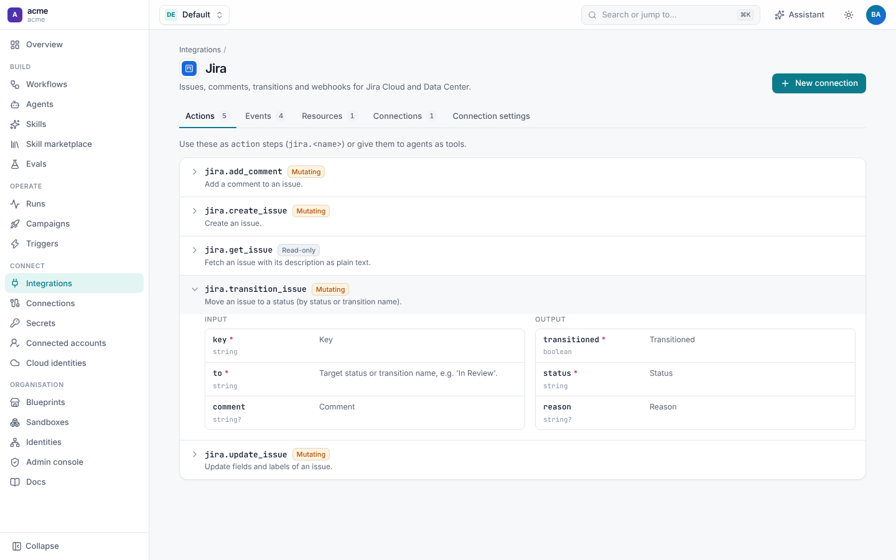
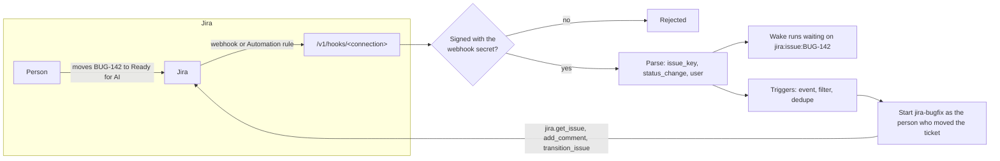
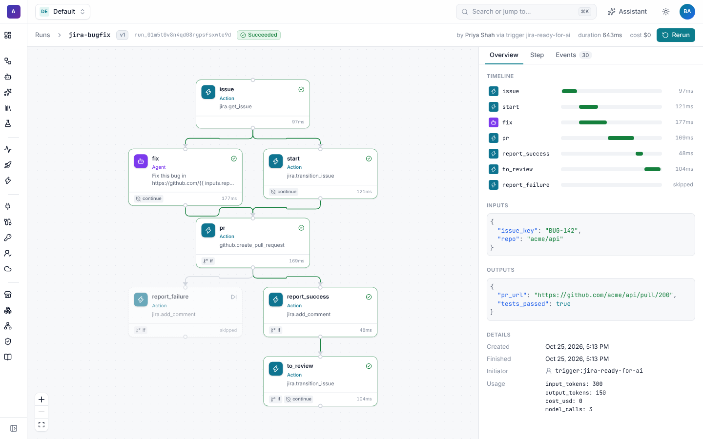

# Jira

Jira is built into Shoal, next to GitHub and Slack. Connect a Jira site once and your workflows can:

- start when an issue is created, updated, moved to a column or commented on,
- read an issue, with its description as plain text and any custom fields you ask for,
- comment, move issues between statuses, update fields and labels, and create issues,
- fan out over every issue a JQL query finds,
- wait, mid-run, until something happens to a particular issue.

It works with **Jira Cloud** (REST API v3, an Atlassian API token) and **Jira Server / Data Center** (REST API v2, a
personal access token). Comments and new issues say who asked for the work, so a ticket shows the person who drove the
automation, not just the bot.



## Features

| Feature | What it does | Guide |
| --- | --- | --- |
| Connection | Cloud with an API token or Data Center with a PAT. Shared, or each person's own credential. | [Set up Jira](setup.md) |
| Webhooks | Jira admin webhooks (signed) or Jira Automation "Send web request" rules, into one URL per connection. | [Set up Jira](setup.md#receive-events-from-jira) |
| Triggers | Start a workflow on `issue_updated`, `issue_created`, `comment_created` or an Automation payload, filtered by status change, project, labels or anything in the payload. | [Triggers](triggers.md) |
| Actions | `get_issue`, `add_comment`, `transition_issue`, `update_issue`, `create_issue`. | [Reference](reference.md#actions) |
| Issue queries | The `issue` resource runs JQL, for campaigns and the API. | [Reference](reference.md#resources) |
| Waking runs | Every event for an issue carries the wake key `jira:issue:<KEY>`, so a waiting run resumes when that issue changes. | [Triggers](triggers.md#wait-for-an-issue-to-change) |
| Attribution | Comments and new issues end with "Requested by: @person", mentioning them when Shoal knows their Jira account. | [Reference](reference.md#attribution) |

## How it fits together



One Shoal **connection** is one Jira site and one credential. The connection holds the site URL and points at secrets for
the token and the webhook secret, so token values never appear in the resource. Each connection has its own webhook URL.

## Five-minute start

1. Create an API token at <https://id.atlassian.com/manage-profile/security/api-tokens> for the account Shoal should act
   as, and store it with a webhook secret:

   ```sh
   shoal secrets set jira-api-token                       # paste the token at the prompt
   shoal secrets set jira-webhook-secret --value "$(openssl rand -hex 32)"
   ```

2. **Connections › New connection › Jira**. Fill in the site URL (`https://acme.atlassian.net`) and the account email,
   pick the two secrets, save, and press **Run test**.
3. Copy the **Webhook URL** from the connection page. In Jira, open **Settings › System › WebHooks › Create a WebHook**,
   paste the URL, set the secret to the same value, and tick **Issue › updated**.
4. Apply the bugfix journey and move a ticket to **Ready for AI**:

   ```sh
   shoal apply -f examples/jira-bugfix/
   ```

   The trigger starts `jira-bugfix`, which reads the ticket, moves it to **In Progress**, has an agent fix the bug, opens
   a pull request, comments the link on the ticket and moves it to **In Review**.



Prefer files? The same connection in YAML:

```yaml
apiVersion: shoal.dev/v1
kind: Connection
metadata: {name: jira-acme}
spec:
  integration: jira
  config:
    base_url: https://acme.atlassian.net
    email: automation@acme.example
  secrets:
    api_token: jira-api-token
    webhook_secret: jira-webhook-secret
```

## Examples

- [`examples/jira-bugfix/`](../../examples/jira-bugfix/): a ticket moved to *Ready for AI* becomes a tested pull request,
  with the link and root cause written back to the ticket.
- [`examples/blueprints/jira-bugfix.yaml`](../../examples/blueprints/jira-bugfix.yaml): the same journey as a blueprint
  any team can adopt with their own connections and column name.

## Pages in this guide

- [Set up Jira](setup.md): Cloud and Data Center credentials, webhooks and Automation rules, per-person credentials.
- [Triggers](triggers.md): events, what the run gets, filters for common cases, and waking waiting runs.
- [Reference](reference.md): connection settings, actions, resources, event fields, attribution and security.

For other integrations see [GitHub](../github/README.md), [Slack](../slack/README.md) and
[building your own](../integrations.md).
