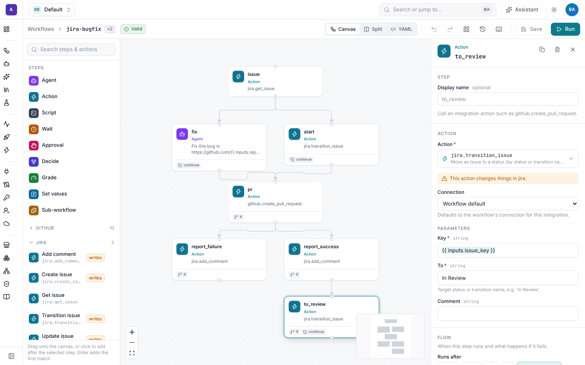
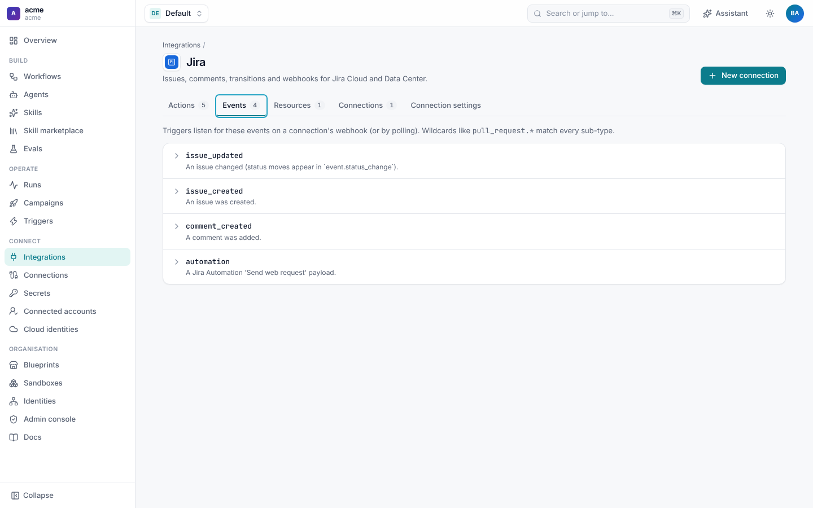

# Jira reference

Everything the Jira integration offers, as listed under **Integrations › Jira**.


## Connection settings

| Setting | Kind | Default | Meaning |
| --- | --- | --- | --- |
| `base_url` | config | | The site, for example `https://acme.atlassian.net`. A trailing `/` is removed. |
| `api_version` | config | `"3"` | `"3"` for Jira Cloud, `"2"` for Server and Data Center. |
| `email` | config | | The Atlassian account email (Cloud, with `api_token`). |
| `api_token` | secret | | An Atlassian API token (Cloud). |
| `personal_access_token` | secret | | A personal access token (Server and Data Center), sent as a bearer token. |
| `webhook_secret` | secret | | Verifies deliveries. See [Security](#security). |
| `requested_by_trailer` | config | `true` | End comments and new issue descriptions with "Requested by: person". |
| `provenance_label` | config | `shoal-automated` | A label added to every issue Shoal creates. Empty for none; no spaces. |

A connection needs either `email` and `api_token`, or `personal_access_token`. Secrets are names of Shoal
[secrets](../connections/README.md), never values. For people's own credentials (`credentials: per_user`) see
[Set up Jira](setup.md#each-persons-own-credential).

## Actions

Call an action from an `action` step, as `jira.<action>`, or give it to an agent as a tool. In the builder, Jira's
actions are in the palette under **Jira** and their inputs appear as a form.



```yaml
- id: start
  type: action
  action: jira.transition_issue
  connection: jira-acme          # optional when the workflow's connections map names one for jira
  with:
    key: "{{ inputs.issue_key }}"
    to: In Progress
    comment: Shoal is working on this. Run {{ run.url }}
```

### `get_issue`

Fetch an issue with its description as plain text. Read-only.

| Input | Type | Meaning |
| --- | --- | --- |
| `key` | string | The issue key, `BUG-142`. |
| `fields` | list | Extra field ids to include, for example `[customfield_10050]`. |

Output: `key`, `id`, `url` (the browse link), `summary`, `description` (Atlassian Document Format converted to text),
`status`, `issue_type`, `priority`, `labels`, `assignee`, `reporter` (display names), `project` (the key), and
`fields` with the extra fields you asked for, as Jira returned them.

### `add_comment`

| Input | Type | Meaning |
| --- | --- | --- |
| `key` | string | The issue key. |
| `body` | string | Plain text with light markdown: paragraphs, `- ` bullets, fenced code blocks and links. |

Output: `id` and `url` (a link straight to the comment). The comment ends with the
[Requested by](#attribution) line.

### `transition_issue`

Move an issue to a status.

| Input | Type | Meaning |
| --- | --- | --- |
| `key` | string | The issue key. |
| `to` | string | A status name (`In Review`) or a transition name (`Send to review`), matched case-insensitively. |
| `comment` | string | Optional. A comment added with the transition. |

Output: `transitioned` (false if the issue was already in that status, with `reason`) and `status`. If no transition from
the current status leads there, the step fails and the error lists the statuses it could move to.

### `update_issue`

| Input | Type | Meaning |
| --- | --- | --- |
| `key` | string | The issue key. |
| `fields` | object | Fields to set, in Jira's format: `{priority: {name: High}, customfield_10050: acme/api}`. |
| `add_labels`, `remove_labels` | list | Labels to add or remove, leaving the others alone. |

Output: `ok` and `key`.

### `create_issue`

| Input | Type | Default | Meaning |
| --- | --- | --- | --- |
| `project` | string | | The project key. |
| `summary` | string | | The title. |
| `description` | string | `""` | Plain text with light markdown. |
| `issue_type` | string | `Task` | `Bug`, `Story`, and so on. |
| `labels` | list | `[]` | Labels; the connection's `provenance_label` is added. |

Output: `ok` and `key`, the new issue's key.

## Resources

Resources are what [campaigns](../runs/campaigns.md) and
`POST /v1/namespaces/{ns}/connections/{name}/resources/{type}/query` page through.

### `issue`

Issues matching a JQL query, keyed by issue key.

| Filter | Default | Meaning |
| --- | --- | --- |
| `jql` | | For example `project = BUG AND status = "Ready for AI"`. |
| `fields` | `summary, status, labels, assignee, issuetype, priority` | The fields Jira returns. |

Each item has the same fields as `get_issue`'s output, without `fields`. A campaign over a JQL query:

```yaml
targets:
  connection: jira-acme
  resource: issue
  filter: {jql: "project = BUG AND labels = ai-fix AND status = 'To Do'"}
  key: "{{ target.key }}"
inputs:
  issue_key: "{{ target.key }}"
```

## Events

| Event | Fields | Wake key |
| --- | --- | --- |
| `issue_updated`, `issue_created`, `comment_created`, and other Jira webhook events | Jira's payload plus `issue_key`, `status`, `status_change`, `summary`, `project`, `labels`, `user` | `jira:issue:<KEY>` |
| `automation` | The rule's body plus the same fields, where the body has them | `jira:issue:<KEY>`, when there is a key |

The person who caused the event (`accountId`, email, display name) is matched to an [identity](setup.md#link-jira-people-to-shoal)
and becomes the run's initiator. See [Triggers](triggers.md) for the fields and recipes.



## Attribution

Shoal often acts through one shared Jira account, so a comment alone would only say "Shoal Automation". To show who
asked for the work:

- **Requested by.** `add_comment`, a `transition_issue` comment, and `create_issue` descriptions end with
  "Requested by: Priya Shah". On Jira Cloud, when Shoal knows the person's Jira account (from the event, or their
  identity's `jira_account_id`), it is an @mention, so they're notified. On Data Center it is plain text. Turn it off with
  `requested_by_trailer: false`.
- **Provenance label.** Every issue Shoal creates gets the `shoal-automated` label (or the connection's
  `provenance_label`), so JQL like `labels = shoal-automated` finds them.
- **Acting as the person.** With `credentials: per_user`, Jira itself shows the person as the author, under their
  permissions.

The person is the run's initiator: whoever started it, or the person behind the event that triggered it. See
[GitHub attribution](../github/attribution.md) for the same idea on pull requests.

## Security

| Delivery | How it is checked |
| --- | --- |
| Jira admin webhook | `X-Hub-Signature: sha256=<HMAC-SHA256 of the body>` with `webhook_secret`. |
| Automation rule | The `X-Shoal-Token` header equal to `webhook_secret`, or `?token=<secret>` on the URL. |
| No `webhook_secret` | Accepted unsigned. Always set one on a connection that receives events. |

Comparisons are constant-time, and a delivery that fails them is rejected (422, `webhook signature verification failed`) before any trigger sees it. Each
connection has its own webhook URL, so rotating one connection's secret doesn't affect others. Calls to Jira use only
the connection's credential (or the person's own), with the permissions of that Jira account; give the shared account
only the projects and permissions your workflows need.

## API

| Call | What it does |
| --- | --- |
| `POST /v1/namespaces/{ns}/connections/{name}/test` | Calls `/myself` and returns the account name. |
| `GET /v1/namespaces/{ns}/connections/{name}/webhook` | The webhook URL and setup instructions. |
| `POST /v1/hooks/{id}` | Where Jira delivers events. |
| `GET /v1/integrations/jira` | This integration's settings, actions, resources and events. |
