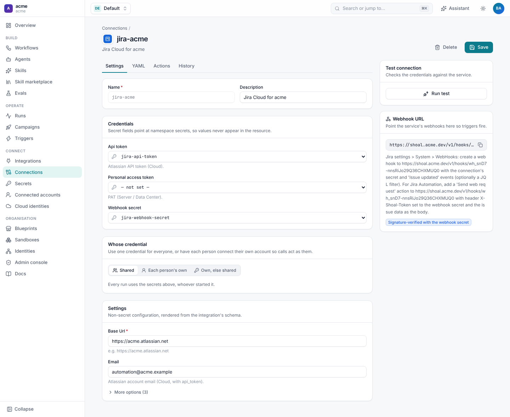

# Set up Jira

A Jira connection needs a site URL, a credential for calling Jira, and (to receive events) a webhook secret.



## Credentials

### Jira Cloud

Jira Cloud uses an Atlassian account email and an API token, sent as HTTP basic auth to REST API v3.

1. Sign in as the account Shoal should act as. A dedicated automation account keeps Shoal's changes easy to spot and
   its permissions easy to limit. It needs **Browse projects**, **Add comments**, **Transition issues**, **Edit issues**
   and **Create issues** in the projects your workflows touch.
2. Create a token at <https://id.atlassian.com/manage-profile/security/api-tokens>.
3. Store it: `shoal secrets set jira-api-token`, or **Secrets › New secret** in the UI.
4. On the connection, set `base_url` (`https://acme.atlassian.net`) and `email`, and point `api_token` at the secret.

### Jira Server and Data Center

Data Center uses a personal access token as a bearer token, against REST API v2.

```yaml
spec:
  integration: jira
  config:
    base_url: https://jira.acme.internal
    api_version: "2"
  secrets:
    personal_access_token: jira-pat
    webhook_secret: jira-webhook-secret
```

Create the token under your Jira profile's **Personal Access Tokens**. With API v2, comments and descriptions are sent
as wiki text instead of Atlassian Document Format; Shoal converts for you either way.

### Check it

**Run test** on the connection page calls `/myself` and shows the account name, or the error Jira returned. The same
check is `POST /v1/namespaces/{ns}/connections/{name}/test`.

## Receive events from Jira

Every connection has its own webhook URL, `https://<shoal>/v1/hooks/<id>`. The connection page shows it with a copy
button and these instructions, and the API returns it in the connection's `status.webhook_url` and from
`GET /v1/namespaces/{ns}/connections/{name}/webhook`, which `shoal connections webhook-url <name>` prints. Point Jira at it
in one of two ways.

### Option 1: a Jira admin webhook

Needs Jira administrator rights. Best for "any issue in these projects".

1. In Jira, **Settings › System › WebHooks › Create a WebHook**.
2. **URL**: the connection's webhook URL.
3. **Secret**: the value of the connection's `webhook_secret`. Jira signs each delivery with it
   (`X-Hub-Signature: sha256=…`) and Shoal rejects any delivery whose signature doesn't match.
4. **Events**: tick what your triggers use: **Issue › created**, **updated**, and **Comment › created**. Optionally
   narrow it with JQL, for example `project = BUG`.

### Option 2: a Jira Automation rule

Any project admin can do this. Best for one project, or for sending exactly the fields a workflow needs.

1. **Project settings › Automation › Create rule**, with the trigger you want (for example **Issue transitioned** to
   *Ready for AI*).
2. Add the action **Send web request**:
   - **Web request URL**: the connection's webhook URL.
   - **Headers**: `X-Shoal-Token` = the webhook secret. (If you can't set headers, append `?token=<secret>` to the URL
     instead.)
   - **HTTP method**: POST. **Web request body**: *Issue data (Jira format)*, or a custom JSON body.
3. Save and turn the rule on.

A delivery from Jira's issue data has the same fields as a webhook (`issue`, `user`, `changelog`). A custom body without
`webhookEvent` arrives as the `automation` event, with its JSON as the payload, and Shoal still picks up `issue_key` from
`issue.key`, `issue_key` or `key`. See [Triggers](triggers.md#automation-rules).

### Without a secret

If the connection has no `webhook_secret`, Jira deliveries are accepted unsigned, so anyone who learns the URL could fire
your triggers. Always set one for a connection that receives webhooks.

## Each person's own credential

By default every run uses the connection's credential. A connection can instead act as the person the run is for, so
Jira shows their name on comments and transitions and applies their permissions:

```yaml
spec:
  integration: jira
  credentials: per_user_or_shared      # or per_user
  user_fields: [api_token, email]
  config: {base_url: https://acme.atlassian.net}
  secrets: {api_token: jira-api-token, webhook_secret: jira-webhook-secret}
```

| `credentials` | Meaning |
| --- | --- |
| `shared` (default) | Every run uses the connection's secrets. |
| `per_user` | Calls use the credential of the person the run acts for. A step that needs it waits until they connect. |
| `per_user_or_shared` | Their own when they have connected one, the connection's otherwise. |

People add their own token under **Connected accounts**. See
[Connections and secrets](../connections/README.md#personal-credentials).

## Link Jira people to Shoal

Events carry the Jira user (`accountId`, display name and, where Jira shares it, email). Shoal matches them to an
**Identity** to know who the run is for:

```yaml
apiVersion: shoal.dev/v1
kind: Identity
metadata: {name: priya}
spec:
  display_name: Priya Shah
  email: priya@acme.dev
  jira_account_id: 5f2c1e9a8b7d6c0012345678
  github: priya-shah
  actors: ["user:priya@acme.dev"]
```

With that in place, a run started by Priya moving a ticket is attributed to Priya. Its GitHub pull request requests her
review, and its Jira comments mention her. Manage identities under **Admin console › Identities**
(`identities:write`). See [Attribution](../github/attribution.md).
