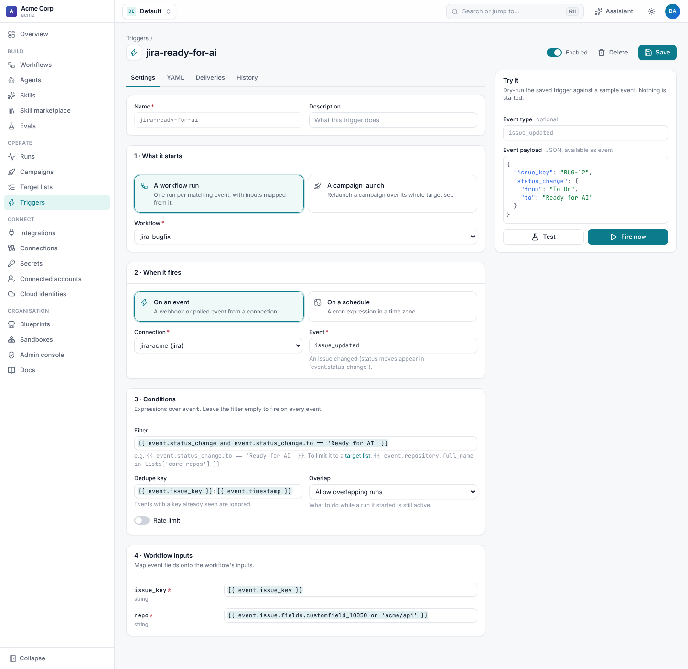
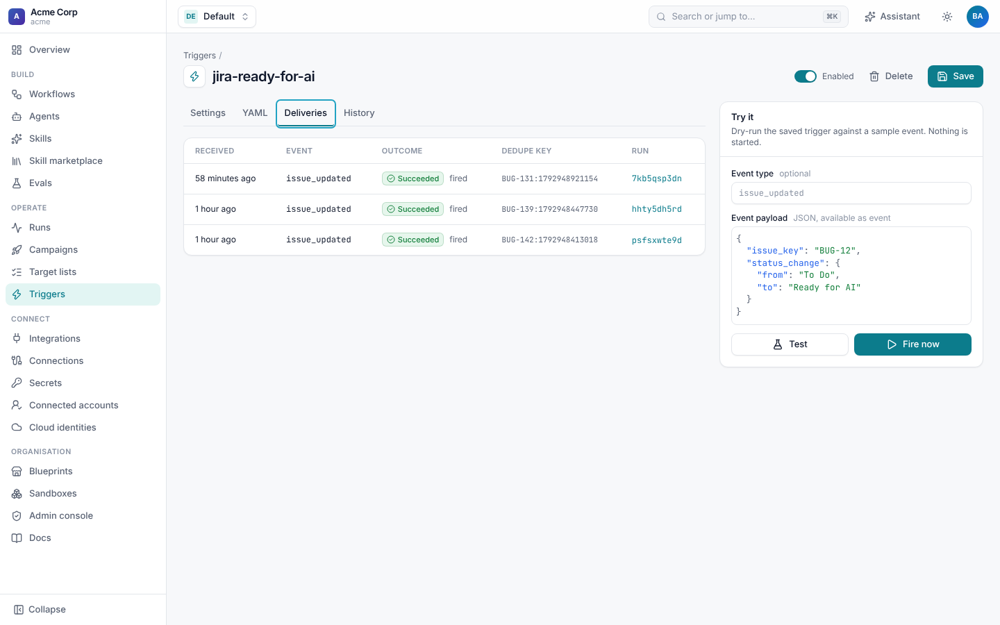

# Jira triggers

A Jira trigger starts a workflow when something happens to an issue: it is created, edited, moved to another column or
commented on, or a Jira Automation rule sends it. This page covers the events, what a run gets from them, and filters for
common cases. For triggers in general (rate limits, triage, schedules, the editor) see [Triggers](../runs/triggers.md).



## Events

| Event | When | Jira setting |
| --- | --- | --- |
| `issue_updated` | Any change to an issue: a field, the assignee, labels, or a status move. | Webhook: **Issue › updated** |
| `issue_created` | A new issue. | Webhook: **Issue › created** |
| `comment_created` | A new comment on an issue. | Webhook: **Comment › created** |
| `automation` | A Jira Automation **Send web request** whose body has no `webhookEvent`. | Automation rule |

The event type is Jira's `webhookEvent` without the `jira:` prefix, so other Jira webhook events (for example
`comment_updated` or `worklog_created`) arrive under their own names too, and a trigger can name them or use a glob such
as `comment_*`.

## What the run gets

Every Jira event carries Jira's whole payload plus these fields, worked out for you:

| Field | Example | From |
| --- | --- | --- |
| `event.issue_key` | `BUG-142` | `issue.key`, or a top-level `issue_key` or `key` in an Automation body |
| `event.status` | `Ready for AI` | the issue's current status |
| `event.status_change` | `{from: To Do, to: Ready for AI}` | the changelog, when the status moved; otherwise empty |
| `event.summary` | `Checkout fails for EUR carts` | the issue summary |
| `event.project` | `BUG` | the project key |
| `event.labels` | `[checkout, customer]` | the issue labels |
| `event.user` | `Priya Shah` | the display name of the person who made the change |
| `event.issue`, `event.changelog`, `event.comment`, `event.timestamp` | | Jira's payload, unchanged |

Custom fields are under `event.issue.fields`, for example `event.issue.fields.customfield_10050`. Jira includes every
field in a webhook payload; an Automation rule sends what its body says.

The run is attributed to the person who made the change. Shoal looks up their Jira account id (or email) in your
[identities](setup.md#link-jira-people-to-shoal), so `run.initiator` names them, and the pull requests and comments the
run creates say it was for them.

## Recipes

Each recipe is the `event` and `filter` of a trigger. Filters are expressions over `event` and must be true for the
trigger to fire.

**An issue moves to a column**

```yaml
event: issue_updated
filter: "{{ event.status_change and event.status_change.to == 'Ready for AI' }}"
```

`status_change` is only set when the status changed, so edits to other fields don't fire it.

**A label is added**

```yaml
event: issue_updated
filter: "{{ 'ai-fix' in event.labels }}"
dedupe_key: "{{ event.issue_key }}"   # fire once per issue, not on every later edit
```

**New bugs in one project**

```yaml
event: issue_created
filter: "{{ event.project == 'BUG' and event.issue.fields.issuetype.name == 'Bug' }}"
```

**A command in a comment**

```yaml
event: comment_created
filter: "{{ event.comment.body is string and event.comment.body.startswith('/shoal retry') }}"
```

On Jira Cloud a comment body in a webhook is plain text; through the REST API it is a document, so check the type as above
when a payload may be either.

**Skip changes Shoal made**

Shoal's own comments and transitions come back as webhooks too. When Shoal acts as a dedicated account, ignore it:

```yaml
filter: "{{ event.user != 'Shoal Automation' and event.status_change and event.status_change.to == 'Ready for AI' }}"
```



## Duplicates and retries

Jira retries a webhook it thinks failed, and one change can reach Shoal through both an admin webhook and an Automation
rule. Give the trigger a `dedupe_key`, and a second delivery with the same key is ignored:

```yaml
dedupe_key: "{{ event.issue_key }}:{{ event.timestamp }}"   # one run per change
# dedupe_key: "{{ event.issue_key }}"                       # at most one run per issue, ever
```

To allow one run per issue at a time instead, set `overlap: skip`, which skips the event while a run this trigger started
is still active. `rate_limit: {max: 3, per: 1h, key: "{{ event.issue_key }}"}` caps how often a single issue can fire it.

## Automation rules

A Jira Automation **Send web request** can post either Jira's issue data or your own JSON. With **Issue data (Jira
format)** you get the same fields as a webhook. With a custom body, the event type is `automation` and the body is the
payload, so you choose the fields:

```json
{
  "issue_key": "{{issue.key}}",
  "repo": "{{issue.customfield_10050}}",
  "requested_by": "{{initiator.accountId}}"
}
```

```yaml
event: automation
filter: "{{ event.issue_key }}"
inputs:
  issue_key: "{{ event.issue_key }}"
  repo: "{{ event.repo or 'acme/api' }}"
```

`event.issue_key` is still filled from `issue_key` or `key`, so the event wakes runs waiting on that issue too. A custom
body has no `user`, so the run is attributed to the trigger's last editor, not the person in Jira; send Jira's issue data
when attribution matters.

## Wait for an issue to change

Every Jira event wakes runs waiting on the wake key `jira:issue:<KEY>`. A workflow can stop until something happens to
its ticket, without holding a worker:

```yaml
# Take the next event for this issue that matches; the step's output.payload is the event.
- id: feedback
  type: wait
  signal:
    event: "jira:issue:{{ inputs.issue_key }}"
    match: "{{ signal.data.status_change and signal.data.status_change.to == 'Done' }}"
  max_wait: 14d
```

The payload is the event as `type`, `id`, `data` (the fields above) and `actor`, and `match` keeps waiting through
events that don't satisfy it. Alternatively, a `condition` wait re-reads the issue on a
schedule, and the wake key makes it check straight away when the issue changes:

```yaml
- id: approved
  type: wait
  condition:
    action: jira.get_issue
    with: {key: "{{ inputs.issue_key }}"}
    check: "{{ result.status == 'Approved' }}"
    poll_interval: 1h
    wake_on: ["jira:issue:{{ inputs.issue_key }}"]
  max_wait: 7d
```

See [Signals and waiting](../runs/signals.md#waiting-for-integration-events).
