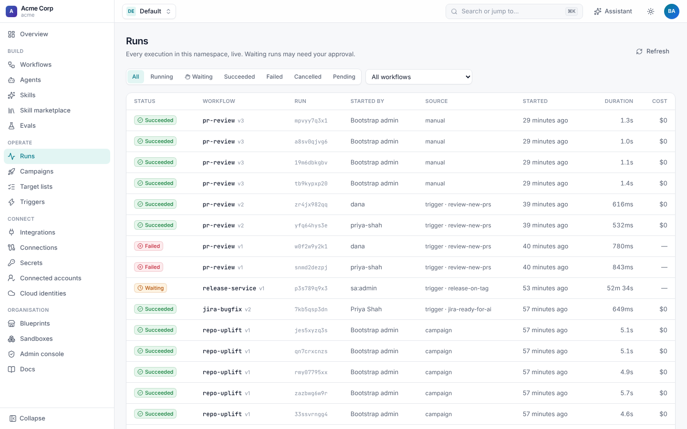
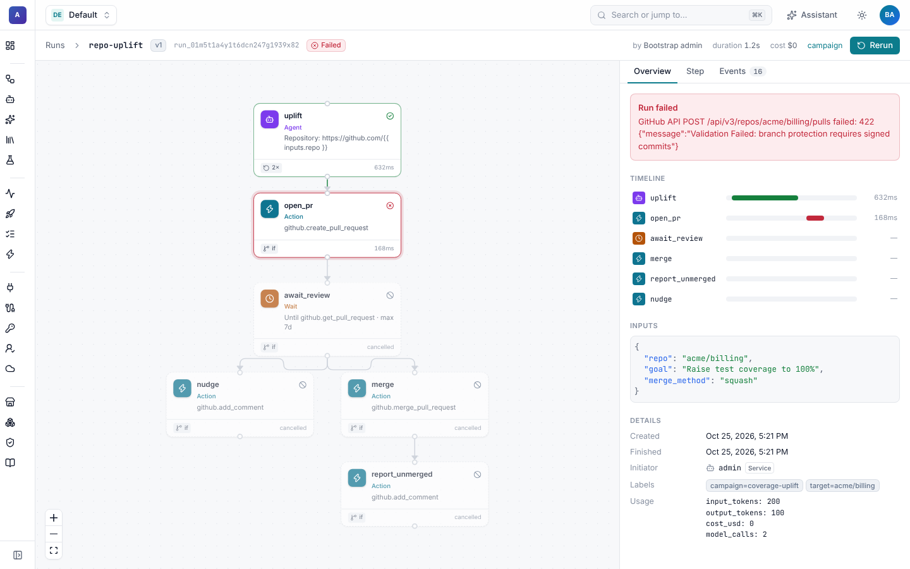
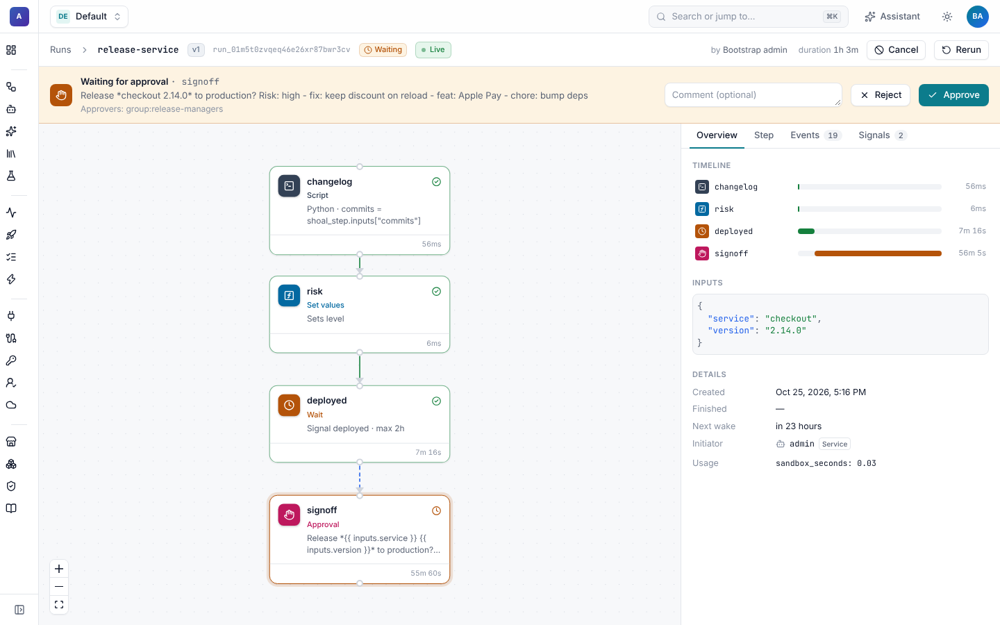

# Runs

Every execution of a workflow is a **run**. Runs are durable: they survive restarts and deploys, and a run can wait for
days for a review, a timer, an approval or another system, without holding a worker. Runs start by hand, from
[triggers](triggers.md) (webhooks and schedules) and from [campaigns](campaigns.md), and people steer them with
[approvals](approvals.md) and [signals](signals.md).


## Features

| Feature | What it does | Guide |
| --- | --- | --- |
| Run viewer | The live graph, a timeline, inputs and outputs, each step's output, logs, agent transcript and events. Cancel and rerun. | [Below](#the-run-viewer) |
| Approvals | A step that waits for a person to approve or reject, in the UI, the CLI, the API or Slack. | [Approvals](approvals.md) |
| Signals | Send data into a waiting run from the UI, the CLI, the API, a callback URL or an integration event. | [Signals](signals.md) |
| Triggers | Start runs from GitHub, Jira, Slack, generic webhooks and cron schedules, with filters, dedupe and rate limits. | [Triggers](triggers.md) |
| Campaigns | Fan one workflow out over many targets (every repository in an org) with concurrency, budgets and progress. | [Campaigns](campaigns.md) |

## Starting a run

| From | How |
| --- | --- |
| The UI | **Run** on a workflow card or in the builder, then fill in the inputs. |
| The CLI | `shoal run jira-bugfix -i issue_key=BUG-142 -i repo=acme/api --follow` (`--wait` waits without streaming; `--version` pins a version; `-l key=value` adds labels). |
| The API | `POST /v1/namespaces/{ns}/workflows/{name}/runs` with `{"inputs": {…}, "version": null, "labels": {}}`. |
| A trigger | An integration event or a schedule. See [Triggers](triggers.md). |
| A campaign | One run per target. See [Campaigns](campaigns.md). |
| A parent run | A `workflow` step. See [the step reference](../workflows/steps.md#workflow). |
| The assistant | "Run hello with name Dana." See [the assistant](../assistant/README.md). |

Starting a run needs `runs:create` in the namespace. Every run records who started it (`started_by`) and, separately,
the person it acts for (the **initiator**): the person who clicked Run, the Jira user who moved the ticket, or the
GitHub user who opened the PR. Integrations use the initiator to [attribute work](../github/attribution.md) to that
person.

## States

```
run:   pending → running → (waiting ↔ running)* → succeeded | failed | cancelled
step:  pending → running → waiting? → succeeded | failed | skipped | cancelled
```

A step is **skipped** when its `if` is false. A run is **waiting** when every step that could run is parked: on a
`wait`, an approval, a sub-workflow, a retry backoff or a credential someone still has to connect. While a run waits,
its run-scoped sandbox is suspended where the backend supports it.

## The runs list

**Runs** lists every run in the namespace, newest first, and refreshes every few seconds. Filter by status (**Waiting**
shows everything that needs a person) and by workflow. Each row shows the workflow and version, who started it and
where from (manual, trigger, campaign, schedule), when, how long it took and what it cost.



The namespace **Overview** has the same information as charts, with a **Needs attention** list of runs waiting on
someone.

## The run viewer

Open a run from **Runs**, a workflow, a campaign target or a link in Slack, Jira or GitHub. The header shows the status,
workflow and version, who started it and through what, the duration and the cost, with **Cancel** while it runs and
**Rerun** after.

- **Graph**: the workflow coloured by step status. Running steps pulse, edges into them are animated, and each card
  shows its duration, retries (`2×`) and whether it was skipped.
- **Overview tab**: a timeline of every step, the run's inputs and outputs, and details: created, finished, next wake,
  initiator, labels and usage (tokens, model calls, sandbox seconds, cost).
- **Step tab**: click a step to see its attempt, duration, cost, output, error, logs (for scripts), the definition it
  ran with, and its events.
- **Events tab**: every event in order, such as `run.started`, `step.started`, `action.called`, `wait.polled`,
  `approval.requested` and `step.succeeded`, with its data.

Updates are live. The viewer subscribes to `GET /v1/runs/{id}/events` with `Accept: text/event-stream`, and if the
connection drops it reconnects and carries on from the last event it saw (`Last-Event-ID`), so nothing is missed. The
badge next to the status says whether it is **Live**, **Reconnecting** or refreshing.

### Agent steps

An agent step's tab shows its transcript: each model turn with its text and tool calls (expand one to see the input),
followed by each tool result, and the tokens used per turn.


### When a run fails

A failed run shows the error at the top of the Overview tab and marks the step that failed. Steps that never ran are
marked cancelled. Ask the [assistant](../assistant/README.md) "why did this run fail?" from the same page; it reads the
run's events and explains.



### While a run waits

When the run waits on a person or a system, a banner across the top says what for and lets you act, if you have the
permission:

- an [approval](approvals.md) shows the message, the approvers, an optional comment and **Approve** / **Reject**;
- a [signal](signals.md) wait shows a JSON payload box and **Send signal**;
- a step waiting for a [personal credential](../connections/README.md#personal-credentials) asks you to connect your account.



## Cancel and rerun

**Cancel** (`shoal cancel <run>`, `POST /v1/runs/{id}/cancel`, permission `runs:cancel`) asks the executor to stop the
run. Running steps are cancelled at their next checkpoint.

**Rerun** (`shoal rerun <run>`, `POST /v1/runs/{id}/rerun`, permission `runs:create`) starts a new run of the same
workflow version with the same inputs and the same trigger, event and target context, so expressions resolve as they
did the first time. The new run is labelled `rerun_of: <id>`.

## From the CLI

```sh
shoal get runs --status waiting --workflow jira-bugfix
shoal logs <run> --follow                # stream events until the run finishes
shoal logs <run> --step fix -o json      # one step's events
shoal approve <run> -m "Looks good"      # or --reject
shoal signal <run> deployed -d '{"env": "staging"}'
shoal cancel <run>
shoal rerun <run> --wait
```

## Durability

Runs are a state machine in the database. The executor checkpoints every step's result before moving on, and handlers
are idempotent by `(run, step, attempt)`, a key that is also passed to integrations. A step that waits releases its
worker; a timer or an event subscription brings the run back. If a worker dies mid-step, its lease expires and another
worker resumes the run from the last checkpoint. See [Operations](../operations/README.md) for scaling workers, and
[Temporal](../temporal.md) to drive runs with a Temporal cluster instead.

## Pages in this guide

- [Approvals](approvals.md): approval steps, approvers, comments, timeouts and deciding from anywhere.
- [Signals](signals.md): sending data into waiting runs.
- [Triggers](triggers.md): webhook, event and schedule triggers.
- [Campaigns](campaigns.md): one workflow over many targets.
