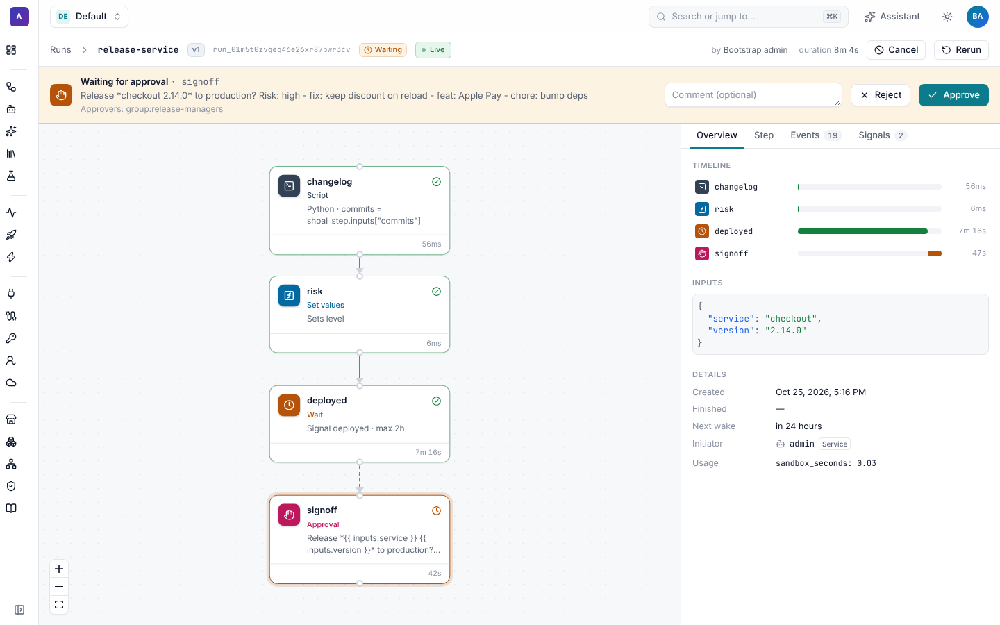
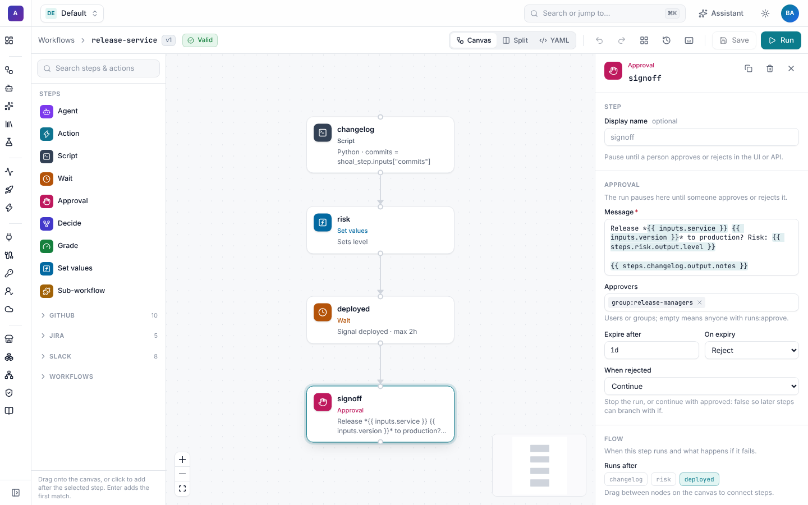
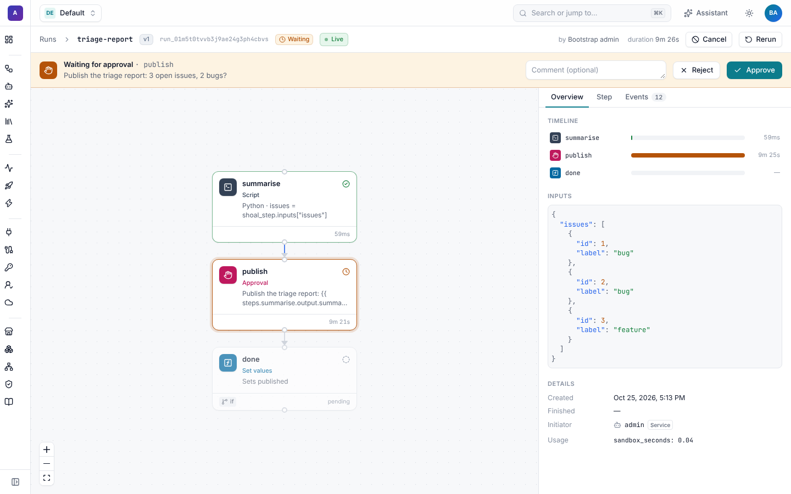

# Approvals

An `approval` step pauses a run until a person approves or rejects it. The run waits durably, for minutes or weeks,
without holding a worker. People decide in the run viewer, from the CLI, through the API, or from buttons in
[Slack](../slack/approvals.md).



## Add an approval

```yaml
- id: signoff
  type: approval
  message: |
    Release *{{ inputs.service }} {{ inputs.version }}* to production? Risk: {{ steps.risk.output.level }}

    {{ steps.changelog.output.notes }}
  approvers: ["group:release-managers"]
  max_wait: 1d
  on_timeout: reject
  on_reject: continue
```

| Field | Meaning |
| --- | --- |
| `message` | What the person is asked. Expressions are rendered once, when the step starts. |
| `approvers` | Who may decide, on top of needing `runs:approve`: usernames, emails, identity names or `group:<name>`. Empty means anyone with `runs:approve` in the namespace. |
| `max_wait` | How long to wait. Without it, the step waits until someone decides or the run is cancelled. |
| `on_timeout` | `reject` (default) or `approve` when `max_wait` passes. |
| `on_reject` | `fail` (default) ends the run with "rejected by …". `continue` succeeds with `approved: false`, so later steps can branch on it. |
| `notify` | Also ask through an integration, for example a Slack channel or a person's DMs. See [Approvals in Slack](../slack/approvals.md). |

The output is `approved`, `by` (who decided), `comment` and `timed_out`:

```yaml
- id: ship
  type: action
  if: "{{ steps.signoff.output.approved }}"
  action: slack.post_message
  with: {channel: "#releases", text: "{{ inputs.service }} {{ inputs.version }} approved by {{ steps.signoff.output.by }}"}
```

In the builder, the approval form holds the message, approvers, wait and outcome settings.



## Decide

### In the run viewer

While the step waits, the run viewer shows a banner with the message, the approvers and the deadline, an optional
comment, and **Approve** / **Reject**. People who can't decide see the banner without buttons, and a note that they
don't have permission. Runs waiting for approval are listed under **Runs › Waiting** and in **Needs attention** on the
namespace overview.



### From the CLI

```sh
shoal approve <run> -m "Looks good"            # the run's only waiting approval
shoal approve <run> signoff --reject -m "Not on a Friday"
```

### Through the API

```sh
curl -X POST "$SHOAL_URL/v1/runs/$RUN_ID/steps/signoff/approval" \
  -H "Authorization: Bearer $SHOAL_API_KEY" -H "Content-Type: application/json" \
  -d '{"approved": true, "comment": "Looks good"}'
```

### From Slack

Add `notify:` and the approval is also posted with buttons. Whoever clicks is matched to their Shoal user and checked
exactly like the UI. See [Approvals in Slack](../slack/approvals.md).

## Who can decide

A decision is accepted only when all of these hold:

1. The person has `runs:approve` in the run's namespace (built-in roles `operator`, `editor`, `namespace-admin` and `tenant-admin`; see
   [Access](../admin/access.md)).
2. If the step lists `approvers`, they match one entry: their username or email (with or without `user:`), an
   identity they belong to, or a group they are in (`group:<name>`). The system admin token always may.
3. The step is still waiting and nobody has decided it. Two people clicking at once can't both win: the second one is
   told the step was already decided.

Every decision is recorded on the run (`approval.decided`, with who, when and the comment) and in the
[audit log](../admin/README.md#audit-log).

## Low-confidence decisions

A [`decide` step](../agents/decisions.md) with `on_low_confidence: approval` asks a person in the same way when the
decision model is unsure, and the person's review becomes part of the step output.

## Patterns

- **Two-person rule:** two approval steps in a row with different `approvers`.
- **Escalate on silence:** `max_wait: 4h`, `on_timeout: reject`, `on_reject: continue`, then a second approval for a
  wider group `if: "{{ steps.first.output.timed_out }}"`.
- **Approve the merge, not the code:** the [GitHub uplift journey](../../examples/github-uplift/) waits for a PR review
  in GitHub instead, with a `wait` condition, so approval stays where reviewers already work.
