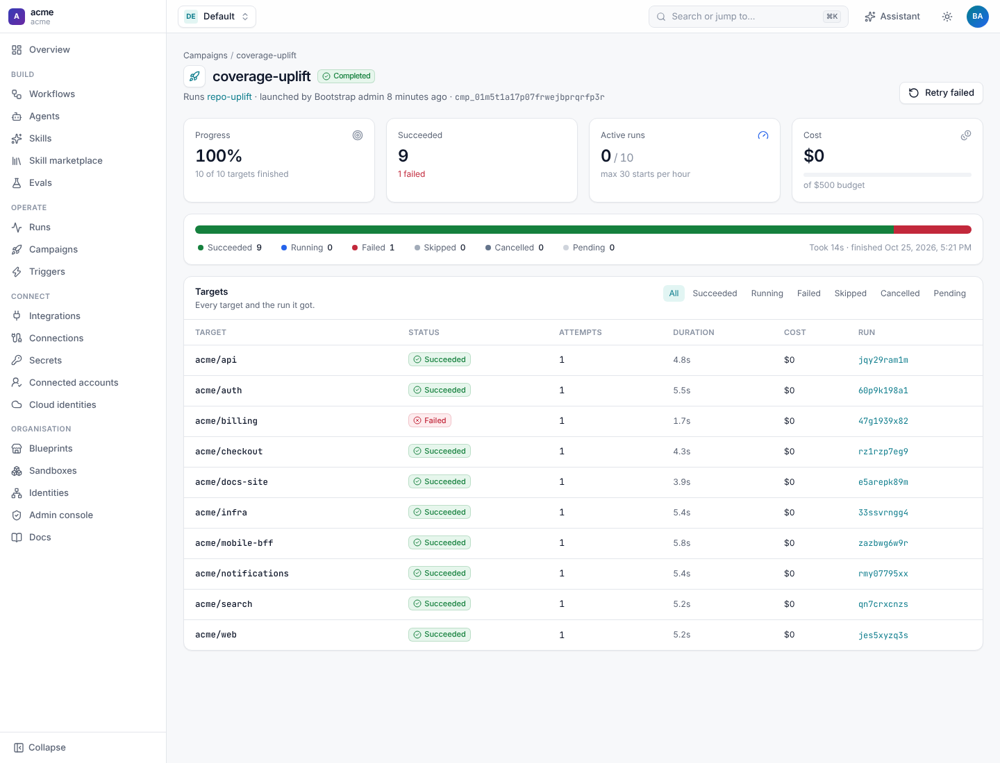
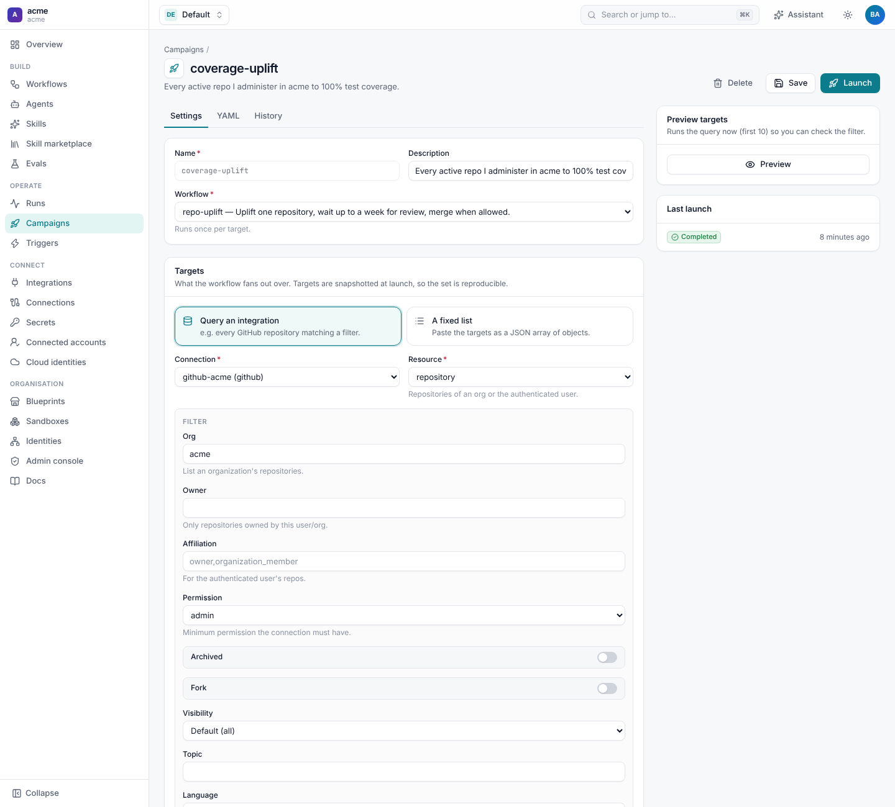
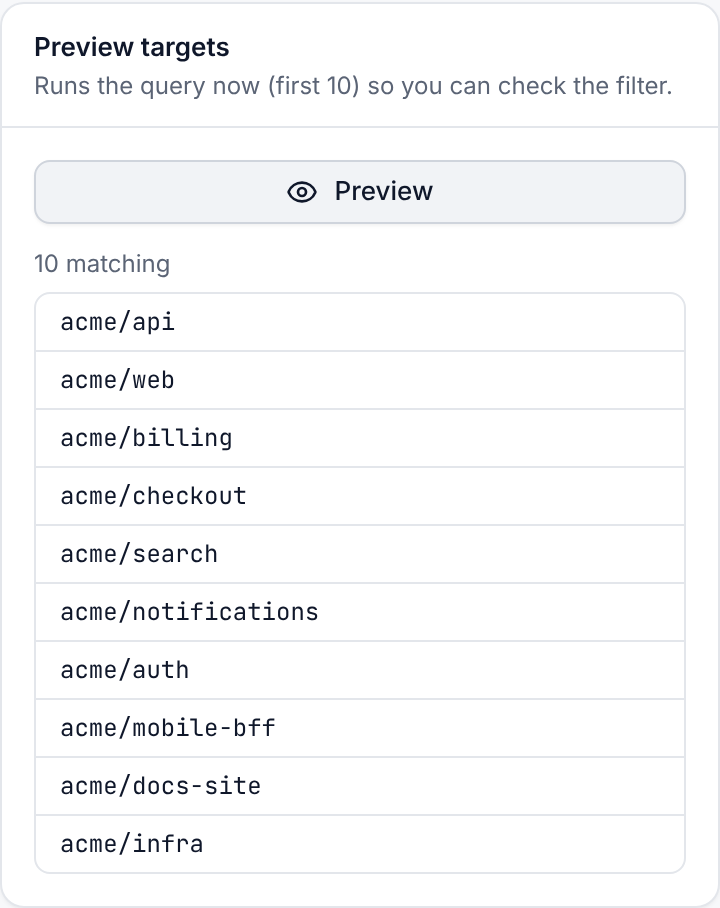
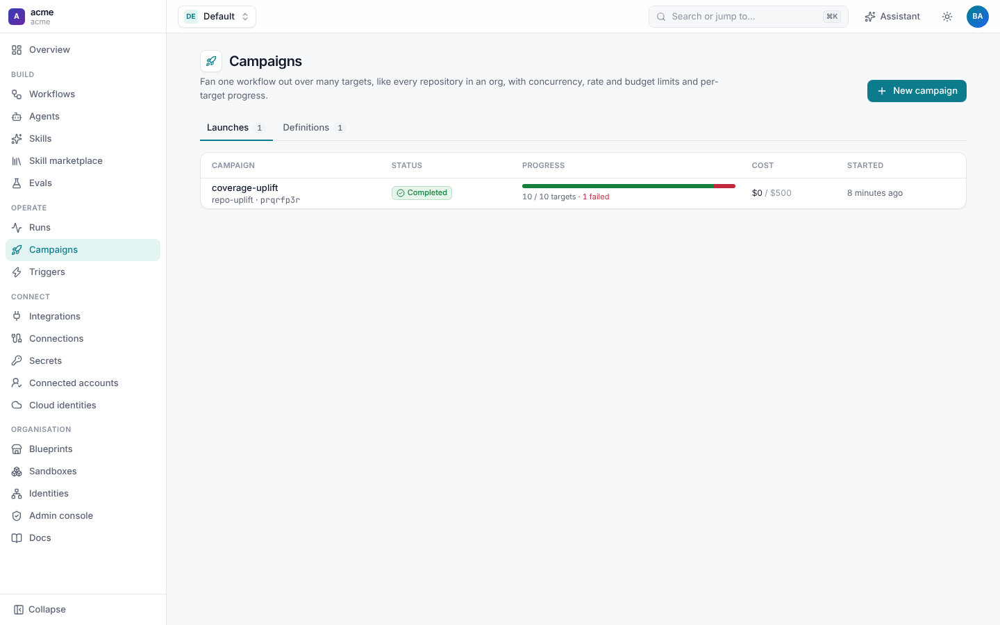

# Campaigns

A **campaign** runs one workflow over many **targets**: every repository in a GitHub org, every Jira issue a JQL query
finds, or a list you paste in. It starts runs within limits you set (how many at once, how many an hour, a cost budget,
how many failures before it pauses) and tracks each target's progress. The [GitHub uplift journey](../../examples/github-uplift/)
uses one to raise test coverage across an org.



## Define a campaign

```yaml
apiVersion: shoal.dev/v1
kind: Campaign
metadata:
  name: coverage-uplift
  description: Every active repo I administer in acme to 100% test coverage.
spec:
  workflow: repo-uplift
  # workflow_version: 3                 # optional pin; otherwise each launch pins the current version
  targets:
    connection: github-acme
    resource: repository                # an integration resource type
    filter: {org: acme, permission: admin, archived: false, fork: false}
    key: "{{ target.full_name }}"       # a stable key per target; duplicates are dropped
    # limit: 50                         # only the first N targets
  inputs:                               # workflow inputs, as expressions over target
    repo: "{{ target.full_name }}"
    goal: Raise test coverage to 100%
  policy:
    concurrency: 10                     # runs in flight at once (default 5)
    runs_per_hour: 30                   # start at most this many per hour
    max_failures: 10                    # pause after this many failures
    budget_usd: 500                     # pause when the runs have cost this much
```

### Targets

Targets come from one of two places:

- **An integration query**: `connection` + `resource` + `filter`. Each integration lists its resources and their
  filters on its page under **Integrations**. Built in: GitHub `repository` (by org or owner, permission, archived,
  fork, visibility, topic, language, name glob) and `pull_request`, and Jira `issue` (by JQL). Results are paged through
  in full.
- **A fixed list**: `items: [{repo: acme/api}, {repo: acme/web}]`.

Targets are **snapshotted at launch**, so a campaign's target set doesn't change under it and a relaunch picks up new
repositories. In each run, `{{ target.… }}` is the target's data plus its `key`, and `{{ campaign.id }}` and
`{{ campaign.name }}` identify the launch. Runs are labelled `campaign=<name>` and `target=<key>`.

## The campaign editor

**Campaigns › New campaign** has the same fields as the YAML: the workflow, the targets (query an integration, with a
form for that resource's filter, or a fixed JSON list), the inputs per target and the policy. **Preview targets** runs
the query now and shows the first ten matches, so you can check the filter before launching.





## Launch

**Launch** in the editor, `shoal campaigns launch coverage-uplift`, `POST /v1/namespaces/{ns}/campaigns/{name}/launch`,
or a [trigger](triggers.md#relaunch-a-campaign) on a schedule. Each launch is a **campaign run** with its own id, and a
campaign definition can be launched many times.

```sh
shoal campaigns launch coverage-uplift -i goal="Raise coverage to 90%"   # override inputs
shoal campaigns launch coverage-uplift --paused                          # plan the targets, start later
```

Launching needs `campaigns:launch`. The workflow version is pinned when the campaign launches, so every target runs the
same version even if the workflow changes mid-campaign.

## Follow and steer it

**Campaigns › Launches** lists every launch with its status, a progress bar, cost against the budget, and when it
started. Open one for its page:

- **Progress**, **Succeeded**, **Active runs** (against the concurrency and hourly limits) and **Cost** (against the
  budget);
- a bar with every target status: succeeded, running, failed, skipped, cancelled and pending;
- every target with its status, attempts, duration, cost and run, filterable by status.



| Action | What it does | CLI |
| --- | --- | --- |
| **Pause** | Stop starting new targets. Runs in flight carry on. | `shoal campaigns pause <id>` |
| **Resume** | Carry on. Failures so far are accepted, and `max_failures` counts new ones from here. | `shoal campaigns resume <id>` |
| **Cancel** | Cancel the runs in flight and every pending target. | `shoal campaigns cancel <id>` |
| **Retry failed** | Put failed and cancelled targets back in the queue and start again. | `shoal campaigns retry <id>` |

These need `campaigns:manage`. `shoal campaigns list` and `shoal campaigns get <id>` show progress in the terminal, and
`POST /v1/campaign-runs/{id}/targets` adds targets to a running launch.

## Policies

The campaign controller runs in every worker, coordinated by a lease. On each tick it:

1. pauses the campaign if `max_failures` new failures have happened, or the runs have spent `budget_usd`;
2. completes it when no target is pending or running;
3. otherwise starts as many pending targets as `concurrency` and `runs_per_hour` allow.

A paused campaign shows why ("paused after 10 failures", "budget of $500 reached"). A campaign paused on its budget
can't resume; launch it again with a higher budget.

## Patterns

- **Wait for review, then merge:** the uplift workflow opens a PR, then waits up to a week for approval with a `wait`
  condition that wakes on GitHub review events. Hundreds of runs can wait at once without holding workers.
- **Canary first:** launch with `targets.limit: 5`, check the results, then launch again without the limit.
- **Nightly sweeps:** a schedule trigger with `campaign:` relaunches it, and the snapshot picks up new targets each time.
