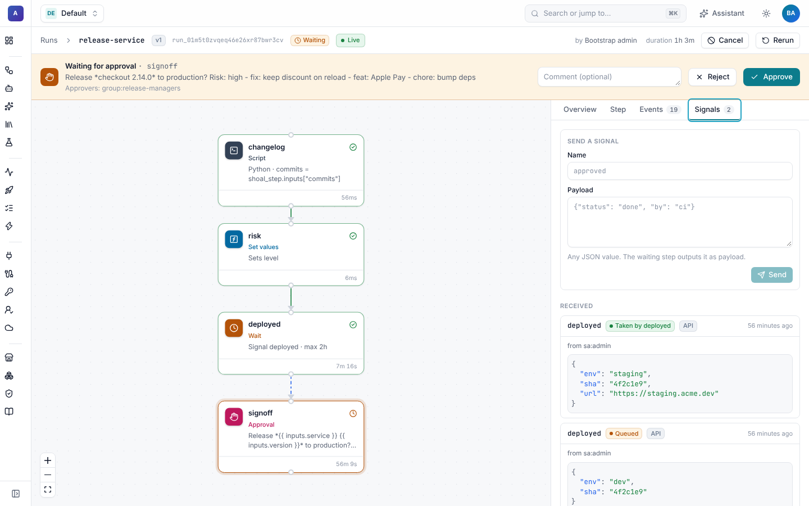

# Signals

A **signal** sends data into a running workflow. A `wait` step with `signal:` pauses until a matching signal arrives,
then outputs its payload, so a run can wait for a deploy pipeline, a customer's reply or another system's callback, and
carry on with what they sent.


## Wait for a signal

```yaml
- id: deployed
  type: wait
  signal:
    name: deployed                         # the name senders use
    match: "{{ signal.env == 'staging' }}" # optional; non-matching signals stay queued
  max_wait: 2h
  on_timeout: fail                         # or continue (default): succeed with timed_out: true

- id: smoke
  type: script
  env: {URL: "{{ steps.deployed.output.payload.url }}"}
  run: curl -fsS "$URL/health"
```

The step output is `received`, `payload`, `name`, `source` (`api`, `callback` or `event`), `sender`, `received_at` and
`timed_out`.

## Send a signal

| From | How | Needs |
| --- | --- | --- |
| The run viewer | The banner on a waiting run, or the **Signals** tab (any name, any JSON payload). | `runs:signal` |
| The CLI | `shoal signal <run> deployed -d '{"env": "staging", "sha": "4f2c1e9"}'` (JSON or plain text) | `runs:signal` |
| The API | `POST /v1/runs/{id}/signals/deployed` with `{"payload": {…}}` | `runs:signal` |
| A callback URL | `POST {{ run.signal_url }}/deployed` with any body. A JSON body is the payload; anything else is sent as text. | Only the URL |

The callback URL carries an HMAC token for that run, so systems that can only call a URL (a CI job, a form, a payment
provider) can reply without an API key. Hand it out from the workflow:

```yaml
- id: kick_off_deploy
  type: script
  env:
    SERVICE: "{{ inputs.service }}"
    CALLBACK: "{{ run.signal_url }}/deployed"
  run: curl -fsS https://ci.acme.dev/deploy -d "service=$SERVICE" -d "callback=$CALLBACK"
```

Anyone holding the URL can signal that one run, so treat it like a secret. An unknown run and a wrong token get the
same `404`. Payloads are limited in size, and every signal is written to the audit log.

## Queueing and matching

- Signals are **stored until a step takes them**, so a reply that beats the workflow to its `wait` is not lost.
- Each signal is taken **once**, by the first waiting step with that name whose `match` accepts it.
- Signals that don't satisfy `match` stay queued for a later step.

The **Signals** tab lists every signal sent to the run with its payload, where it came from, who sent it, and whether it
is still **Queued** or which step took it. It also has a form to send one.



## Waiting for integration events

Instead of a name, a signal wait can take the next integration event with a given **wake key**. The payload is the
event: `type` (for example `pull_request_review.submitted`), `id`, `data` (the event's fields) and `actor`, so `match`
can look at `signal.data`:

```yaml
- id: next_review
  type: wait
  signal:
    event: "github:pr:{{ inputs.repo }}#{{ steps.pr.output.number }}"
  max_wait: 7d
```

Integrations attach wake keys to the events they receive, for example `github:pr:acme/api#12` and
`github:repo:acme/api` for GitHub and `jira:issue:BUG-142` for Jira. A [generic webhook](triggers.md#generic-webhooks)
delivery can name its own in an `X-Shoal-Wake-Key` header, but not keys that belong to another integration. A `wait` condition's `wake_on` uses the same keys to
re-check a condition early. Slack interactive messages use signals too: a button click becomes a signal on the run that
posted the message ([Interactive messages](../slack/interactive-messages.md)).
