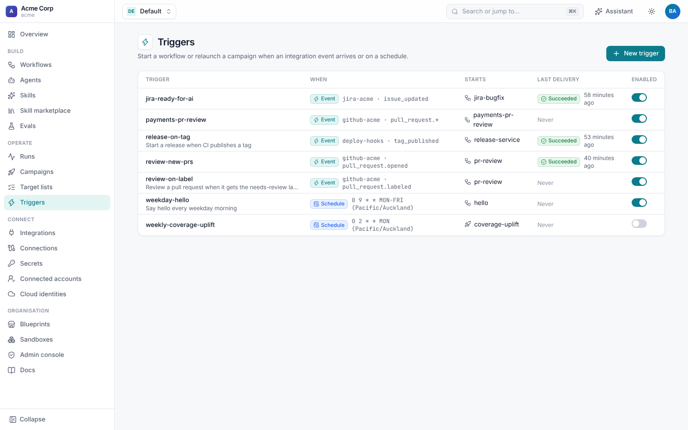
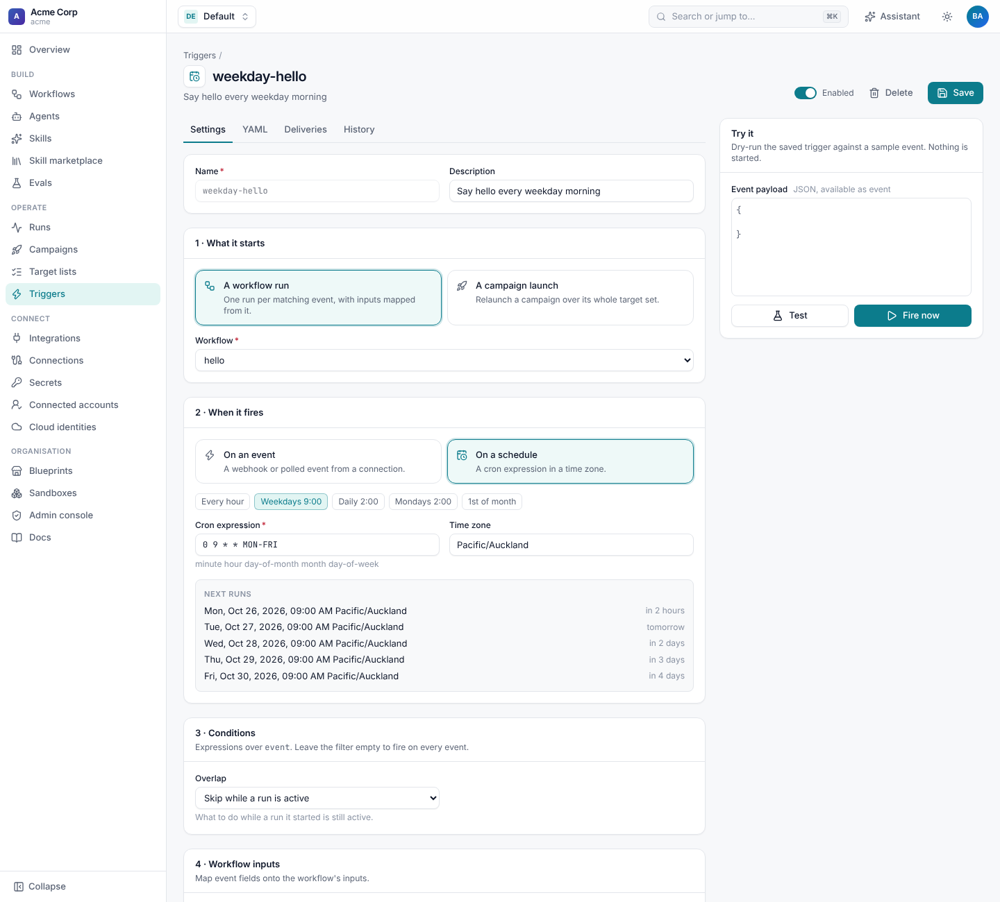
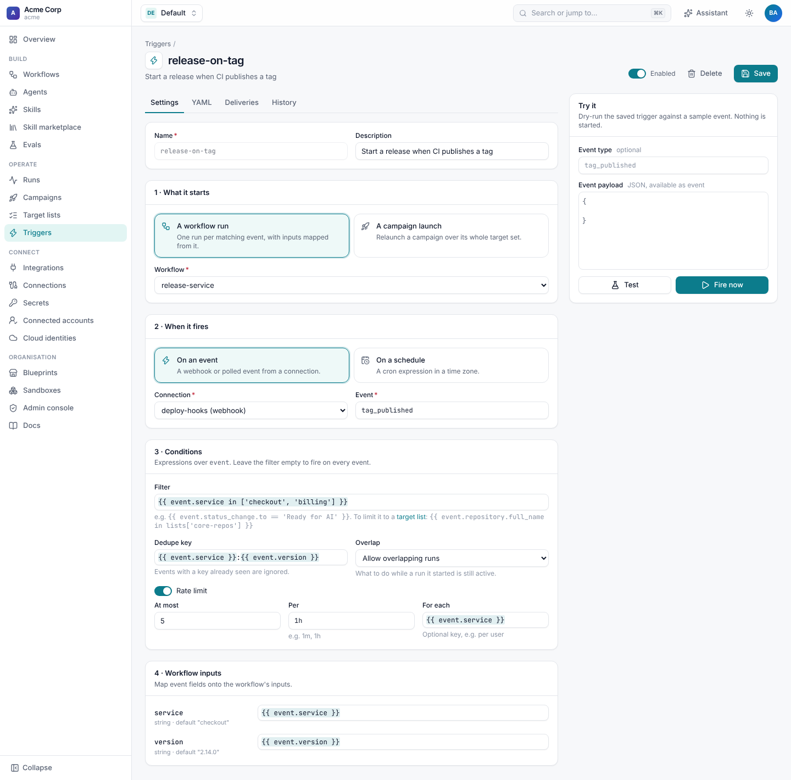
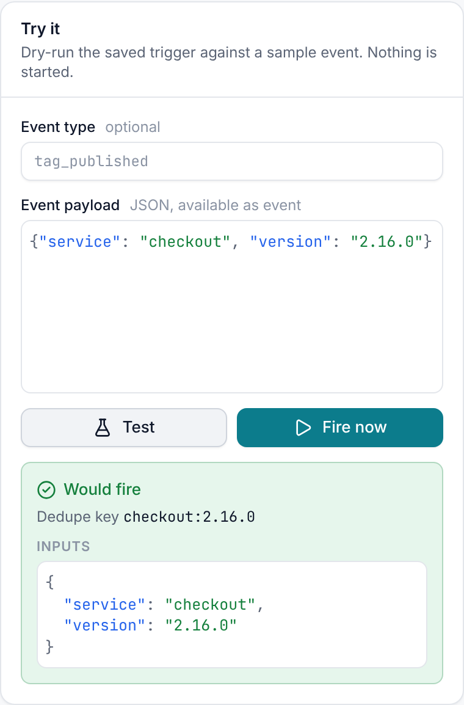
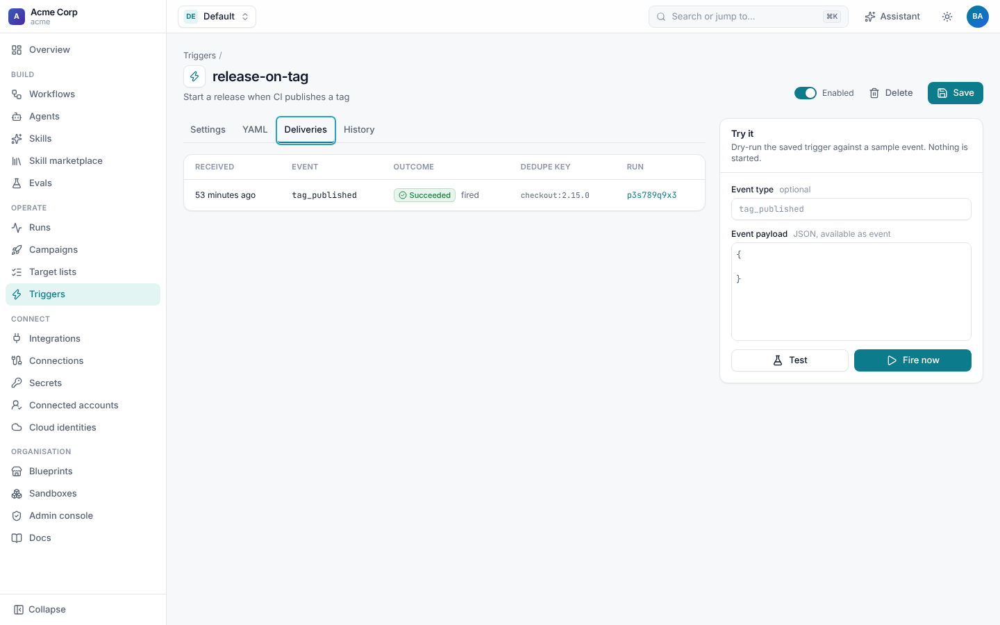

# Triggers

A **trigger** starts a workflow run, or relaunches a [campaign](campaigns.md), when something happens: an integration
event arrives (a Jira ticket moves, a PR is opened, someone mentions a Slack bot, CI posts a webhook) or a cron schedule
comes round. Filters, dedupe keys, rate limits and an optional decision-model triage decide which events count.



## Event triggers

```yaml
apiVersion: shoal.dev/v1
kind: Trigger
metadata:
  name: jira-ready-for-ai
spec:
  workflow: jira-bugfix
  connection: jira-acme                  # whose webhook deliveries count
  event: issue_updated                   # event type; globs work, e.g. pull_request.*
  filter: "{{ event.status_change and event.status_change.to == 'Ready for AI' }}"
  inputs:
    issue_key: "{{ event.issue_key }}"
    repo: "{{ event.issue.fields.customfield_10050 or 'acme/api' }}"
  dedupe_key: "{{ event.issue_key }}:{{ event.timestamp }}"
```

Each connection has its own webhook URL (`/v1/hooks/<id>`), shown on the connection page and in its `status`. The
integration verifies every delivery (a signature or a token), parses it into one or more events, and Shoal checks every
enabled trigger that names that connection:

1. **Event type** must match `event` (`*` globs are allowed: `pull_request.*`, `*`).
2. **`filter`**, an expression over `event`, must be true.
3. **`match`**: structured filters the integration understands, such as Slack's channels, mentions, keywords and users
   ([channel bots](../slack/channel-bots.md)).
4. **Rate limit**: `rate_limit: {max: 5, per: 1h, key: "{{ event.user }}"}` fires at most `max` times per window,
   overall or per key.
5. **Dedupe**: when `dedupe_key` renders to a key that this trigger has already seen, the delivery is ignored. Use it
   for senders that retry, such as Jira and GitHub.
6. **Triage** (optional): ask a decision model about the event and fire only when `when` is true. See
   [below](#triage-with-a-decision-model).
7. **Overlap**: with `overlap: skip`, the trigger doesn't fire while a run it started is still active.

Then `inputs` are rendered from the event and the run starts. The run's context has `event` (the payload) and
`trigger` (`name`, `event_type` and any triage answers), so steps can use `{{ event.… }}` too. The run is attributed to
the person behind the event when the integration knows who it was: the Jira user who changed the ticket, the GitHub
sender, the Slack user.

Each integration's events are listed on its page under **Integrations**:

| Integration | Events |
| --- | --- |
| [GitHub](../github/triggers.md) | `pull_request.*`, `pull_request_review.submitted`, `issue_comment.created`, `issues.*`, `push`, `check_suite.completed` (any GitHub event name works) |
| [Jira](../jira/triggers.md) | `issue_updated`, `issue_created`, `comment_created`, `automation` |
| [Slack](../slack/events-and-commands.md) | `app_mention`, `message`, `reaction_added`, `slash_command`, shortcuts and more |
| [Generic webhook](#generic-webhooks) | `received`, or the type named by a header or a body field |

To fire only for a known set of repositories or projects, keep the set in a [target list](campaigns.md#target-lists)
and check it in the filter: `{{ event.repository.full_name in lists['core-repos'] }}`. `filter`, `inputs` and
`dedupe_key` all see `lists`.

## Schedules

```yaml
apiVersion: shoal.dev/v1
kind: Trigger
metadata:
  name: weekday-hello
spec:
  workflow: hello
  event: schedule
  schedule: "0 9 * * MON-FRI"           # minute hour day-of-month month day-of-week
  timezone: Pacific/Auckland           # IANA name; default UTC
  overlap: skip
  inputs: {name: team}
```

Schedules are checked by every worker and claimed atomically, so each tick fires exactly once however many workers
run. Changing the cron or time zone reschedules from now. The event carries `scheduled_at`, `fired_at` and `next_at`,
and a scheduled run is attributed to whoever last changed the trigger.

In the editor, pick a preset or type a cron expression, and **Next runs** previews the next five fire times in the
trigger's time zone (`GET /v1/schedule-preview?cron=…&tz=…`).



## Relaunch a campaign

A trigger can start a campaign instead of a run, for example every Monday:

```yaml
spec:
  campaign: coverage-uplift
  event: schedule
  schedule: "0 2 * * MON"
  timezone: Pacific/Auckland
```

A trigger targets exactly one of `workflow` or `campaign`. Its `inputs` are merged over the campaign's inputs.

## The trigger editor

**Triggers › New trigger** walks through four sections: what it starts (a workflow run or a campaign launch), when it
fires (an event from a connection, or a schedule), conditions (filter, dedupe key, overlap and rate limit) and the
workflow inputs, with a field for each input the workflow declares. Expression fields autocomplete `event.…`. The
**YAML** tab shows the same trigger as YAML, **Deliveries** lists what happened to recent events, and **History** lists
its versions.



The **Enabled** switch turns a trigger off without deleting it (`enabled: false`).

### Try it

**Try it** dry-runs the saved trigger against a sample payload and shows whether it would fire, why not, the dedupe key
and the inputs it would pass. Nothing is started. **Fire now** fires it for real with that payload (permission
`triggers:fire`).



The same from the CLI and API:

```sh
shoal triggers fire release-on-tag -d '{"service": "checkout", "version": "2.16.0"}'
curl -X POST "$SHOAL_URL/v1/namespaces/default/triggers/release-on-tag/test" \
  -H "Authorization: Bearer $SHOAL_API_KEY" -H "Content-Type: application/json" \
  -d '{"event_type": "tag_published", "data": {"service": "checkout", "version": "2.16.0"}}'
```

### Deliveries

Every event that reached a trigger is recorded with its outcome: **fired** (with a link to the run or campaign),
**rate_limited**, **triaged_out** (with the answers), **skipped** (a run was still active), or **error** (an expression
or `match` was invalid, or the run couldn't start, with the reason). Events whose type or filter didn't match are not
recorded. Read them under **Deliveries** or from `GET /v1/namespaces/{ns}/triggers/{name}/deliveries`.



## Generic webhooks

The `webhook` integration accepts JSON from any system that can POST:

```yaml
apiVersion: shoal.dev/v1
kind: Connection
metadata: {name: deploy-hooks}
spec:
  integration: webhook
  config:
    event_type_header: X-Event-Type   # or event_type_field: a dot path into the body
    id_field: delivery.id             # optional: dedupe on a body field
  secrets:
    secret: deploy-hook-secret        # HMAC-SHA256 secret, or a shared token
```

| Setting | Default | Meaning |
| --- | --- | --- |
| `secret` | | Verifies deliveries: an `X-Signature-256: sha256=<hmac>` header (`signature_header`, `signature_prefix`), or the secret itself in `X-Shoal-Token` or `?token=`. |
| `allow_unsigned` | `false` | Accept deliveries without a secret. Anyone with the URL could then fire triggers. |
| `event_type_header`, `event_type_field` | `X-Event-Type` | Where the event type comes from; otherwise it is `received`. |
| `id_field` | | A delivery id for dedupe; otherwise `X-Request-Id` or `X-Delivery-Id`. |

A delivery can also name wake keys in `X-Shoal-Wake-Key` (comma-separated) to wake runs that are
[waiting for that event](signals.md#waiting-for-integration-events). Keys that start with another integration's name
(`github:…`, `jira:…`) are ignored, so a generic webhook can't impersonate GitHub or Jira.

```sh
curl -X POST "$WEBHOOK_URL" -H "X-Shoal-Token: $SECRET" -H "X-Event-Type: tag_published" \
  -H "Content-Type: application/json" -d '{"service": "checkout", "version": "2.15.0"}'
```

## Triage with a decision model

For events that need judgement ("is this ticket a bug we can fix automatically?"), add `triage`. A decision model
answers typed questions about the event before the run starts:

```yaml
spec:
  triage:
    state: "{{ event.issue.fields.summary }}\n\n{{ event.issue.fields.description }}"
    questions:
      automatable:
        type: boolean
        instructions: Could a coding agent fix this without a product decision?
      area:
        type: choice
        instructions: Which area is it in?
        options: {checkout: Checkout and payments, search: Search, other: Anything else}
    when: "{{ answers.automatable.value and answers.automatable.confidence > 0.7 and answers.area.value != 'other' }}"
```

The answers are stored on the delivery and passed to the run as `trigger.triage`. In the editor, triage is shown as
configured and edited in the YAML tab. See [Decisions and grading](../agents/decisions.md).

## Permissions

Creating and editing triggers needs `triggers:write`. Firing or testing one by hand needs `triggers:fire`. Webhook
deliveries need no Shoal credentials: the integration verifies them with the connection's secret.
