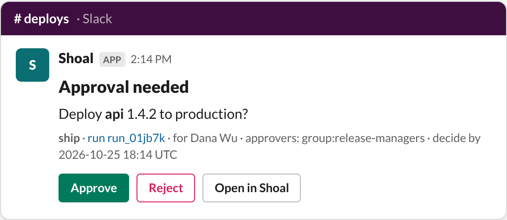
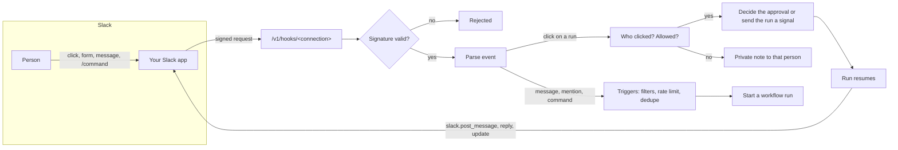

# Slack

Slack is built into Shoal, next to GitHub and Jira. Install it once and your workflows can talk to people where they
already work. A workflow can:

- ask for approvals and get the decision back,
- ask questions with forms,
- post messages with any buttons, menus and date pickers, and resume when someone uses them,
- run as a bot in a channel and answer mentions, keywords or every message,
- start from a slash command, a reaction or a shortcut.

Every click is checked. Shoal verifies the request came from your Slack app, works out which Shoal user clicked, and
checks they are allowed to act on the run before anything happens.



## Features

| Feature | What it does | Guide |
| --- | --- | --- |
| Guided setup | Pick what the app does, see the Slack permissions each feature needs and why, generate the app manifest, install and check it. | [Set up Slack](setup.md) |
| Approvals | Approval steps post Approve and Reject buttons, with an optional comment. The message updates with the outcome however the step was decided. | [Approvals](approvals.md) |
| Questions and forms | `slack.request_input` posts a button that opens a form. The answers resume the run. | [Interactive messages](interactive-messages.md#ask-for-input-with-a-form) |
| Custom interactive messages | Any Block Kit message. Buttons, selects, date pickers, checkboxes and forms send the run a signal, and the workflow branches on the value. | [Interactive messages](interactive-messages.md) |
| Message builder | Lay out a message with a live, clickable preview, see its hooks, and copy the workflow steps. | [Message builder](message-builder.md) |
| Channel bots | Wire a channel to a workflow. Filters pick which messages count (mentions, words, regex, people, threads and more), and a rate limit keeps it in check. | [Channel bots](channel-bots.md) |
| Slash commands, reactions and shortcuts | Start workflows as the person who typed the command or reacted. | [Events and slash commands](events-and-commands.md) |
| Actions | Post, reply, update, react, send private messages, read a conversation and look up people from any workflow or agent. | [Reference](reference.md#actions) |

## How it fits together



One Shoal **connection** is one Slack app installed in one workspace. The connection holds the app's settings and
points at secrets for its tokens, so token values never appear in the resource. Each connection has its own webhook
URL, which the generated manifest already uses for events, interactivity and the slash command.

## Five-minute start

1. **Connections → New connection → Slack.** Give it a name and create it. The [guided setup](setup.md) opens.
2. **Choose features**, then **Create app in Slack**. Slack opens with the manifest filled in.
3. Paste the app's **signing secret**, **client ID** and **client secret** from its Basic Information page.
4. **Add to Slack** to install it, then **Check the app**.
5. Invite the app to a channel (`/invite @Shoal`) and either:
   - add `notify: [{integration: slack, to: "#deploys"}]` to an approval step ([Approvals](approvals.md)), or
   - adopt the **Slack bot** blueprint to answer questions in a channel ([Channel bots](channel-bots.md)).

Prefer files? The same setup in YAML:

```yaml
apiVersion: shoal.dev/v1
kind: Connection
metadata: {name: slack}
spec:
  integration: slack
  config:
    default_channel: "#deploys"
    client_id: "1234567890.987654321"
    features: [mentions, channel_messages, reactions, slash_command]   # omit for everything
  secrets:
    signing_secret: slack-signing-secret
    client_secret: slack-client-secret
    bot_token: slack-bot-token        # filled in by Add to Slack
```

## Examples

- [`examples/slack-approval/`](../../examples/slack-approval/): `/shoal ship api` asks for a version in a form, waits
  for a release manager's approval in `#deploys`, then announces the release.
- [`examples/blueprints/slack-bot.yaml`](../../examples/blueprints/slack-bot.yaml): a channel bot that reacts with
  :eyes:, reads the thread, answers with an agent and asks whether the answer helped.
- [`examples/blueprints/slack-release-check.yaml`](../../examples/blueprints/slack-release-check.yaml): a custom
  message with a select menu and Go / Hold buttons, where Hold asks why in a form.

## Pages in this guide

- [Set up Slack](setup.md): the guided setup, permissions, the manifest, installing, linking people.
- [Approvals](approvals.md): asking for approval in Slack, who may click, comments, outcomes.
- [Interactive messages](interactive-messages.md): forms, signal buttons, custom Block Kit with hooks.
- [Message builder](message-builder.md): designing messages in the UI.
- [Channel bots](channel-bots.md): wiring channels to workflows, filters, rate limits, conversation context.
- [Events and slash commands](events-and-commands.md): every trigger event, slash commands, waking waiting steps.
- [Reference](reference.md): connection settings, actions, event fields, wake keys, security.

For building your own integration with the same hooks Slack uses, see [Integrations](../integrations.md).
