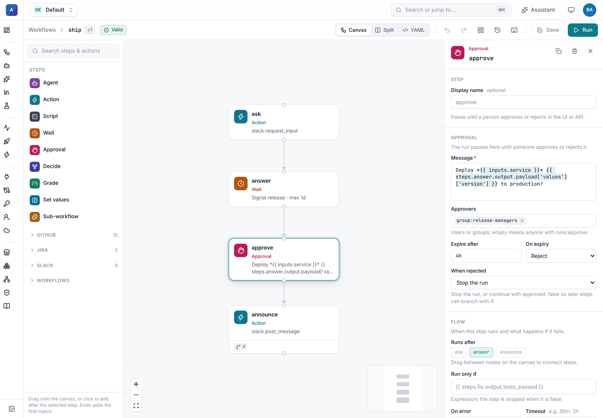
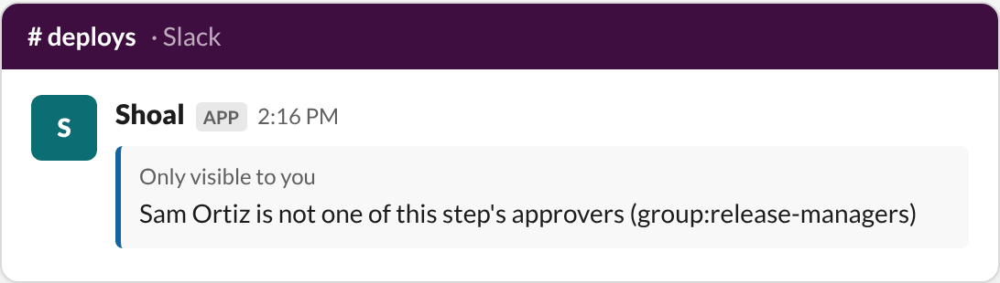
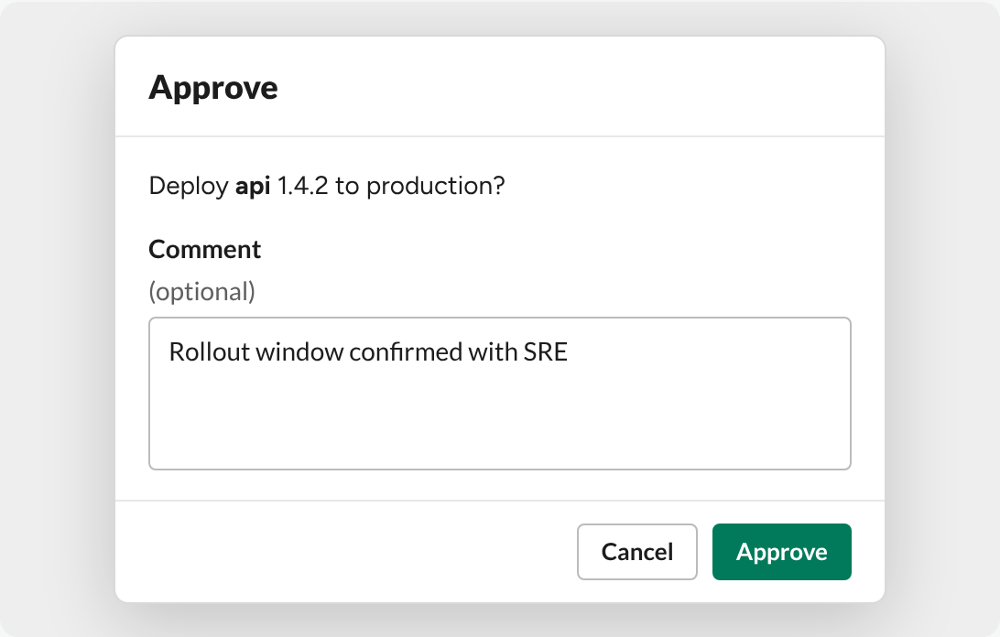
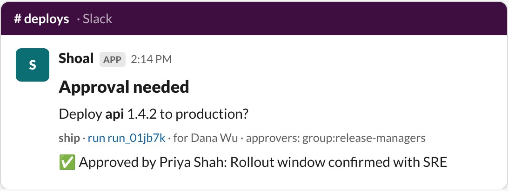

# Approvals in Slack

An approval step pauses a run until someone approves or rejects it. Add `notify:` and Shoal also asks in Slack, with
buttons that decide the step.


## Ask in Slack

```yaml
- id: go
  type: approval
  message: "Deploy *{{ inputs.service }}* {{ inputs.version }} to production?"
  approvers: ["group:release-managers"]
  max_wait: 4h
  on_timeout: reject
  notify:
    - integration: slack
      to: "#deploys"
      with:
        title: Production deploy        # header, default "Approval needed"
        approve_label: Ship it          # default "Approve"
        reject_label: Hold              # default "Reject"
        ask_comment: true               # ask for a comment in a form first
        # thread_ts: "{{ steps.post.output.ts }}"   # post in a thread instead
```

| Field | Meaning |
| --- | --- |
| `integration` or `connection` | `integration: slack` uses the workflow's Slack connection (`connections: {slack: …}`); `connection:` names one. |
| `to` | A channel id or `#name`, a Slack user id, or an email (sent as a direct message). Defaults to the connection's `default_channel`. |
| `with` | Slack options from the example above. Expressions are allowed. |

`notify` is a list, so you can ask in several places at once, for example a channel and the on-call person's DMs.
Whichever click arrives first decides the step.

The message shows the step's `message` in mrkdwn, then a line with the workflow, a link to the run, who started it,
the approvers and the deadline. **Open in Shoal** goes to the run.

In the workflow builder, the approval step's panel holds the message, approvers and expiry. Add `notify:` in the YAML
tab for now.



## Who can decide

A click only decides the step when all of these hold:

1. The request carries a valid signature from your app's signing secret and is less than five minutes old.
2. The approval was sent through this same connection. A click from another app or workspace doesn't count.
3. Shoal can match the Slack user to an active Shoal user ([how linking works](setup.md#link-slack-people-to-shoal-users)).
4. That user has `runs:approve` in the run's namespace.
5. If the step lists `approvers`, they are one of them. Entries can be usernames, `user:<name>`, emails or
   `group:<name>`. This is the same check the UI and API apply.
6. Nobody has decided the step yet.

Anyone who fails a check gets a private message that only they can see. The approval stays open for the right people.
Both the decision and any refusal go to the audit log with `via: slack`.



## Comments

With `ask_comment: true`, clicking either button opens a form first. The comment is optional when approving and
required when rejecting. It is saved with the decision and shown on the message.



## The outcome

However the step is decided, Shoal replaces the buttons with the verdict on every message it posted for that step:

- a click in Slack,
- the **Approve** or **Reject** buttons on the run page in Shoal,
- the API,
- or the deadline (`max_wait` with `on_timeout`).



Later steps read the decision from the step's output:

```yaml
- id: announce
  type: action
  action: slack.post_message
  with:
    channel: "#deploys"
    text: ":rocket: Approved by {{ steps.go.output.by }}"
```

`output` has `approved`, `by`, `comment` and `timed_out`. A rejection ends the run unless the step sets
`on_reject: continue`. With that set, the step succeeds with `approved: false` so you can branch on it.

## Reliability

- Each notification is saved as soon as it is posted. If the step is retried, Shoal does not post the same request
  twice.
- If updating a message fails (for example, someone deleted it), the decision still stands. The failure is logged on
  the step.
- Slack retries requests that are not answered within three seconds. Shoal answers clicks straight away, and a
  second click on a decided step is refused with "already approved by …".
