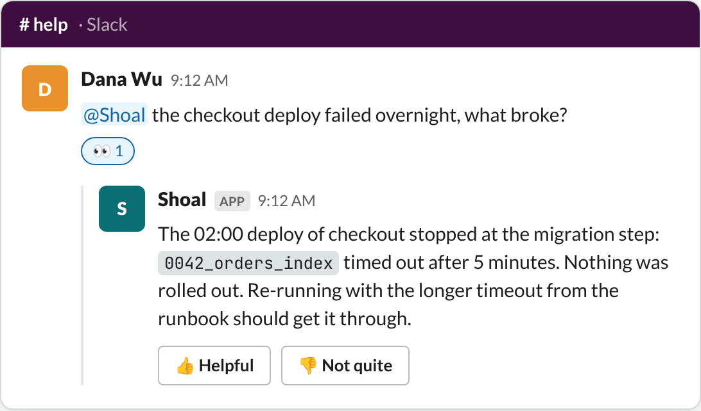
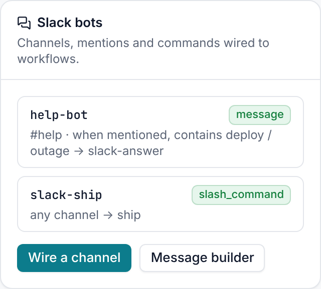
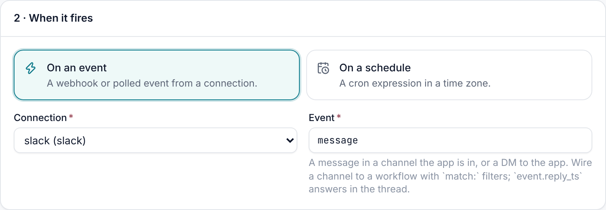
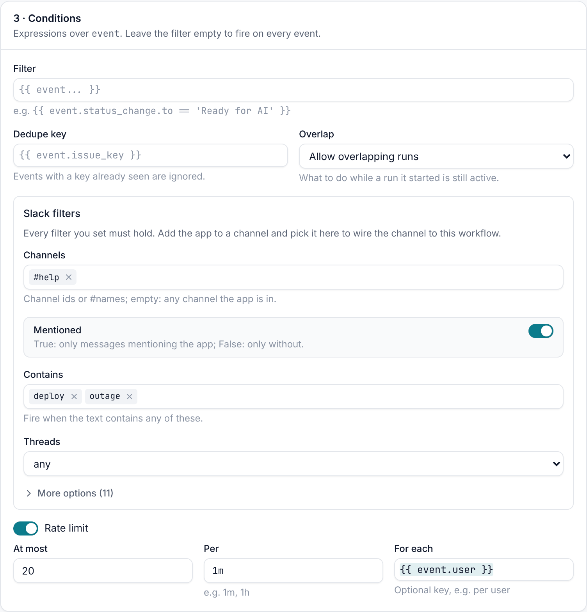
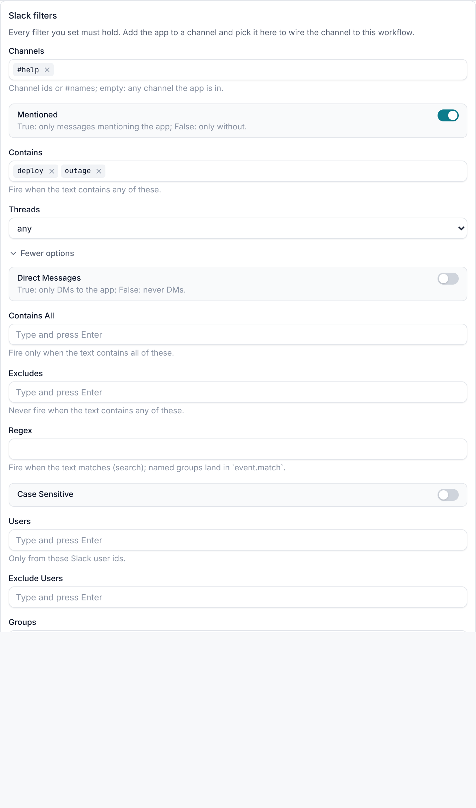
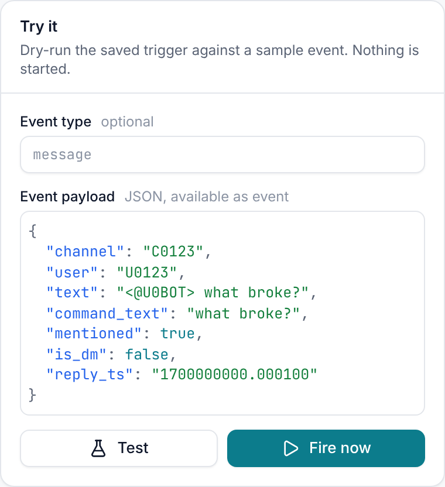

# Channel bots

Wire a Slack channel to a workflow and you have a bot. Every message in the channel, or only the ones you pick, starts
a run with the message as input. The run can read the thread, think with an agent, answer in the thread and ask for
feedback.



## Quick start: the Slack bot blueprint

1. Set up a Slack connection with **Channel bots** and **Reactions** turned on ([setup](setup.md)).
2. Invite the app to the channel: `/invite @Shoal`.
3. **Blueprints → Slack bot → Adopt.** Pick the connection, the channel and the bot's instructions.

The bot answers when someone @-mentions it in that channel. It:

1. reacts with :eyes: so people know it is on it,
2. reads the thread with `slack.get_conversation`,
3. asks an agent for an answer,
4. replies in the thread with **Helpful** and **Not helpful** buttons,
5. waits up to a day for feedback and keeps it as the run's `helpful` output.

Everything it does is an ordinary workflow (`slack-answer`) and trigger (`slack-bot`), so you can change any of it.

## Wire a channel yourself

On the connection page, the **Slack bots** card lists every trigger on the connection: which channels it listens to,
what it waits for, and which workflow it runs. **Wire a channel** opens a new trigger with the connection and the
`message` event filled in.





Then pick which messages count under **Conditions → Slack filters**, and map the message onto the workflow's inputs.



```yaml
apiVersion: shoal.dev/v1
kind: Trigger
metadata: {name: help-bot}
spec:
  connection: slack
  event: message
  workflow: slack-answer
  match:
    channels: ["#help"]
    mentioned: true
    contains: [deploy, outage]
  rate_limit: {max: 20, per: 1m, key: "{{ event.user }}"}
  dedupe_key: "{{ event.event_id }}"
  inputs:
    channel: "{{ event.channel }}"
    ts: "{{ event.reply_ts }}"
    question: "{{ event.command_text }}"
```

## Filters

Every filter you set must hold. Leave `match` empty to run on every message in every channel the app is in.



| Filter | Fires when |
| --- | --- |
| `channels` | The message is in one of these channels (ids or `#names`). Empty: any channel the app is in. |
| `mentioned` | `true`: the message @-mentions the app. `false`: it doesn't. |
| `direct_messages` | `true`: only DMs to the app. `false`: never DMs. |
| `contains` | The text contains any of these. |
| `contains_all` | The text contains all of these. |
| `excludes` | Never when the text contains any of these. |
| `regex` | The text matches this regular expression (a search, not a full match). Named groups land in `event.match`. |
| `case_sensitive` | Text filters respect case (off by default). |
| `users` / `exclude_users` | Only from, or never from, these Slack user ids. |
| `groups` | Only from people in these Shoal groups or identities ([linked people](setup.md#link-slack-people-to-shoal-users) only). |
| `threads` | `any` (default), `top_level` (new messages only) or `replies` (thread replies only). |
| `include_bots` | Also fire on other bots' messages. The app's own messages never fire. |
| `has_files` | `true`: only messages with files. `false`: only without. |
| `reactions` | For `reaction_added` triggers: only these emoji names. |

Some ready-made recipes:

```yaml
# answer only when the bot is named
match: {mentioned: true}

# triage every new incident report, but not replies or bots
match: {channels: ["#incidents"], threads: top_level}

# pick out a ticket number:  "PAY-1234 is stuck" -> event.match.ticket == "PAY-1234"
match: {regex: "(?P<ticket>[A-Z]+-\\d+)"}

# only the on-call group, never in DMs
match: {groups: [oncall], direct_messages: false}

# start a run when someone reacts with :ticket: in #support
event: reaction_added
match: {channels: ["#support"], reactions: [ticket]}
```

Housekeeping messages (edits, deletes, joins, topic changes) never fire a trigger.

## What the run gets

A `message` event carries:

| Field | Meaning |
| --- | --- |
| `event.text` | The message as written, mentions included (`<@U0BOT> what broke?`). |
| `event.command_text` | The text with the bot's mention taken out (`what broke?`). |
| `event.user`, `event.channel`, `event.ts` | Who, where, and the message's timestamp. |
| `event.reply_ts` | Where to answer so the conversation stays in one thread: the thread's root for a reply, or the message itself. |
| `event.thread_ts`, `event.is_reply` | The thread the message is in, if any. |
| `event.mentioned`, `event.is_dm` | Whether the bot was mentioned, and whether it is a DM. |
| `event.from_bot` | Another bot wrote it (only with `include_bots`). |
| `event.has_files`, `event.files` | Attached files (`files:read`). |
| `event.match` | Named groups from `regex`. |
| `event.event_id` | Slack's id for the delivery. Use it as the `dedupe_key`. |

The person who wrote the message becomes the run's initiator when Shoal can [link them](setup.md#link-slack-people-to-shoal-users),
so actions that act as the requester use their access.

## Answer in the thread with context

```yaml
- id: thread
  type: action
  action: slack.get_conversation
  with: {channel: "{{ inputs.channel }}", thread_ts: "{{ inputs.ts }}", limit: 30}
- id: think
  type: agent
  prompt: |
    The Slack conversation so far, oldest first:
    {{ steps.thread.output.transcript }}
    Answer the latest question in a few sentences of Slack mrkdwn.
  outputs: {answer: {type: string}}
- id: reply
  type: action
  action: slack.reply
  with: {channel: "{{ inputs.channel }}", ts: "{{ inputs.ts }}", text: "{{ steps.think.output.answer }}"}
```

`get_conversation` returns `messages` (each with `ts`, `user`, `name`, `text`, `bot`, `thread_ts`) and a ready-made
`transcript` of `name: text` lines for prompts. Without `thread_ts` it reads the channel's latest messages instead.
`slack.reply` answers in the thread. Set `broadcast: true` to also post the reply to the channel. A reply can carry
[interactive controls](interactive-messages.md) like any other message.

## Keep it under control

- **Rate limit.** `rate_limit: {max, per, key}` caps how often the trigger fires: at most `max` runs per `per`
  (`30s`, `1m`, `1h`), counted separately for each value of `key` (for example per person with
  `key: "{{ event.user }}"`). Messages over the limit are recorded as `rate_limited` deliveries, so you can see them.
- **Retries.** Slack resends an event if it doesn't get an answer within three seconds. `dedupe_key: "{{ event.event_id }}"`
  makes sure a resend never starts a second run.
- **Overlap.** Choose what happens while an earlier run is still going: allow overlapping runs, or skip.
- **Dry run.** The trigger page's **Try it** panel tests a sample message against the saved filters without starting
  anything, and shows why a message would or wouldn't fire. **Deliveries** lists what really arrived.



## Bots for other teams

Each team can run its own branded bot with its own connection, or share an organisation-wide one. See
[one bot for the whole organisation, or one per team](setup.md#one-bot-for-the-whole-organisation-or-one-per-team).
