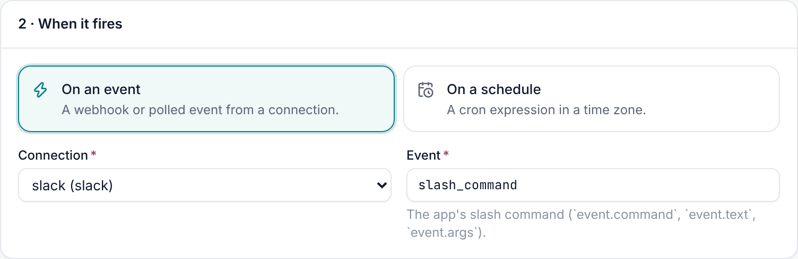
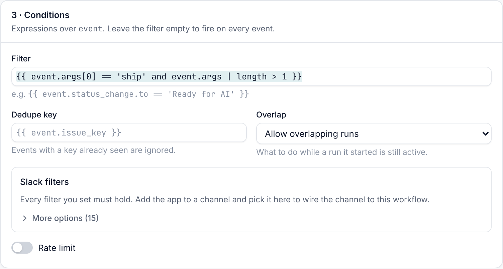

# Events and slash commands

Anything people do with your Slack app can start a workflow. Add a trigger on the Slack connection, pick the event,
and map the event's fields onto the workflow's inputs. Messages in channels have their own page:
[channel bots](channel-bots.md).

| Event | When | Useful fields |
| --- | --- | --- |
| `app_mention` | Someone @-mentions the app | `event.text`, `event.command_text` (without the mention), `event.user`, `event.channel`, `event.ts` |
| `message` | A message in a channel the app is in, or a DM to it | See [channel bots](channel-bots.md#what-the-run-gets) |
| `reaction_added` | Someone adds an emoji reaction | `event.reaction`, `event.user`, `event.item.channel`, `event.item.ts` |
| `slash_command` | Someone runs the app's slash command | `event.command`, `event.text`, `event.args`, `event.user_id`, `event.channel_id` |
| `block_actions` | Someone uses a control that isn't bound to a run | `event.action_id`, `event.value`, `event.label`, `event.user`, `event.channel`, `event.message_ts` |
| `view_submission` | Someone submits a modal that Shoal didn't open for a run | `event.values` |
| `shortcut` | A global shortcut | `event.callback_id` |
| `message_action` | A message shortcut | `event.callback_id`, `event.message` |

Whoever caused the event becomes the run's initiator when Shoal can
[link them to a Shoal user](setup.md#link-slack-people-to-shoal-users).

## Slash commands

The generated manifest adds one slash command, `/shoal` by default (change it with the connection's `slash_command`
setting). Everything typed after it arrives as `event.text`, and as words in `event.args`, so one command can serve
many workflows:





```yaml
apiVersion: shoal.dev/v1
kind: Trigger
metadata: {name: slack-ship}
spec:
  connection: slack
  event: slash_command
  filter: "{{ event.args[0] == 'ship' and event.args | length > 1 }}"
  workflow: ship
  inputs: {service: "{{ event.args[1] }}"}
```

`/shoal ship api` starts `ship` with `service: api`. Slack expects an answer within three seconds, so Shoal replies
straight away with a private message, visible only to the person who typed the command, that names each run started
with a link. If nothing matched, it says so: "No Shoal trigger handles `/shoal …`".

## Reactions

A reaction can be a lightweight button on any message: react with :ticket: to file a ticket, or :rotating_light: to
page someone. Use the `reactions` filter to pick the emoji:

```yaml
spec:
  connection: slack
  event: reaction_added
  match: {channels: ["#support"], reactions: [ticket]}
  workflow: file-ticket
  inputs: {channel: "{{ event.item.channel }}", ts: "{{ event.item.ts }}"}
```

The workflow can read the message it was added to with `slack.get_conversation`.

## Your own buttons and forms

Controls in messages you post can start new runs instead of resuming the run that posted them. Mark them with
`shoal: {event: true}`, or leave them unbound, and they arrive as `block_actions` events:

```yaml
# in a message's blocks
- type: actions
  elements:
    - type: button
      action_id: page_oncall
      text: {type: plain_text, text: Page on-call}
      shoal: {event: true}
---
# a trigger that runs on that click
spec:
  connection: slack
  event: block_actions
  filter: "{{ event.action_id == 'page_oncall' }}"
  workflow: page-oncall
  inputs: {channel: "{{ event.channel }}"}
```

Shoal handles its own approval, form and bound-control clicks itself, so those never reach triggers.

## Waking a waiting step

Instead of starting a new run, a Slack event can resume a run that is waiting for it. A `wait` step with
`signal: {event: <wake key>}` resumes on the first event with that key:

| Wake key | Fires on |
| --- | --- |
| `slack:thread:<channel>:<ts>` | A reply in that thread. Every post returns it as `thread_key`. |
| `slack:channel:<channel>` | Any message in that channel. |
| `slack:message:<channel>:<ts>` | A reaction to that message, or a click on one of its unbound controls. |
| `slack:action:<action_id>` | A click on an unbound control with that `action_id`. |

```yaml
- id: post
  type: action
  action: slack.post_message
  with: {channel: "#releases", text: "React with :white_check_mark: once you've checked the changelog."}
- id: checked
  type: wait
  signal: {event: "slack:message:{{ steps.post.output.channel }}:{{ steps.post.output.ts }}"}
  max_wait: 4h
```

## Delivery and retries

- Every request is checked against the app's signing secret. Requests that are unsigned, have a bad signature or are
  more than five minutes old are rejected.
- Shoal answers Slack within its three-second window and does the work afterwards.
- Slack resends an event that wasn't acknowledged in time. Set `dedupe_key: "{{ event.event_id }}"` on triggers that
  must never fire twice.
- Each trigger's **Deliveries** tab shows every event it saw and whether it fired, was filtered out, deduplicated or
  rate limited.
