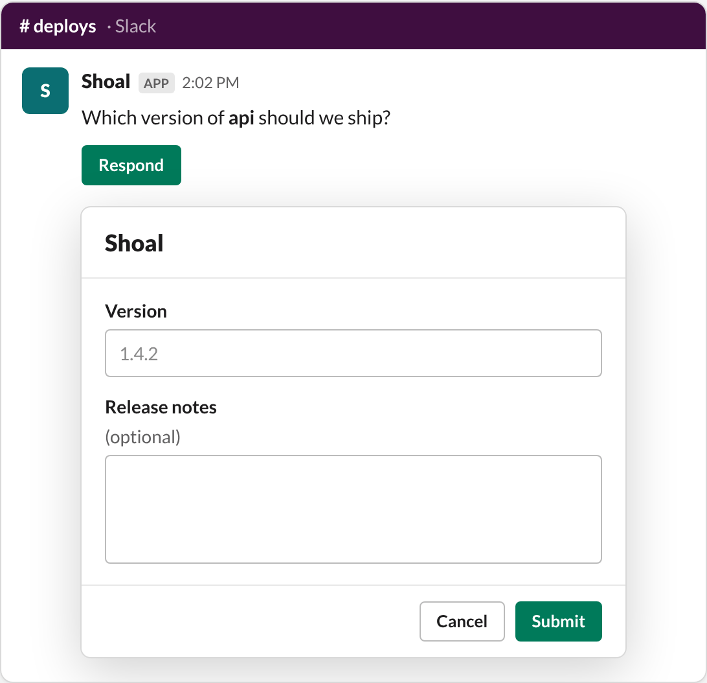
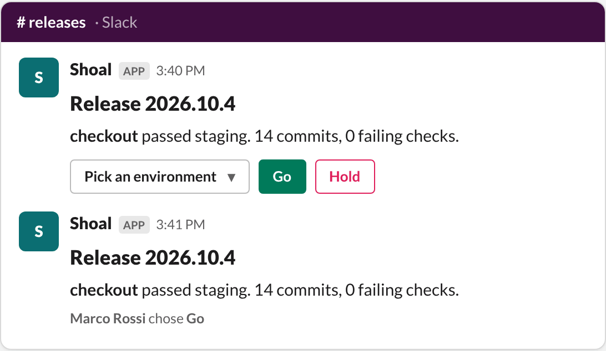

# Interactive messages

Workflows can post messages with buttons, menus and forms, wait for someone to use them, and act on the answer. There
are three ways to do it, from simplest to most flexible:

| You want | Use |
| --- | --- |
| A few answers typed into a form | [`slack.request_input`](#ask-for-input-with-a-form) |
| A row of buttons | [`buttons:` on `slack.post_message`](#buttons-that-signal-the-run) |
| Your own layout with any controls | [Block Kit with `shoal:` hooks](#custom-block-kit-with-hooks) |

All three send the waiting run a **signal**. A `wait` step with `signal: {name: …}` resumes, and later steps read the
answer from `steps.<wait>.output.payload`. As with approvals, the click is checked first: the person must map to a
Shoal user with `runs:signal` in the run's namespace ([linking people](setup.md#link-slack-people-to-shoal-users)).

## Ask for input with a form

`slack.request_input` posts your question with a button. The button opens a form, and the answers are sent to the run.



```yaml
- id: ask
  type: action
  action: slack.request_input
  with:
    channel: "#deploys"
    text: "Which version of *{{ inputs.service }}* should we ship?"
    signal: release              # default "slack.input"
    button: Respond              # the button's label
    title: Release               # the form's title (24 characters at most)
    fields:
      - {name: version, label: Version, placeholder: "1.4.2"}
      - {name: env, label: Environment, type: select, options: [staging, production]}
      - {name: notes, label: Release notes, type: multiline, optional: true}
- id: answer
  type: wait
  signal: {name: release}
  max_wait: 1d
  on_timeout: fail
- id: deploy
  type: action
  action: github.dispatch_workflow   # any action
  with:
    ref: "v{{ steps.answer.output.payload['values']['version'] }}"
```

Field types are `text`, `multiline`, `select` (with `options`) and `number`. The signal's payload is
`{values: {<name>: <answer>}, user: {id, name}}`.

## Buttons that signal the run

For a quick choice, list `buttons:` on `slack.post_message`. Each button sends its own signal, and `payload` becomes
the signal's `value`.

```yaml
- id: ask
  type: action
  action: slack.post_message
  with:
    channel: "#incidents"
    text: "Error rate is 4% on checkout. Roll back?"
    buttons:
      - {label: Roll back, signal: incident, payload: rollback, style: danger}
      - {label: Keep watching, signal: incident, payload: watch}
- id: choice
  type: wait
  signal: {name: incident}
```

## Custom Block Kit with hooks

`slack.post_message`, `slack.reply` and `slack.update_message` take any
[Block Kit](https://api.slack.com/block-kit) `blocks`, as a list or as the JSON that Slack's Block Kit Builder gives
you. Expressions like `{{ inputs.version }}` are filled in first. To wire a control back to the run, add a Shoal-only
`shoal:` key to it. Shoal removes the key and wires the element up before posting.



| `shoal:` key | What a click does |
| --- | --- |
| `{signal: choice}` (or just `choice`) | Sends the run the signal `choice`. |
| `{signal: choice, modal: <view>}` | Buttons only. Opens that [modal](https://api.slack.com/surfaces/modals) first, then sends its answers with the signal. |
| `{event: true}` | Doesn't signal the run. The click becomes a `block_actions` event that [triggers](events-and-commands.md#your-own-buttons-and-forms) can start new runs from. |
| `after: keep` (with `signal`) | Leaves the controls on the message after a click. |

This works on buttons, static selects, user, channel and conversation selects, multi-selects, overflow menus, date,
time and datetime pickers, checkboxes and radio buttons, in `actions` blocks and as a section's accessory.

Set `signal:` on the action itself to bind every control that has no `shoal:` key of its own. Link buttons (with a
`url`) are left alone.

```yaml
- id: post
  type: action
  action: slack.post_message
  with:
    channel: "#releases"
    text: "{{ inputs.service }} is ready to ship"
    blocks:
      - type: header
        text: {type: plain_text, text: "Release {{ inputs.version }}"}
      - type: section
        text: {type: mrkdwn, text: "*{{ inputs.service }}* passed staging."}
        accessory:
          type: static_select
          action_id: env
          placeholder: {type: plain_text, text: Pick an environment}
          options:
            - {text: {type: plain_text, text: Staging}, value: staging}
            - {text: {type: plain_text, text: Production}, value: production}
          shoal: {signal: env, after: keep}
      - type: actions
        elements:
          - type: button
            action_id: go
            style: primary
            text: {type: plain_text, text: Go}
            value: go
            shoal: {signal: decision}
          - type: button
            action_id: hold
            style: danger
            text: {type: plain_text, text: Hold}
            value: hold
            shoal:
              signal: decision
              modal:
                title: {type: plain_text, text: Hold the release}
                blocks:
                  - type: input
                    block_id: reason
                    label: {type: plain_text, text: "Why?"}
                    element: {type: plain_text_input, action_id: reason, multiline: true}
- id: decision
  type: wait
  signal: {name: decision}
  max_wait: 1d
- id: ship
  type: action
  if: "{{ steps.decision.output.payload.value == 'go' }}"
  action: slack.reply
  with:
    channel: "{{ steps.post.output.channel }}"
    ts: "{{ steps.post.output.ts }}"
    text: "Shipping to {{ steps.env.output.payload.value }}"
```

This is the [`slack-release-check`](../../examples/blueprints/slack-release-check.yaml) blueprint. The
[message builder](message-builder.md) writes this kind of step for you.

### What the run receives

A click sends:

```json
{
  "action_id": "go",
  "block_id": "b1",
  "value": "go",
  "label": "Go",
  "user": {"id": "U04ABCDEF", "name": "marco"},
  "channel": "C0123",
  "message_ts": "1729861200.000100"
}
```

`value` is the button's value, the chosen option's value, a list for multi-selects and checkboxes, or the picked date
or time. `label` is the visible text of what was chosen. A submitted modal sends `{values: {<action_id>: …}, user,
action_id}`, keyed by each input's `action_id`.

### After a click

By default, once someone clicks a bound control, Shoal replaces the message's controls with "*who* chose *what*" so
nobody answers twice. Keep the controls with `after: keep` on one element, or `after_click: keep` on the action for
the whole message. To change the message yourself, call `slack.update_message` with the `channel` and `ts` from the
post step's output.

### Limits

- Slack caps an `action_id` at 255 characters. Shoal stores the run id and signal name in it, so keep action ids and
  signal names short.
- A bound modal travels in the button's value, which Slack caps at 2000 characters. Shoal compresses it, but very long
  forms won't fit. Use `slack.request_input`, or a form button with fewer fields.
- Controls bound to a signal need a run to answer to, so post them from a workflow, not by calling the action
  directly.

## Wait for a reply in a thread

Every post returns `thread_key`, a wake key for replies in that message's thread. A `wait` step can resume on the
next reply:

```yaml
- id: post
  type: action
  action: slack.post_message
  with: {channel: "#help", text: "What's the ticket number?"}
- id: reply
  type: wait
  signal: {event: "{{ steps.post.output.thread_key }}"}
  max_wait: 2h
```

The reply's text and author are in `steps.reply.output.payload`. See [wake keys](reference.md#wake-keys) for the other
keys.
