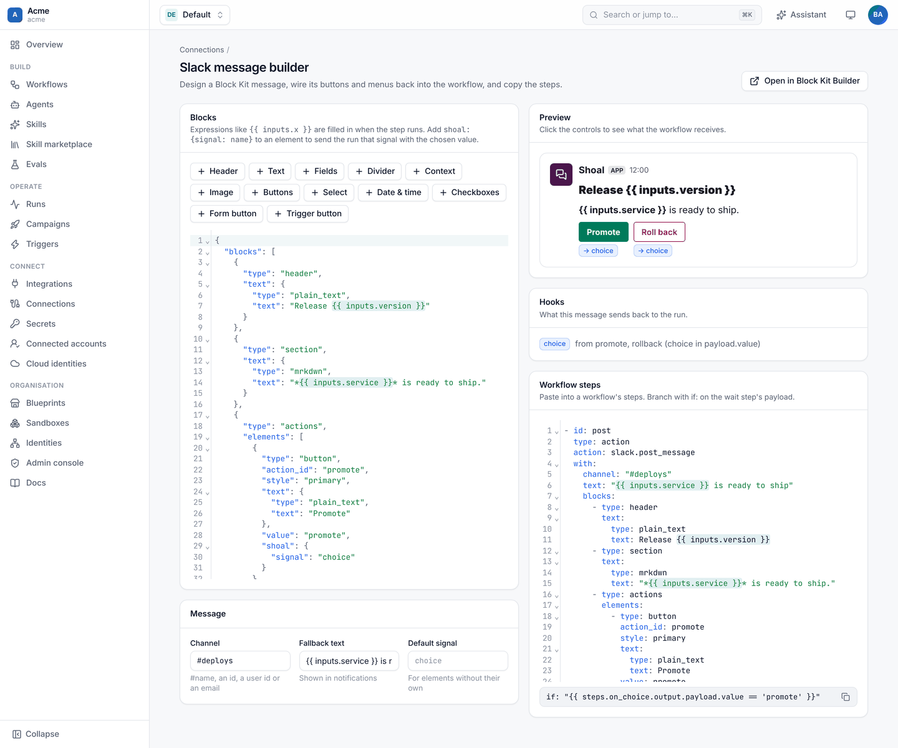
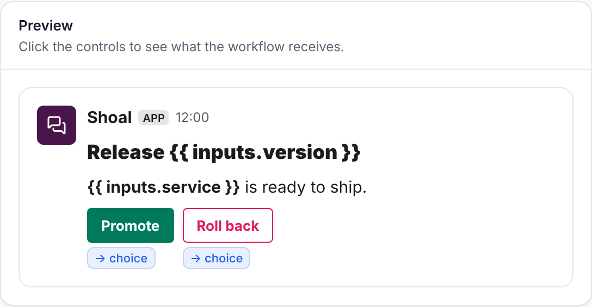
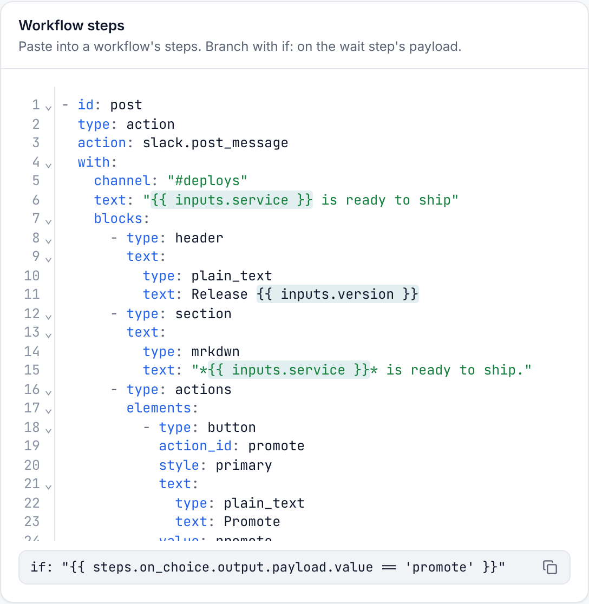

# Message builder

The message builder designs a Slack message, wires its controls back into the workflow, and writes the workflow steps
for you. Open it from a Slack connection's **Slack bots** card (**Message builder**), or go to
`/ns/<namespace>/slack/builder`.

## Lay out the message

The **Blocks** card has a palette and a JSON editor. Each palette button adds a ready-made block that you can then
edit in place:

| Palette | Adds |
| --- | --- |
| Header, Text, Fields, Divider, Context, Image | Layout and text blocks. |
| Buttons | A row of buttons that send the run a signal. |
| Select | A menu whose choice is sent to the run. |
| Date & time | Date and time pickers. |
| Checkboxes | A checkbox group (it stays on the message so people can tick several). |
| Form button | A button that opens a form; the answers are sent to the run. |
| Trigger button | A button that starts a new run through a `block_actions` trigger instead. |

The editor takes any [Block Kit](https://api.slack.com/block-kit) JSON, so you can paste a design from Slack's own
builder. Expressions such as `{{ inputs.version }}` are highlighted and stay as they are until the step runs.

Under **Message**, set the channel (a `#name`, a channel id, a user id or an email for a DM), the fallback text that
Slack shows in notifications, and a default signal for controls that don't name their own.

## Try it

The **Preview** shows the message the way Slack lays it out. Click a control to see what the workflow will receive:
which signal is sent, and with what value.

Each bound control is tagged with the signal it sends. The **Hooks** card lists every signal the message can send, and
which controls send it.

## Copy the steps

**Workflow steps** is the YAML to paste into a workflow:

1. a `slack.post_message` step with your blocks,
2. a `wait` step for each signal,
3. an `if:` expression you can copy to branch on the answer.

How the hooks work, and everything the run receives, is described in
[interactive messages](interactive-messages.md#custom-block-kit-with-hooks).

**Open in Block Kit Builder** opens the same blocks in Slack's builder, with the Shoal-only `shoal:` keys removed, if
you want to check them against Slack's own rendering.
