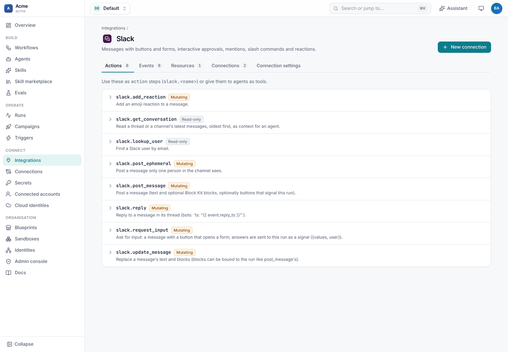

# Slack reference

## Connection settings

| Setting | Kind | Meaning |
| --- | --- | --- |
| `bot_token` | secret | The bot token (`xoxb-…`). **Add to Slack** fills it in. |
| `signing_secret` | secret | Verifies every request from Slack. Required for clicks, events and commands. |
| `client_id` | setting | The app's client ID, for **Add to Slack**. |
| `client_secret` | secret | The app's client secret, for **Add to Slack**. |
| `default_channel` | setting | Used when an action or approval names no channel. |
| `app_name` | setting | The app's name and bot name in the generated manifest (default `Shoal`). |
| `slash_command` | setting | The slash command in the generated manifest (default `/shoal`). |
| `features` | setting | What the app is set up for: `mentions`, `channel_messages`, `direct_messages`, `reactions`, `slash_command`, `files` (`messages` is always on). Decides the manifest's permissions and events, what Add to Slack asks for, and what the check expects. Leave it empty for everything. See [setup](setup.md#1-choose-what-the-app-does). |
| `api_url` | setting | The Slack Web API base URL (default `https://slack.com/api`; change it for GovSlack). |

Secrets are names of Shoal secrets, never the values.

## Actions

Use these as `action` steps (`slack.<name>`), or give them to agents as tools.

| Action | Does | Main inputs | Returns |
| --- | --- | --- | --- |
| `post_message` | Posts a message | `channel`, `text`, `blocks`, `buttons`, `signal`, `after_click`, `thread_ts`, `reply_broadcast`, `unfurl_links` | `channel`, `ts`, `thread_key` |
| `reply` | Replies in a message's thread | `channel`, `ts` (use `event.reply_ts`), `text`, `blocks`, `signal`, `after_click`, `broadcast` | `channel`, `ts`, `thread_key` |
| `update_message` | Replaces a message's text and blocks | `channel`, `ts`, `text`, `blocks`, `signal`, `after_click` | `channel`, `ts`, `thread_key` |
| `post_ephemeral` | Posts a message only one person in the channel sees | `channel`, `user`, `text`, `blocks` | `ok` |
| `add_reaction` | Adds an emoji reaction | `channel`, `ts`, `name` (no colons) | `ok` |
| `request_input` | Posts a button that opens a form; the answers are sent to the run | `channel`, `text`, `fields`, `signal`, `button`, `title`, `thread_ts` | `channel`, `ts`, `thread_key` |
| `get_conversation` | Reads a thread, or a channel's latest messages, oldest first | `channel`, `thread_ts`, `limit` (1 to 200), `names` | `messages`, `transcript` |
| `lookup_user` | Finds a Slack user by email | `email` | `id`, `name`, `real_name`, `email` |

`channel` takes a channel id or `#name`, a user id, or an email (sent as a direct message). `blocks` takes a list or a
JSON string, and its controls can carry [`shoal:` hooks](interactive-messages.md#custom-block-kit-with-hooks).

Resource: `channel` lists the channels the app can see, for pickers and campaigns (`types`, `exclude_archived`).

## Approval options

On an approval step's `notify` entry for Slack ([approvals](approvals.md)):

| `with:` | Default | Meaning |
| --- | --- | --- |
| `title` | Approval needed | The message's header. |
| `approve_label` / `reject_label` | Approve / Reject | Button labels. |
| `ask_comment` | `false` | Ask for a comment in a form first (required when rejecting). |
| `thread_ts` | none | Post the request in this thread. |

## Signals the run receives

| From | Signal payload |
| --- | --- |
| A bound control | `{action_id, block_id, value, label, user: {id, name}, channel, message_ts}` |
| A bound form button or `request_input` | `{values: {<field or action_id>: …}, user: {id, name}, action_id?}` |

Read them from the `wait` step: `steps.<wait>.output.payload`.

## Events

See [events and slash commands](events-and-commands.md) for every event and its fields, and
[channel bots](channel-bots.md) for message fields and `match:` filters.

## Wake keys

| Key | Fires on |
| --- | --- |
| `slack:thread:<channel>:<ts>` | A reply in that thread (`thread_key` from any post) |
| `slack:channel:<channel>` | Any message in the channel |
| `slack:message:<channel>:<ts>` | A reaction to the message, or a click on one of its unbound controls |
| `slack:action:<action_id>` | A click on an unbound control with that `action_id` |

## Security

- **Signatures.** Every request from Slack is checked against the signing secret with Slack's v0 scheme. Requests
  that are unsigned, wrongly signed or more than five minutes old are rejected.
- **Who acts.** Clicks and messages are attributed to the Shoal user linked to the Slack account
  (`Identity.slack_id`, then email). Unlinked people can't decide anything.
- **Permissions.** Approving needs `runs:approve`, and the step's `approvers` when it lists them. Signal controls need
  `runs:signal` in the run's namespace. Decisions and refusals are audited with `via: slack`.
- **Scope.** An approval click only counts for requests sent through the same connection. Bound controls carry the run
  they belong to, and Shoal rejects a run that doesn't exist.
- **Secrets.** Tokens are stored as encrypted secrets, and pasted values can't be read back. The OAuth install uses
  signed, encrypted state that expires after 15 minutes.

## API

| Endpoint | Purpose |
| --- | --- |
| `GET /v1/namespaces/{ns}/connections/{name}/setup` | The guided setup: features (with `used_by`), scopes, events, manifest (JSON and YAML), `create_url`, saved credentials. `?features=a,b` previews a different choice. |
| `GET /v1/namespaces/{ns}/connections/{name}/webhook` | The webhook URL, setup instructions and manifest. |
| `POST /v1/namespaces/{ns}/connections/{name}/install` | Starts **Add to Slack**; returns `authorize_url`. `?then=setup` comes back to the guide. |
| `GET /v1/install/callback` | Where Slack returns after the install; stores the bot token. |
| `POST /v1/namespaces/{ns}/connections/{name}/test` | The check: team, bot, granted and missing scopes. |
| `POST /v1/hooks/{webhook_id}` | Where Slack sends events, clicks and commands. |

## Testing workflows that use Slack

`shoal.sdk.testing.MockSlack` is a fake Slack for tests. It keeps posted messages, updates, modals, reactions and users,
and builds signed requests: `click`, `select`, `submit`, `say`, `event`, `command` and `url_verification`. Set
`scopes` to control what the check sees as granted. The Slack integration's own tests in
[`engine/tests/test_slack.py`](../../engine/tests/test_slack.py) show it in use.
