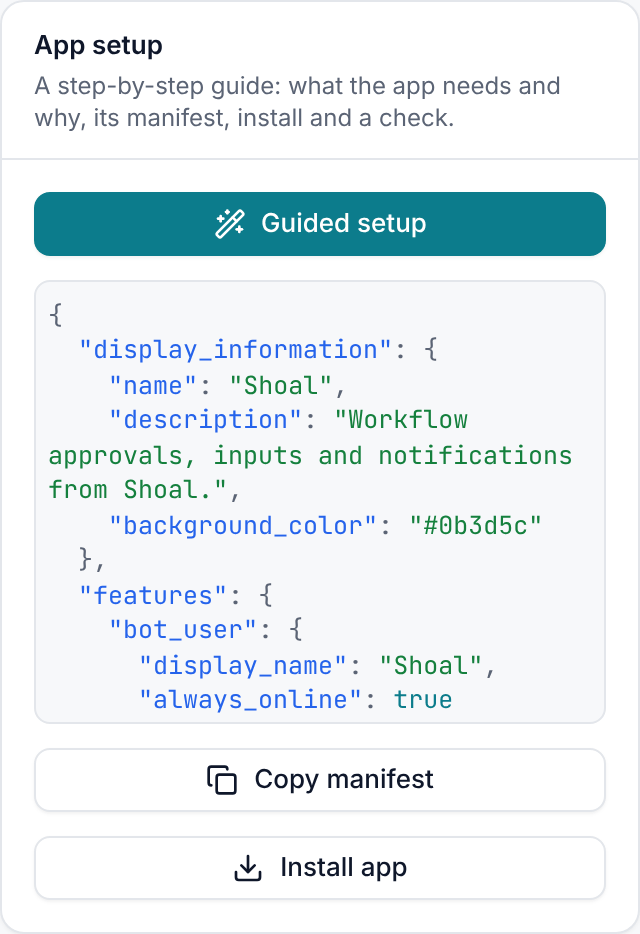
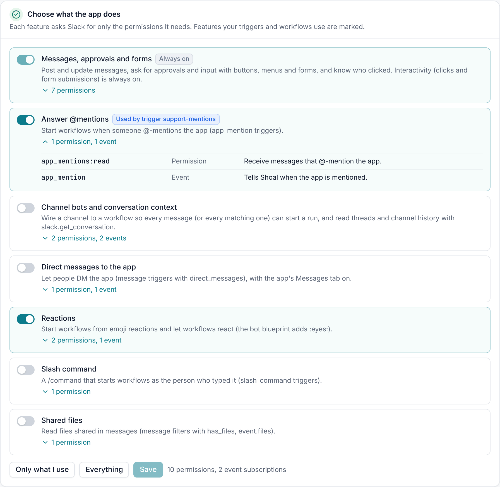
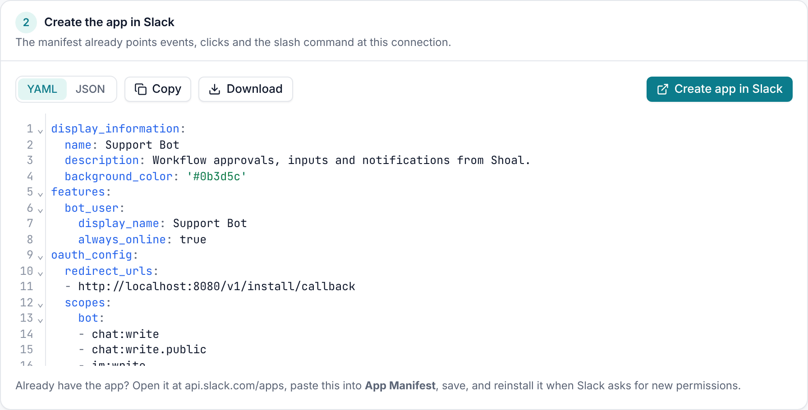
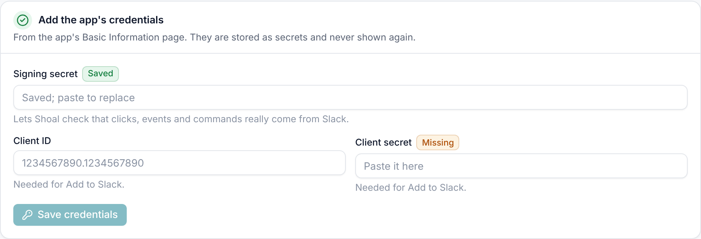
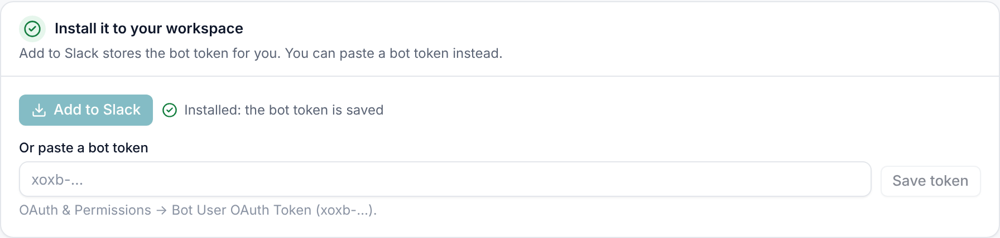
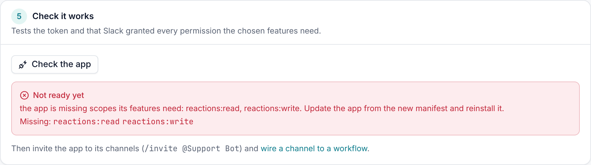
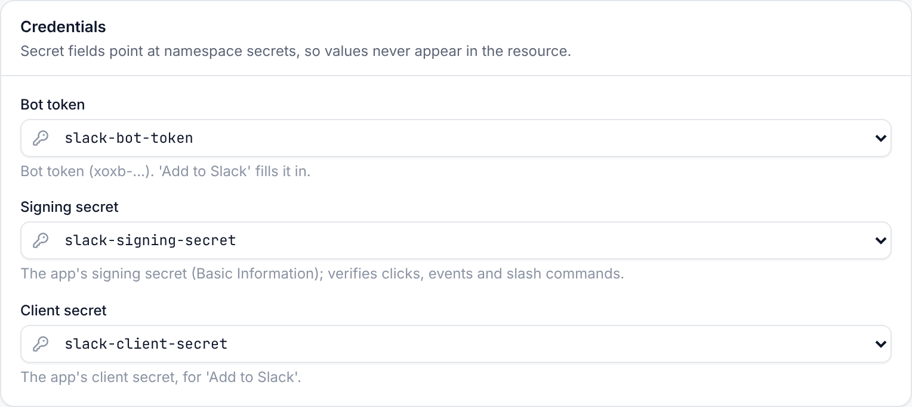

# Set up Slack

Each Shoal Slack connection is one Slack app installed in one workspace. The guided setup walks you through creating
that app with only the permissions it needs. Find it at **Connections → your Slack connection → Guided setup**. It
opens on its own when you create a Slack connection.



The guide has five steps. Each one is ticked off once it is done, so you can leave and come back.

## 1. Choose what the app does

Slack asks an admin to approve every permission (OAuth scope) an app requests. Turn on the features you need, and the
guide shows exactly which permissions and event subscriptions each one adds and why.



| Feature | Permissions | Events | Turn it on for |
| --- | --- | --- | --- |
| **Messages, approvals and forms** (always on) | `chat:write`, `chat:write.public`, `im:write`, `users:read`, `users:read.email`, `channels:read`, `groups:read` | none | Posting, approvals, forms, knowing who clicked |
| **Answer @mentions** | `app_mentions:read` | `app_mention` | `app_mention` triggers |
| **Channel bots and conversation context** | `channels:history`, `groups:history` | `message.channels`, `message.groups` | `message` triggers, `slack.get_conversation` |
| **Direct messages to the app** | `im:history` | `message.im` | DMs to the bot (also turns on the app's Messages tab) |
| **Reactions** | `reactions:read`, `reactions:write` | `reaction_added` | `reaction_added` triggers, `slack.add_reaction` |
| **Slash command** | `commands` | none | `slash_command` triggers |
| **Shared files** | `files:read` | none | `has_files` filters, `event.files` |

Features that your triggers and workflows already rely on are marked **Used by trigger …** or
**Used by workflow …**. A feature that something needs but is switched off is marked **Needed**.

- **Only what I use** turns on just the features that are marked.
- **Everything** turns them all on. This is also the default when you have never saved a choice.
- **Save** stores the choice on the connection as `config.features`. The manifest, Add to Slack and the check in step 5
  all follow it.

The app's name (`app_name`, default "Shoal") and slash command (`slash_command`, default `/shoal`) are connection
settings too. Change them to run several differently named bots in one workspace.

## 2. Create the app in Slack

The guide writes the [app manifest](https://api.slack.com/reference/manifests) for you. Events, interactivity and the
slash command already point at this connection's webhook URL, and the OAuth redirect points at Shoal.



- **Create app in Slack** opens api.slack.com with the manifest filled in. Pick the workspace and confirm.
- **Copy** or **Download** the manifest as YAML or JSON if you would rather paste it in yourself, or keep it in source
  control.
- **Already have the app?** Open it at api.slack.com/apps, paste the new manifest into **App Manifest** and save.
  Slack asks you to reinstall when the permissions change.

The manifest regenerates whenever you change features, the app name or the slash command, so come back here after any
change.

## 3. Add the app's credentials

Copy these from the app's **Basic Information** page in Slack.



| Credential | Why Shoal needs it |
| --- | --- |
| Signing secret | Proves every click, event and command really came from your app. Without it, Shoal rejects them. |
| Client ID | Needed for **Add to Slack**. |
| Client secret | Needed for **Add to Slack**. |

Pasted values are stored as secrets in the connection's namespace, named `<connection>-<field>` unless the connection
already points at a secret. They are write-only: Shoal never shows them again, and the badge only says **Saved** or
**Missing**.

## 4. Install it to your workspace



**Add to Slack** sends you to Slack's install screen. When you approve, Slack sends you back to the guide and the bot
token is stored as a secret on the connection. You need the `connections:write` and `secrets:write` permissions in
Shoal to do this.

If you can't use OAuth (for example, your workspace admin installs apps for you), paste the **Bot User OAuth Token**
(`xoxb-…`) from the app's **OAuth & Permissions** page instead.

## 5. Check it works

**Check the app** calls Slack with the bot token and compares the permissions Slack granted against the ones your
chosen features need.



If a permission is missing, usually because you turned on a feature after installing, update the app from the new
manifest (step 2) and reinstall it (step 4). The check also warns when there is no signing secret.

When it passes, invite the app to the channels it should post in or listen to: `/invite @Shoal`. Public channels work
for posting without an invite (`chat:write.public`), but the app only hears messages in channels it has joined.

## One bot for the whole organisation, or one per team

A Slack connection is an ordinary Shoal resource, so it follows the usual namespace rules.

- **Organisation-wide bot.** Create the connection in the `shared` namespace. Every namespace that has no connection
  of that name falls back to it, so any team can use it for approvals, messages and triggers with no setup of their
  own. Its webhook still fires triggers that live in other namespaces.
- **A team's own bot.** A team creates a Slack connection in their namespace, with its own `app_name`, slash command,
  features and channels. It is a separate Slack app with its own tokens, so the team can brand it however they like.
  When both exist with the same name, the team's connection takes precedence for that namespace.

```yaml
# an org-wide bot every team can use
apiVersion: shoal.dev/v1
kind: Connection
metadata: {name: slack, namespace: shared}
spec:
  integration: slack
  config: {app_name: Acme Bot, default_channel: "#approvals"}
  secrets: {signing_secret: acme-bot-signing-secret, bot_token: acme-bot-bot-token}
---
# the payments team's own bot, with its own name and command
apiVersion: shoal.dev/v1
kind: Connection
metadata: {name: payments-bot, namespace: payments}
spec:
  integration: slack
  config: {app_name: Ledger, slash_command: /ledger, features: [mentions, channel_messages]}
  secrets: {signing_secret: payments-bot-signing-secret, bot_token: payments-bot-bot-token}
```

Workflows choose which one to use with `connections: {slack: payments-bot}`, or with `connection:` on a `notify`
entry or a trigger. Who can change a connection, and who can see its secrets, follows the namespace's roles.

## Link Slack people to Shoal users

Approvals and signal buttons act as the person who clicked, so Shoal needs to know who that is. It matches a Slack user
to a Shoal user in this order:

1. An **Identity** with `slack_id` set to their Slack user id. Its `actors` (for example `user:dana`) name the Shoal
   user. This is the strict link.
2. Their **email**, read from Slack with `users:read.email`, matched to a Shoal user's email.

```yaml
apiVersion: shoal.dev/v1
kind: Identity
metadata: {name: dana}
spec:
  slack_id: U04ABCDEF
  actors: ["user:dana"]
```

Someone Shoal can't match can still click. Nothing happens except a private note telling them to ask an admin to link
their account. Email matching trusts the emails in your Slack workspace, so use `slack_id` where that matters.

## Without the UI

Everything the guide shows is available from the API:

```bash
# features (with used_by), scopes, events, the manifest as JSON and YAML, the create link, which secrets are saved
curl -H "Authorization: Bearer $TOKEN" "$SHOAL/v1/namespaces/default/connections/slack/setup"
# preview a different choice without saving it
curl -H "Authorization: Bearer $TOKEN" "$SHOAL/v1/namespaces/default/connections/slack/setup?features=mentions,reactions"
# start Add to Slack (returns authorize_url); then=setup comes back to the guide
curl -X POST -H "Authorization: Bearer $TOKEN" "$SHOAL/v1/namespaces/default/connections/slack/install?then=setup"
# the check
curl -X POST -H "Authorization: Bearer $TOKEN" "$SHOAL/v1/namespaces/default/connections/slack/test"
```

The connection page also keeps the manifest, **Install app**, **Test connection** and the webhook URL in its sidebar,
and lists the connection's secrets under **Credentials**.


