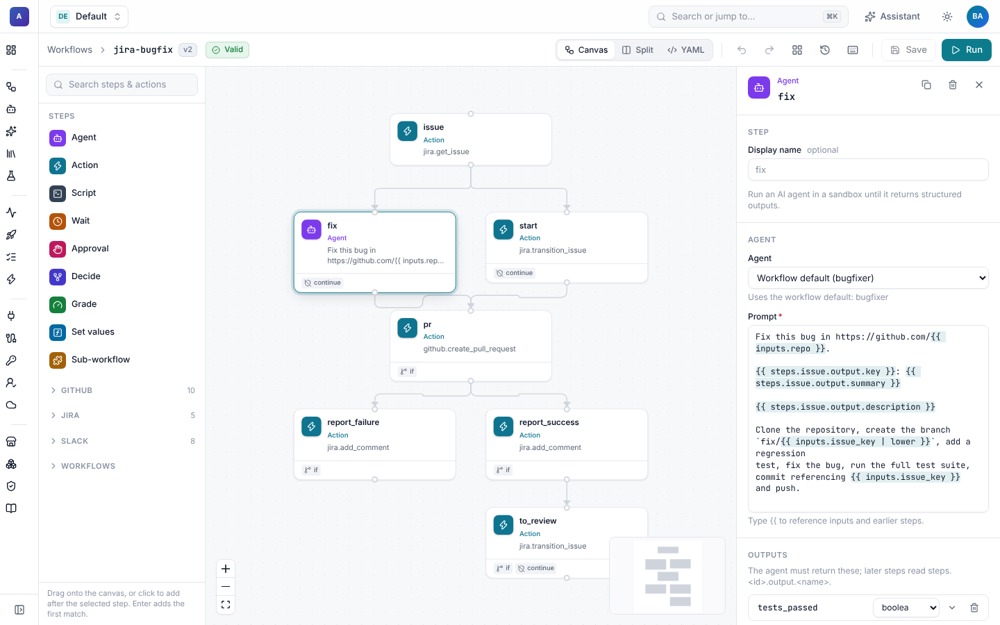
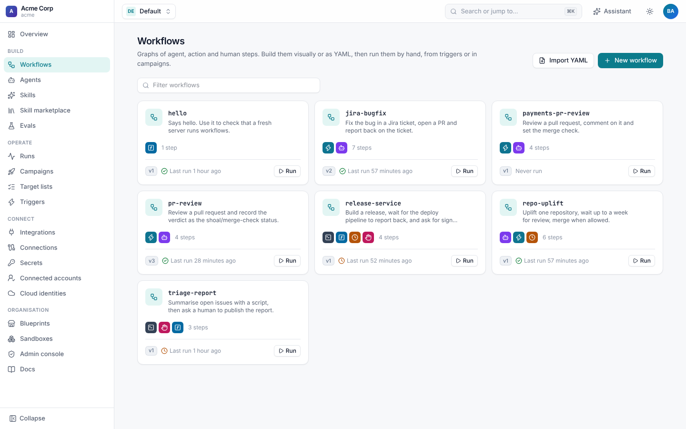

# Workflows

A **workflow** is a versioned list of steps that Shoal runs durably. Steps call integrations, run agents and scripts,
wait for people or other systems, and pass typed data to each other. You can write a workflow as YAML and
`shoal apply` it, manage it with Terraform, or build it on the visual canvas. All three produce the same resource.



## Features

| Feature | What it does | Guide |
| --- | --- | --- |
| Visual builder | Drag steps onto a canvas, wire dependencies, edit each step in a form, and keep the YAML in sync as you type. | [The builder](builder.md) |
| Step types | `agent`, `action`, `script`, `wait`, `approval`, `decide`, `grade`, `set` and `workflow` (sub-workflows with `for_each` fan-out). | [Step reference](steps.md) |
| Script steps | Deterministic code in Python, Node or shell with typed inputs and validated outputs. No model needed. | [Script steps](script-steps.md) |
| Expressions | `{{ … }}` over inputs, earlier steps' outputs, the run, the trigger event and secrets. | [Expressions](expressions.md) |
| Versions | Every change is a new version, with change notes, diffs, rollback and pinning. | [Versions](versions.md) |
| Runs | Start a run from the UI, the CLI, the API, a trigger or a campaign, and watch it live. | [Runs](../runs/README.md) |

## Anatomy of a workflow

```yaml
apiVersion: shoal.dev/v1
kind: Workflow
metadata:
  name: jira-bugfix
  description: Fix the bug in a Jira ticket, open a PR and report back on the ticket.
spec:
  inputs:                                  # typed; supplied by whoever starts the run
    issue_key: {type: string}
    repo: {type: string, description: owner/name of the repository to fix}
  connections:                             # the connection each integration uses by default
    jira: jira-acme
    github: github-acme
  defaults:
    agent: bugfixer                        # used by agent steps that don't name one
  timeout: 2h                              # optional limit for the whole run
  steps:
    - id: issue
      type: action
      action: jira.get_issue
      with: {key: "{{ inputs.issue_key }}"}
    - id: fix
      type: agent
      prompt: "Fix {{ steps.issue.output.summary }} in {{ inputs.repo }}."
      outputs:
        branch: {type: string}
        tests_passed: {type: boolean}
    - id: pr
      type: action
      if: "{{ steps.fix.output.tests_passed }}"
      action: github.create_pull_request
      with:
        repo: "{{ inputs.repo }}"
        head: "{{ steps.fix.output.branch }}"
        title: "{{ inputs.issue_key }}: {{ steps.issue.output.summary }}"
  outputs:                                 # expressions evaluated when the run finishes
    pr_url: "{{ steps.pr.output.url }}"
```

| Field | Meaning |
| --- | --- |
| `inputs` | Parameters, each with a `type` (`string`, `integer`, `number`, `boolean`, `object`, `array`, `any`), and optional `description`, `default`, `required` and `enum`. Inputs are validated and coerced when a run starts. |
| `connections` | Integration key to connection name. Action steps and agent tools for that integration use it unless they name another. |
| `defaults` | `agent` and `sandbox` used by steps that don't set their own. |
| `timeout` | A deadline for the whole run, for example `30m` or `7d`. |
| `steps` | The steps. Each has a unique `id`. |
| `outputs` | Output name to expression. They appear on the run and are returned to callers such as `shoal run --wait`, parent workflows and evals. |

## How steps are ordered

Steps form a graph. A step without `needs` runs after the step before it in the list, so a plain list runs top to
bottom. Give a step `needs: [a, b]` to run it after both `a` and `b`, or `needs: []` to start it straight away. Steps
with no path between them run in parallel.

In the example above, `fix` has `needs: [issue]` in the full file so it runs alongside the `start` step that moves the
ticket to *In Progress*. The builder draws the same graph.

Every step also takes:

| Field | Meaning |
| --- | --- |
| `if` | An expression. When it is false the step is **skipped**, and steps that depend on it still run. |
| `retry` | `max_attempts` (default 1), `backoff` (default `10s`), `backoff_factor` (default 2) and `max_backoff` (default `1h`). |
| `timeout` | A limit for one attempt of the step. |
| `on_error` | `fail` (default) fails the run. `continue` records the failure and carries on, so later steps can check `steps.<id>.status`. |
| `name` | A display name for the canvas and run viewer. |

## Five-minute start

1. Apply and run the smallest example. It needs no model, sandbox or connection:

   ```sh
   shoal apply -f examples/hello/
   shoal run hello -i name=Dana --wait
   ```

2. Open **Workflows** in the UI. Every workflow in the namespace is listed with its version, the step types it uses
   and when it last ran.

   

3. Open `hello`, add a step from the palette, and press **Save**. The version goes up by one.
4. Press **Run**, fill in the inputs and start the run. The [run viewer](../runs/README.md) opens and streams every
   event.

## Examples

- [`examples/hello/`](../../examples/hello/): one `set` step.
- [`examples/triage-report/`](../../examples/triage-report/): a Python script step, then an approval.
- [`examples/jira-bugfix/`](../../examples/jira-bugfix/): Jira ticket to tested pull request, with writeback.
- [`examples/github-uplift/`](../../examples/github-uplift/): one repository uplift that waits up to a week for review.
- [`examples/slack-approval/`](../../examples/slack-approval/): a release that asks for approval in Slack.

## Pages in this guide

- [The builder](builder.md): the canvas, palette, inspector, YAML view, validation and shortcuts.
- [Step reference](steps.md): every step type, its fields and its output.
- [Script steps](script-steps.md): running code instead of an agent.
- [Expressions](expressions.md): what you can reference, filters, and quoting rules.
- [Versions](versions.md): change notes, diffs, rollback and pinning.
