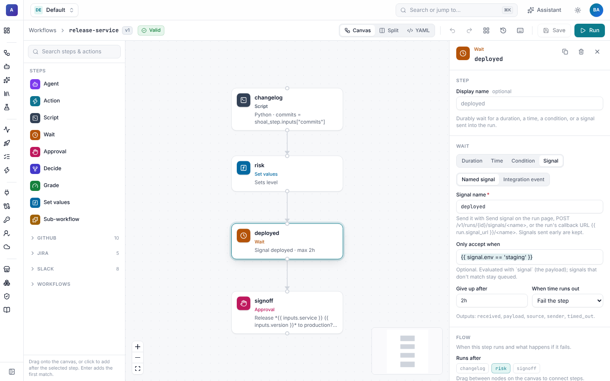
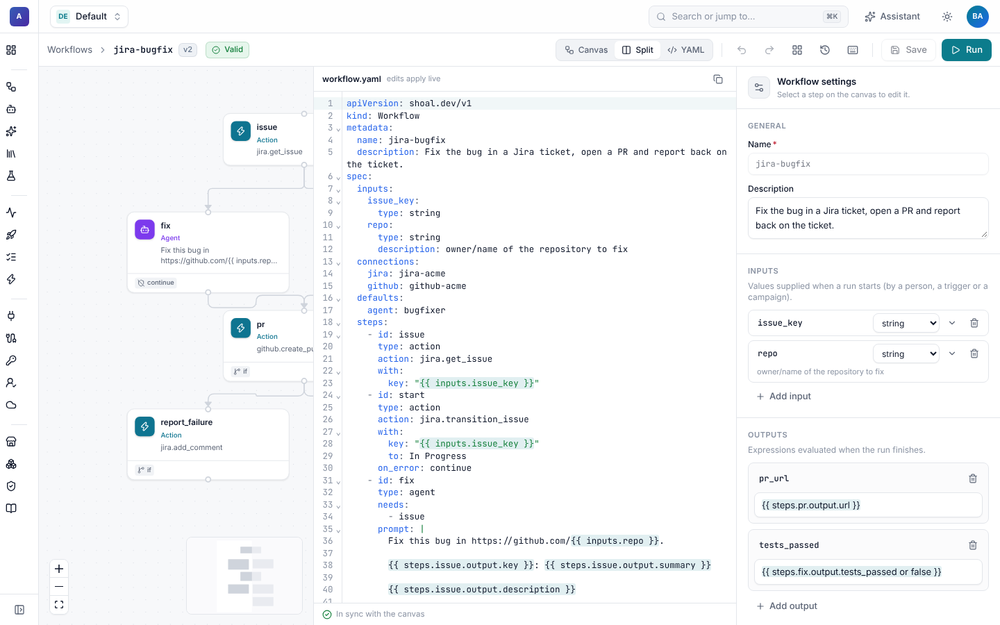
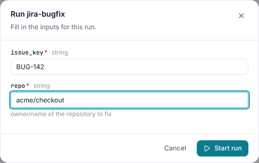

# The workflow builder

The builder edits the same YAML you can write by hand. Anything you build on the canvas can be read, diffed and applied
as YAML, and anything written as YAML opens on the canvas. Open it from **Workflows**, either on an existing workflow or
with **New workflow**. **Import YAML** on the same page applies a pasted or uploaded file after a dry run.

## Layout

| Area | What it holds |
| --- | --- |
| **Palette** (left) | Every step type, then the actions of each installed integration (GitHub, Jira, Slack, MCP servers and your own) and the workflows in the namespace as sub-workflows. Search it and press <kbd>Enter</kbd> to add the first match below the selected step, or drag an item onto the canvas. |
| **Canvas** (middle) | One card per step with its id, type and a short summary, and badges for `if`, `retry` and `on_error: continue`. Lines are dependencies. |
| **Inspector** (right) | A form for the selected step, or the workflow settings when nothing is selected. |
| **Toolbar** (top) | The version, a validity badge, **Canvas / Split / YAML**, undo and redo, auto-layout, version history, keyboard shortcuts, **Save** and **Run**. |

## Wiring steps

Drag from the bottom handle of one step to the top handle of another to say "run after". Select a line and press
<kbd>Delete</kbd> to remove it. The builder keeps the YAML short: when a step only depends on the step above it in the
list, `needs` is left out, and otherwise it is written out (including `needs: []` for a step that starts at once).
Steps with no path between them run in parallel.

## The inspector

Each step type has its own form, generated from the server's step schema, so plugin step types work without UI changes.
Every form has the common settings (display name, `if`, `retry`, `timeout`, `on_error`) and the type's own fields:

- **Agent**: the agent (or the workflow default), the prompt, typed outputs, extra skills and tools, sandbox and
  connections.
- **Action**: the action and its parameters, rendered from the integration's input schema, and the connection.
- **Script**: code or a command, the language, inputs, outputs and the environment. **Write with assistant** opens the
  [assistant](../assistant/README.md) with a request for the code already filled in. See [Script steps](script-steps.md).

  

- **Wait**: a duration, a time, a polled condition or a signal, with `max_wait` and what to do on timeout.

  

- **Approval**: the message, approvers, how long to wait and what a rejection does. See
  [Approvals](../runs/approvals.md).

  

- **Decide** and **Grade**: questions or a rubric for a decision model. See
  [Decisions and grading](../agents/decisions.md).
- **Set values** and **Sub-workflow**: expressions to compute, or the workflow to call with its inputs and an optional
  `for_each`.

Pickers list the agents, sandbox profiles, connections and cloud identities that the namespace can see, including
shared ones.

### Workflow settings

Click an empty part of the canvas, or press <kbd>Esc</kbd>, to edit the workflow itself: its name and description,
inputs (with type, default, description and allowed values), outputs, the default agent and sandbox, and the default
connection for each integration.

## Expressions in fields

Any field that accepts an expression autocompletes as soon as you type `{{`. It suggests workflow inputs, the outputs
of steps that run *before* this one, `run.*`, `trigger`, `event`, `campaign`, `target` and `secrets.<name>`. Steps
that are downstream are not offered, because their outputs don't exist yet. See [Expressions](expressions.md).

## YAML and split view

Switch between **Canvas**, **Split** and **YAML** in the toolbar. Edits flow both ways: changing the graph rewrites the
YAML, and valid YAML updates the graph as you type. If the YAML doesn't parse, the error is shown inline and the canvas
keeps the last valid version.

## Validation

The badge next to the version shows **Valid**, or the number of errors and warnings. The builder checks as you work for
duplicate ids, references to unknown or downstream steps, dependency cycles and missing required fields. It also asks
the server for a dry run of the apply, so you see exactly the errors the API would return (marked **server**). Click
the badge to list the problems, and click one to select its step. Steps with problems are flagged on the canvas.

## Saving and running

**Save** (<kbd>⌘S</kbd>) creates a new version when the meaning of the workflow changed. Positions you set by dragging
are saved with the workflow (in the `ui.shoal.dev/layout` annotation) and don't create a version on their own.

If someone else saves while you are editing, a banner says so. Choose **Load version N** to take theirs, or keep
editing and save over it.

**Run** opens a form for the workflow's inputs, typed by their schema, and starts a run of the saved version. Save first
if you have unsaved edits.

## Version history

The history button lists every version with who saved it, when, and the change note. Pick one to compare it with what
is in the editor, and **Restore into editor** to start from it. Restoring is an edit like any other: save to make it a
new version. See [Versions](versions.md) for diffs and rollback from the CLI and API.

## Keyboard shortcuts

| Shortcut | Action |
| --- | --- |
| <kbd>⌘S</kbd> | Save |
| <kbd>⌘Z</kbd> / <kbd>⌘⇧Z</kbd> | Undo / redo |
| <kbd>⌘D</kbd> | Duplicate the selected step |
| <kbd>Delete</kbd> | Delete the selected steps or connection |
| <kbd>L</kbd> | Auto-layout the graph |
| <kbd>F</kbd> | Fit to screen |
| <kbd>Esc</kbd> | Deselect and show the workflow settings |
| <kbd>⇧</kbd> + drag | Select several steps |
| <kbd>⌘K</kbd> | Command palette |
| <kbd>?</kbd> | Show all shortcuts |

On Windows and Linux use <kbd>Ctrl</kbd> instead of <kbd>⌘</kbd>.
