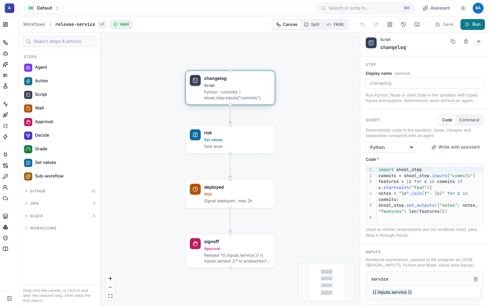

# Script steps

Much of a workflow is glue that needs no judgement: reshape an API response, dedupe a list, compute a score, call a
plain HTTP endpoint, run the tests. A `script` step does that as code in a sandbox. It is faster and cheaper than an
agent, and it gives the same answer every time.



## A script with typed inputs and outputs

```yaml
- id: summarise
  type: script
  language: python                  # python, node, shell (default) or bash
  sandbox: default                  # any sandbox profile; defaults to the workflow's
  inputs:                           # rendered, then handed to the program as JSON
    issues: "{{ steps.search.output.items }}"
  outputs:                          # typed; checked like agent outputs
    summary: {type: string}
    bugs: {type: integer}
  code: |
    import shoal_step
    issues = shoal_step.inputs["issues"]
    bugs = sum(1 for i in issues if i["label"] == "bug")
    shoal_step.set_outputs({"bugs": bugs, "summary": f"{len(issues)} open issues, {bugs} bugs"})
```

Later steps read `steps.summarise.output.bugs` and `steps.summarise.output.summary`.

## `code` or `run`

A step has exactly one of these.

| Field | What it is | Expressions |
| --- | --- | --- |
| `code` | A program in `language`, written to a file and run. | **Never rendered.** Data reaches the program only through `inputs`, so nothing in an issue title or a webhook payload can be injected into the code. |
| `run` | A shell command line, for example `make test`. | Rendered, like any other field. Use it for short commands, and prefer `code` with `inputs` when the values come from outside. |

`language` only applies to `code`.

## How data gets in and out

Before the program starts, Shoal writes three files to `.shoal/steps/<step>-<attempt>/` in the sandbox workspace and
sets these environment variables:

| Variable | Contents |
| --- | --- |
| `SHOAL_INPUTS` | Path of `inputs.json`: the rendered `inputs` as a JSON object. |
| `SHOAL_OUTPUTS` | Path of `outputs.json`: write a JSON object of outputs here. |
| `SHOAL_STEP_DIR` | The step's directory. |
| `SHOAL_INPUT_<NAME>` | Each scalar input (string, number, boolean) for shell scripts. An input `text` becomes `$SHOAL_INPUT_TEXT`. |

Python and Node also get a small `shoal_step` helper on their module path, so nothing has to be installed in the image:

```python
import shoal_step
shoal_step.inputs["items"]               # the rendered inputs
shoal_step.set_output("count", 3)        # one output
shoal_step.set_outputs({"a": 1, "b": 2}) # several
```

```js
const { inputs, setOutput, setOutputs } = require("shoal_step");
setOutput("count", inputs.items.length);
```

In shell, write the JSON yourself:

```sh
count=$(printf '%s' "${SHOAL_INPUT_TEXT:-}" | wc -w | tr -d ' ')
printf '{"count": %s}' "$count" > "$SHOAL_OUTPUTS"
```

Because the contract is only files and environment variables, scripts work on every sandbox backend: local, Docker,
Kubernetes, E2B, SPACE and remote sandboxes. The image needs `python3` for Python and `node` for Node.

## Outputs and failures

After the program exits, the step output contains:

| Field | Meaning |
| --- | --- |
| `exit_code` | The program's exit code. |
| `stdout`, `stderr` | What it printed (secrets redacted). |
| `duration_seconds`, `timed_out` | How long it ran, and whether `timeout` stopped it. |
| your outputs | Each declared output, at the top level and again under `outputs`. |

- A non-zero exit fails the step, unless `fail_on_error: false`. Then the step succeeds and you can branch on
  `steps.<id>.output.exit_code`.
- Declared outputs are validated: defaults are filled in, values are coerced to their type, and a missing required
  output or a wrong type fails the step with the reason and the end of `stderr`.
- The names `exit_code`, `stdout`, `stderr`, `timed_out`, `duration_seconds` and `outputs` are reserved.
- Secrets used anywhere in the step are redacted from the output and the run's events.

## Environment and credentials

| Field | Meaning |
| --- | --- |
| `sandbox` | The sandbox profile. With the default `scope: run`, every step in the run shares one sandbox and workspace, so a script can read files an agent wrote. |
| `env` | Extra environment variables. Values are rendered, so `{{ secrets.api_token }}` works. |
| `workdir` | Working directory (default: the profile's, usually `/workspace`). |
| `timeout` | Limit for one attempt. |
| `cloud_identities` | [Cloud identities](../cloud-identities.md) whose short-lived credentials (for example AWS keys) are added to the environment. |

## In the builder

The **Script** form switches between **Code** and **Command**. Picking a language fills in a starter program for it, as long as you haven't changed the code yet.
**Write with assistant** opens the [assistant](../assistant/README.md) with a request that already names the step, its
inputs and its outputs, so you only describe what the code should do. The assistant proposes the change and you approve
it.

In the run viewer, a script step shows its exit code, `stdout`, `stderr` and outputs.
