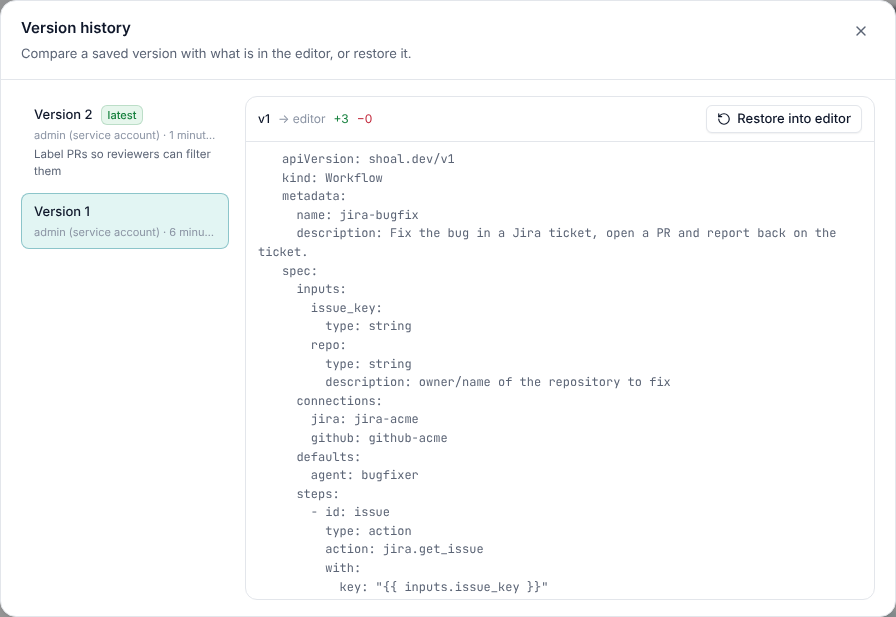

# Versions

Every declarative resource in Shoal (workflows, agents, skills, triggers, campaigns, evals, blueprints and the rest) is
versioned by the server. A change that alters what the resource means creates a new integer version. Submitting the
same meaning again, even spelled differently, does not.



## Change notes

Saving in the builder, `shoal apply` and Terraform all create versions. To store a note with the new version, pass
`message` to the API:

```sh
curl -X PUT "$SHOAL_URL/v1/namespaces/default/workflows/jira-bugfix?message=Label%20PRs" \
  -H "Authorization: Bearer $SHOAL_API_KEY" -H "Content-Type: application/json" -d @workflow.json

curl -X POST "$SHOAL_URL/v1/apply?message=Label%20PRs" ...      # applies several documents at once
```

The note is shown in the builder's version history next to who saved the version and when.

## History and diffs

| Request | Returns |
| --- | --- |
| `GET …/workflows/{name}/versions` | Every version, newest first, with `created_by`, `created_at`, `message` and the full document. |
| `GET …/workflows/{name}/versions/{n}` | One version. |
| `GET …/workflows/{name}/diff?from=1&to=2` | The changes between two versions (`to` defaults to the current one). |

The diff compares the spec as written, not server defaults, and matches steps by `id`, so inserting a step reads as one
`add` rather than every later step changing:

```json
{"kind": "Workflow", "name": "jira-bugfix", "from_version": 1, "to_version": 2,
 "changes": [{"op": "add", "path": "/spec/steps/[id=pr]/with/labels", "to": ["shoal", "bugfix"]}]}
```

In the builder, **Version history** shows each version and compares it with what is in the editor.

## Roll back

```sh
curl -X POST "$SHOAL_URL/v1/namespaces/default/workflows/jira-bugfix/rollback" \
  -H "Authorization: Bearer $SHOAL_API_KEY" -H "Content-Type: application/json" \
  -d '{"version": 1, "message": "PR labels broke the merge rules", "dry_run": true}'
```

A rollback restores an earlier version as a **new** version, so history only moves forward and a rollback can itself be
rolled back. With `dry_run: true` you get the diff instead. In the builder, pick the version, **Restore into editor**,
and save.

## Pinning

Runs always record the version they ran, and the run viewer shows it. By default everything uses the current version,
but you can pin:

| Where | Field |
| --- | --- |
| Starting a run | `shoal run jira-bugfix --version 1`, or `version` in `POST /v1/namespaces/{ns}/workflows/{name}/runs` |
| A trigger | `workflow_version: 3` |
| A sub-workflow step | `version: 3` |
| A campaign | `workflow_version: 3`. Without it, each launch pins the version current at launch, so a long campaign never switches versions mid-flight. |
| An eval | `variants: [{name: before, version: 3}, {name: after, version: 4}]` |

## Upgrading with confidence

The loop Shoal is built around:

1. Change the workflow. It becomes version N+1.
2. Run its [eval](../evals/README.md) with `gate: {baseline: "version:N", max_regression: 0.05}`.
3. When the gate passes, move pinned triggers and campaigns to N+1.
4. If production regresses, roll back.

Blueprint adoptions upgrade the same way, with a dry-run diff first. See [Blueprints](../blueprints/README.md).
